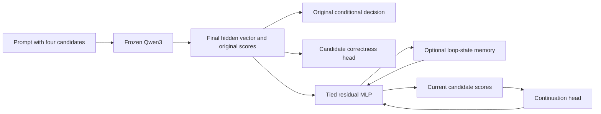

# Architecture

The native MLX Qwen3 backbone remains frozen and read-only. Right padding follows every real token; the selected last real position cannot attend to padding under the causal mask. There is no generated reasoning trace. The fixed assistant prefix is supplied equally to every variant, and verified single-token labels complete it.

Architecture 1 operates after the final backbone normalization, on a single 1,024-dimensional vector. Original candidate decoder weights stay fixed. A width-64 MLP sees normalized current state and original context. A scalar residual gate and reinjection gate start closed. Memory adds width-32 normalized query/key projections, a learned distance slope and gate, and a three-state window; values are prior residual states. Memory excludes the state currently being updated and retains position alignment because only one decision position is present.

All depths share the same update weights. Initialization preserves original logits at every depth; after training a one-loop head generally changes the baseline. This differs from middle-layer injection, whose one-loop path remains unchanged even after training. Training samples depths 1–4 and uses the same candidate CE as baseline evaluation. Memory and no-memory models train separately; disabling memory after fitting provides a dependency ablation, not a substitute for the separately trained comparator.

Confidence is a candidate outcome probability. The continuation MLP uses normalized current state, current four-option probabilities, and normalized loop depth. Its training labels ask whether any permitted deeper state lowers loss. Ground truth and deeper states are never inputs to live stopping. Live inference performs one loop at a time and stops when the predicted continuation probability falls below its validation threshold. There is a hard four-loop budget. Eight-loop evaluation is fixed-depth extrapolation only.

Architecture 2 repeats original transformer layers 12–14, zero-based, with shared weights and independent same-depth causal attention passes. Three scalar input-injection parameters are the only trained additions. Original encoder/decoder layers and the repeated block remain frozen. No KV cache is used in this teacher-forced prompt experiment, so cache behavior in free generation is untested. The full-prefix versus truncated-prefix test checks causal behavior at two loops.

Source modules are `backbone.py`, `models.py`, `training.py`, `evaluation.py`, and `datasets.py`. NumPy/SciPy reporting and CI do not import MLX. CUDA implementation was outside this pilot's scope.
