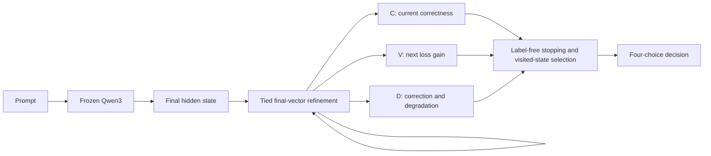
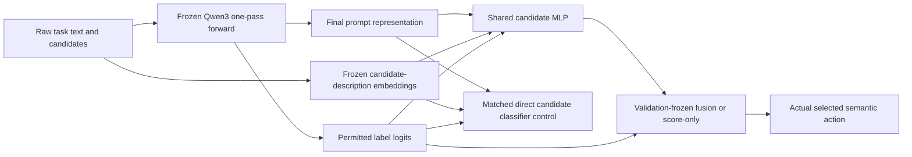

# Latent Loop Confidence — research overview

Can auxiliary networks recognize when another latent computation will improve a decision? The historical work separates correctness (C), next-loop supervised loss gain (V), and correction/degradation value (D). Prediction signals can be useful even when the recurrent computation they describe is unreliable.

| Study | Research question | Architecture | Key recorded result | Important limitation | Report |
|---|---|---|---|---|---|
| Initial pilots and middle-layer probe | Can confidence/refinement recover decisions from a frozen representation? | Frozen Qwen3; final-vector heads, tied residual refinement, bounded memory; separate repeated-middle-block probe | One pass 50.28% versus frozen 44.83%; recurrence advantage unestablished | Initial answer-format artifact; shared templates; eight-loop degradation; middle probe trains only three scalars | [Detailed report](../reports/research_summary.md) |
| Experiment 3 | Does next-loop loss value differ from confidence? | Frozen parent refiners; C and immediate-gain probes; stopping controls | Correctness AUROC 0.798; gain AUROC 0.762 versus confidence-only gain 0.695 | Gain stopping 49.06% versus one pass 51.28%; weaker template transfer | [Detailed report](../reports/experiment_03/learning_when_to_think.md) |
| Experiment 4A | Do signals survive stronger tasks and structural shifts? | Historical frozen heads; fresh scalar controls/calibrators; causal trajectory exports | Fresh-ID historical C/V AUROC 0.530/0.534; scalar gain 0.580 | Weak transfer; poor task competence; no newly trained neural heads | [Detailed report](../reports/experiment_04a/foundation_report.md) |
| Experiment 4B | Can decision transitions guide paid stopping and state selection? | Fresh four-event D head, grouped OOF rankers, frozen parent trajectories | WR AUROC/AP 0.779/0.147; RW 0.794/0.229; D 34.85% | D-versus-one-pass and selection-versus-final paired intervals include zero | [Detailed report](../reports/experiment_04b/decision_value_and_trajectory_selection.md) |
| Experiment 5 | Can trained middle-layer recurrence improve Qwen decisions? | Frozen Qwen; shared layers 12–14, rank-8 LoRA and bounded gates | Rec4 36.00% versus one-pass 32.87%; interval includes zero | Depth4 versus depth1 −0.46 pp [−3.13, +1.50]; weak transfer | [Detailed report](../reports/experiment_05/train_the_thinker.md) |
| Experiment 5.1 / 5B | Can repeated unchanged-input computation help navigation? | Tiny shared local gated grid network; separate Qwen and Snake controls | Grid4 98.28%, grid8 99.56%; four-versus-one +36.44 pp [32.55, 40.50] | Feedforward controls tie; long-path completion 54.44%; negative Qwen transfer | [Detailed report](../reports/experiment_05b/learning_to_navigate.md) |
| Experiment 5.2 / 5C | Does repeated local planning scale? | Frozen/retrained grid recurrence, deep untied/global controls, interventions | 9×9 eight-vs-four +5.67 pp [3.56, 8.00] | Long-path episodes essentially fail; stronger first moves are not full navigation | [Report](../reports/experiment_05c/scaling_and_failure_frontier.md) |
| Experiment 5.3 / 5D | Can candidate Q improve frozen graph decisions? | Arbitrary-graph recurrent policy, frozen-base shared candidate Q, direct controls | One-loop 79.39% → 84.89%; eight-loop base 100% | One-loop gain seed-dominated, classifier comparable; primary lambda zero | [Report](../reports/experiment_05d/decision_bridge.md) |
| Experiment 5.4 / 5E | Can Q change frozen LM outputs for the better? | Pinned frozen Qwen, shared 197,057-parameter candidate heads, matched C1/C2 | Structural 27.50% → 33.11%, +5.61 pp [2.89, 8.31] | C2 42.58%, prior 44.75%; graph damage, severe permutation sensitivity | [Report](../reports/experiment_05e/the_rendezvous.md) |

Historical naming is retained. The original pilots share one report; no separate Experiment 2 report is present. Data distributions change between studies, so the aggregate accuracies cannot be compared as successive model improvements.

The diagram describes the primary historical architecture. The separate middle-layer probe repeats transformer layers before the late decoder; it does not reproduce RecurTrace's loop-time memory protocol.

The initial pilots and most secondary comparisons are exploratory. Experiment 4B prospectively identifies three primary comparisons: D versus one pass, selection versus the same visited final state, and event AP versus scalar C+V. The first two are inconclusive; the event-prediction comparison supports useful discrimination within this benchmark. Label-informed oracles are privileged opportunity bounds. Negative transfer and deeper-loop harm are retained.

## Closing frozen-LM decision interface

The shared head is an ordinary supervised candidate model. The measured distinction is its objective and selected deployment rule; its name does not establish architectural novelty.

## Closing synthesis and release status

The original question distinguishes predicting useful computation from creating it. Local grid/graph recurrence can propagate information and improve a fixed model with more iterations; feedforward alternatives and long-horizon failures constrain the planning claim. Candidate scoring can change frozen LM choices for the better, but does not establish an advantage over an ordinary supervised classifier. Calibration, candidate utility, output intervention, and reasoning remain different quantities.

**PIVOT:** favor ordinary constrained task adaptation and exact external solvers. The [research conclusion](../reports/research_conclusion.md) synthesizes Experiments 1–5.4 and identifies one narrowly justified optional replication; none is started here.

Public releases are still **v0.1.0 and v0.2.0**. Experiments 5C/5D/5E are completed local work proposed for **v0.3.0**, not published. Previous release tags are unchanged. See the [draft release notes](release_notes_v0.3.0.md), [publication audit](publication_audit_v0.3.0.md), [reproduction guide](reproduction_v0.3.0.md), [limitations](limitations.md), and [references](literature_review.md).
