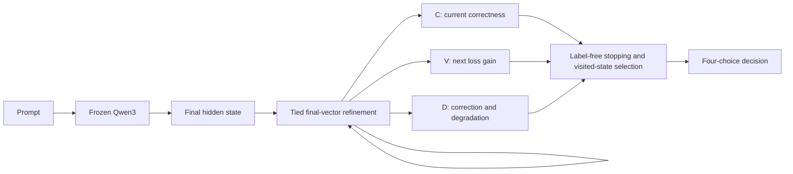

# Latent Loop Confidence — research overview

Can auxiliary networks recognize when another latent computation will improve a decision? The historical work separates correctness (C), next-loop supervised loss gain (V), and correction/degradation value (D). Prediction signals can be useful even when the recurrent computation they describe is unreliable.

| Study | Research question | Architecture | Key recorded result | Important limitation | Report |
|---|---|---|---|---|---|
| Initial pilots and middle-layer probe | Can confidence/refinement recover decisions from a frozen representation? | Frozen Qwen3; final-vector heads, tied residual refinement, bounded memory; separate repeated-middle-block probe | One pass 50.28% versus frozen 44.83%; recurrence advantage unestablished | Initial answer-format artifact; shared templates; eight-loop degradation; middle probe trains only three scalars | [Detailed report](../reports/research_summary.md) |
| Experiment 3 | Does next-loop loss value differ from confidence? | Frozen parent refiners; C and immediate-gain probes; stopping controls | Correctness AUROC 0.798; gain AUROC 0.762 versus confidence-only gain 0.695 | Gain stopping 49.06% versus one pass 51.28%; weaker template transfer | [Detailed report](../reports/experiment_03/learning_when_to_think.md) |
| Experiment 4A | Do signals survive stronger tasks and structural shifts? | Historical frozen heads; fresh scalar controls/calibrators; causal trajectory exports | Fresh-ID historical C/V AUROC 0.530/0.534; scalar gain 0.580 | Weak transfer; poor task competence; no newly trained neural heads | [Detailed report](../reports/experiment_04a/foundation_report.md) |
| Experiment 4B | Can decision transitions guide paid stopping and state selection? | Fresh four-event D head, grouped OOF rankers, frozen parent trajectories | WR AUROC/AP 0.779/0.147; RW 0.794/0.229; D 34.85% | D-versus-one-pass and selection-versus-final paired intervals include zero | [Detailed report](../reports/experiment_04b/decision_value_and_trajectory_selection.md) |

Historical naming is retained. The original pilots share one report; no separate Experiment 2 report is present. Data distributions change between studies, so the aggregate accuracies cannot be compared as successive model improvements.

The diagram describes the primary historical architecture. The separate middle-layer probe repeats transformer layers before the late decoder; it does not reproduce RecurTrace's loop-time memory protocol.

The initial pilots and most secondary comparisons are exploratory. Experiment 4B prospectively identifies three primary comparisons: D versus one pass, selection versus the same visited final state, and event AP versus scalar C+V. The first two are inconclusive; the event-prediction comparison supports useful discrimination within this benchmark. Label-informed oracles are privileged opportunity bounds. Negative transfer and deeper-loop harm are retained.

## Roadmap

**Experiment 5 — Training Recurrent Computation (planned):** train the thinker itself using frozen-backbone middle-layer LoRA, bounded reinjection, and multi-depth supervision. Use fresh training/validation and a prospective final lockbox. Compare recurrence to trained one-pass adaptation at equal parameter counts and measured compute. Assess fixed depths before attempting C/V/D transfer or a new controller.

See [reproduction guidance](reproduction.md), [publication audit](publication_audit.md), [limitations](limitations.md), and [research references](literature_review.md).
