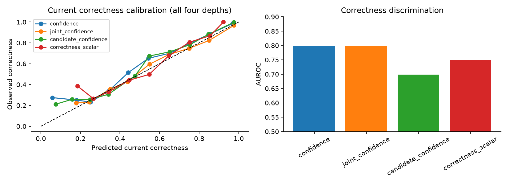
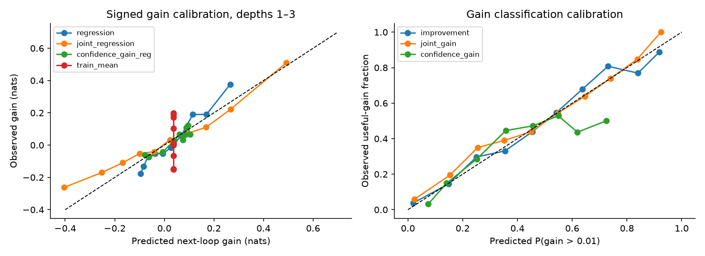
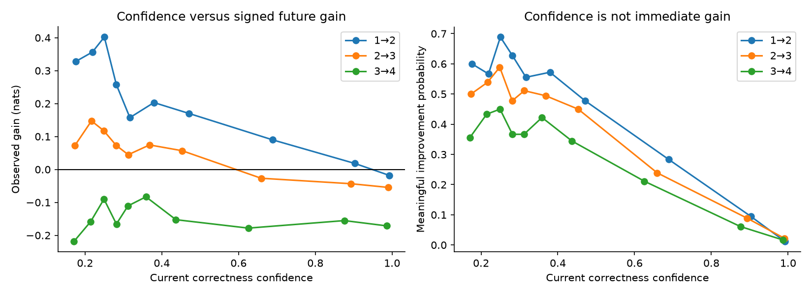
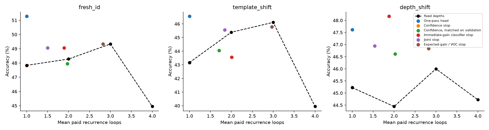
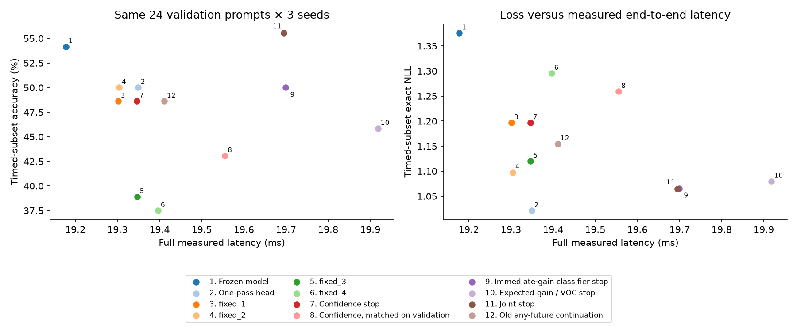
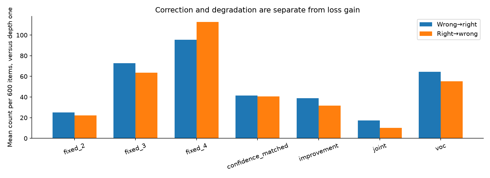
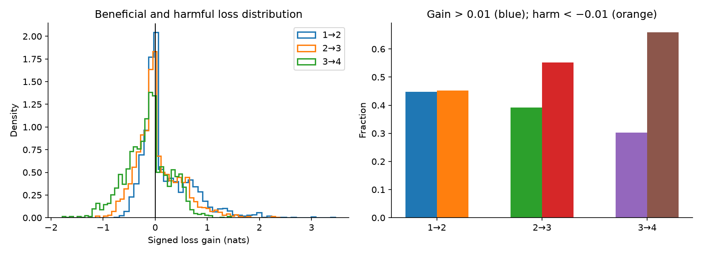
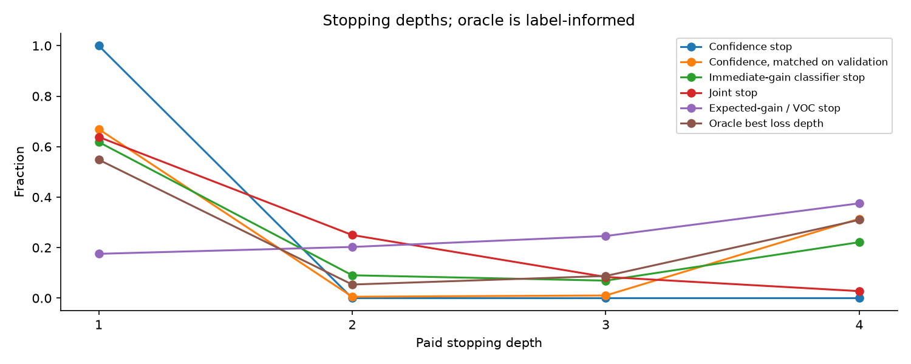
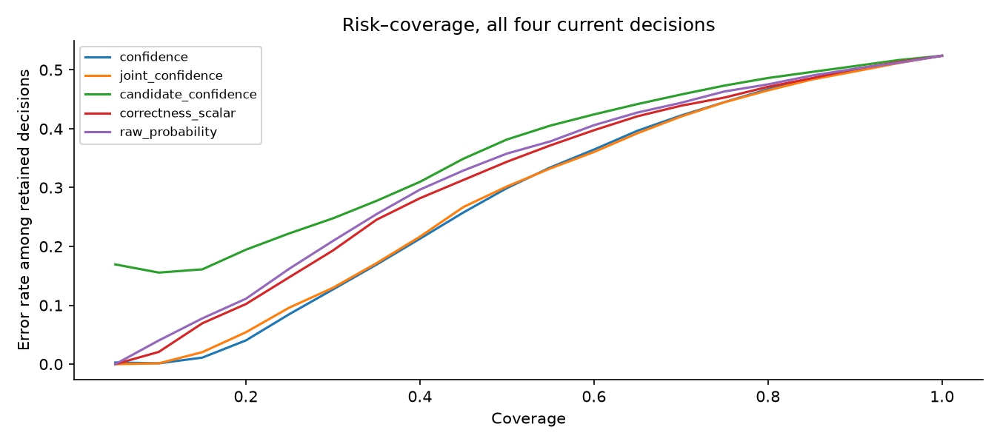

# Experiment 3: Learning When to Think

## Findings

A small frozen-state probe distinguishes current correctness from immediate next-loop loss improvement in this synthetic pilot. On 600 fresh original-template examples, the validation-selected confidence estimator (confidence) reaches AUROC **0.798**; the validation-selected gain predictor (joint_gain) reaches AUROC **0.762**, AP **0.641** against useful-gain prevalence **0.381**. Confidence alone as a supervised gain predictor reaches AUROC **0.695**. This is evidence of a distinguishable predictive signal, not evidence of internal reasoning or broad transfer.

The stopping family selected by validation accuracy is **Immediate-gain classifier stop**. It scores **49.06%** at **1.894 loops**, versus frozen **47.83%** and the existing one-pass head **51.28%**. Its accuracy difference from confidence stopping is +1.22 pp [-2.17, +4.00]. Accuracy gains remain uncertain with only three seeds and 600 shared items. The one-pass head remains stronger on fresh-ID raw accuracy.

Full measured latency on a prespecified balanced 24-item controller-validation subset is **19.70 ms** for this controller and **19.35 ms** for the one-pass head. The complete timed subset, costs, and raw repetitions are recorded. These timings include tokenization, backbone, live stopping, and Metal synchronization. They do not establish a deployment speedup on another device or prompt distribution.

## Audit and preserved baseline

Recomputed 360 historical accuracy/NLL rows from saved logits. All passed. Recovered depths 1–4 from the three original refiner checkpoints; all historical test and OOD logits matched archived trajectories exactly. Verified dataset hashes, cache signatures, shapes, FP32 dtype, and distinct parent checkpoint hashes. Historical tracked files remain intact except an added README link; original reports and results are untouched.

The source audit found no invalidating final-test leakage, causal-cache, stopping-budget, or probability-normalization error. The earlier continuation target was **any later permitted loss improvement**, trained on refiner-training examples. This experiment uses **immediate** loss gain and fresh out-of-refiner-training examples. Historical candidate confidence was a depth-zero candidate classifier; the new primary confidence head predicts current recurrent argmax correctness. The adapted historical architecture is a separate baseline, fitted to current correctness with conditional statistics and depth.

Historical NLL clips probabilities at 1e-12. New target loss uses stable, unclipped logsumexp; both historical-convention NLL and exact NLL are saved for policies. The answer prefix `Answer: (` and public frozen FP32 Qwen3-0.6B revision are retained. Output probabilities are conditional on four labels; this is not language-model perplexity or free-generation accuracy.

## Frozen design and supervision

The pre-fit opportunity analysis completed before every new fit (timestamps verified). Independent fresh splits have 1,200 controller-training, 300 controller-validation, and 600 items each for fresh ID, rewritten templates, and harder depth. Independent reference solvers validate every answer. Exact instance IDs and prompts are disjoint across all historical and new splits. Templates/algorithm families and alpha-renamed structures remain shared; unseen structural generalization is not claimed. Template shift changes wording while retaining original distributions. Depth shift uses existing OOD depths 5–8 and numeric ranges; three easy task families remain depth one.

At depth k, each probe observes RMS-normalized current state (1,024 values), current probabilities (four), option entropy, margin, k/4, and relative change from the previous completed state: 1,032 features. The previous state at depth one is the backbone state. No live API accepts labels, future hidden states, or future loss. Backbone and three existing refiners remain frozen. Hidden vectors and weights stay in ignored artifacts.

Targets are current argmax correctness; gain classification `L_k − L_(k+1) > 0.01 nat`; and signed regression `E[L_k − L_(k+1)]`. Confidence trains at depths 1–4. Gain losses train at depths 1–3 with terminal masking. The joint head has separate confidence/classification/regression outputs with summed BCE/BCE/MSE, using a training-only gain standard deviation to scale regression. MSE targets retain both signs and all magnitudes; no positive-example selection. Width 64, AdamW 0.001, decay 0.01, clipping 1, batch 64, 30 epochs; each checkpoint chosen by its validation loss. Three parent/controller seeds [11,22,33]; 15 new neural fits; no new backbone/refiner fits. Epoch-level resumable optimizer/last/best states and immutable data/parent/config signatures are saved.

Scalar logistic and ridge controls fit on controller training only: entropy, margin, completed change, confidence alone, all scalar observables with confidence, and a diagnostic task/depth/difficulty control with and without the dedicated gain score. Task/difficulty metadata is used only in diagnostic controls. They are never deployed as controller inputs. Fitting these controls to training predictions is not cross-fitting; held-out metrics remain the basis of claims.

## Opportunity before training

| Transition | Meaningful gain | Harmful loss | Changed answer | Wrong→right | Right→wrong | Mean gain |
|---|---:|---:|---:|---:|---:|---:|
| 1→2 | 47.44% | 42.78% | 37.0/300 | 9.3/300 | 11.3/300 | +0.190 nat |
| 2→3 | 40.78% | 53.00% | 75.0/300 | 19.7/300 | 24.0/300 | +0.044 nat |
| 3→4 | 31.44% | 65.11% | 91.3/300 | 18.3/300 | 29.7/300 | -0.147 nat |

Counts are seed means on 300 shared validation items. Gains are not extremely rare, but most loss reductions do not correct an answer. All transition quantiles, positive/meaningful/harmful frequencies, confidence increases on wrong outcomes, and historical opportunities are in `opportunity_before_training.json`; final-split opportunities are reported separately after fitting.

## Predictor results

Models/families below are selected on controller validation AUROC; checkpoints use validation objective. Tables show final results without using them to reselect models.

| Split | Confidence AUROC | Gain AUROC | Gain AP | Prevalence | Confidence-only gain AUROC | Scalar gain AUROC |
|---|---:|---:|---:|---:|---:|---:|
| historical_test | 0.793 | 0.755 | 0.631 | 0.412 | 0.701 | 0.732 |
| historical_ood | 0.795 | 0.741 | 0.600 | 0.384 | 0.681 | 0.712 |
| fresh_id | 0.798 | 0.762 | 0.641 | 0.381 | 0.695 | 0.726 |
| template_shift | 0.746 | 0.689 | 0.589 | 0.435 | 0.645 | 0.677 |
| depth_shift | 0.812 | 0.767 | 0.623 | 0.372 | 0.671 | 0.713 |

| Fresh-ID confidence estimate | AUROC | Brier | ECE | Accuracy at 50% coverage |
|---|---:|---:|---:|---:|
| confidence | 0.798 | 0.172 | 0.040 | 70.06% |
| candidate_confidence | 0.699 | 0.196 | 0.031 | 61.83% |
| joint_confidence | 0.798 | 0.172 | 0.023 | 69.78% |
| correctness_scalar | 0.750 | 0.193 | 0.028 | 65.56% |
| raw_probability | 0.737 | 0.218 | 0.131 | 64.19% |
| train_prior | 0.500 | 0.249 | 0.005 | 48.06% |

| Fresh-ID gain classifier | AUROC | AP | Brier | Precision at 0.5 | Recall at 0.5 |
|---|---:|---:|---:|---:|---:|
| improvement | 0.755 | 0.621 | 0.192 | 0.582 | 0.554 |
| joint_gain | 0.762 | 0.641 | 0.190 | 0.628 | 0.506 |
| old_continuation | 0.723 | 0.564 | 0.196 | 0.553 | 0.683 |
| entropy | 0.642 | 0.468 | 0.218 | 0.449 | 0.241 |
| margin | 0.644 | 0.466 | 0.219 | 0.461 | 0.255 |
| change | 0.518 | 0.379 | 0.236 | — | 0.000 |
| confidence_gain | 0.695 | 0.503 | 0.204 | 0.518 | 0.561 |
| scalar_all | 0.726 | 0.561 | 0.200 | 0.564 | 0.532 |
| task_depth_control | 0.726 | 0.567 | 0.200 | 0.555 | 0.532 |
| control_plus_gain | 0.762 | 0.629 | 0.191 | 0.600 | 0.594 |
| train_prior | 0.500 | 0.381 | 0.236 | — | 0.000 |

AP is a tied-score-aware average precision, not trapezoidal PR-AUC. A constant predictor has AP equal to prevalence and AUROC 0.5. Precision/recall use fixed probability 0.5; deployable thresholds are selected separately. Confidence metrics pool four current decisions; gain metrics pool three transitions. These repeated observations are correlated.

| Fresh-ID signed-gain regressor | MAE (nat) | RMSE (nat) | Spearman |
|---|---:|---:|---:|
| regression | 0.340 | 0.455 | 0.274 |
| joint_regression | 0.329 | 0.431 | 0.366 |
| confidence_gain_reg | 0.342 | 0.477 | 0.076 |
| scalar_all_reg | 0.348 | 0.452 | 0.265 |
| task_depth_control_reg | 0.346 | 0.452 | 0.273 |
| control_plus_gain_reg | 0.336 | 0.444 | 0.327 |
| train_mean | 0.351 | 0.481 | — |

Regression calibration curves, per-depth prevalence/AUROC/AP, per-task gain metrics, and confidence/entropy/margin/change versus observed-gain correlations are saved in each seed JSON. Poor signed-regression calibration limits the VOC interpretation even when gain classification ranks opportunities well.

## Information beyond confidence and task difficulty

Brier reductions below are paired across the same items and depths; positive means the augmented predictor is better. Hierarchical intervals resample seeds and unique items, averaging repeated depths within items. Intervals are exploratory, with three seeds and no multiplicity adjustment.

| Split | Joint gain vs confidence-only gain: Brier reduction | Task/depth control + dedicated gain vs control |
|---|---:|---:|
| historical_test | +0.0065 [-0.0038, +0.0152] | +0.0003 [-0.0103, +0.0117] |
| historical_ood | +0.0082 [-0.0042, +0.0223] | -0.0013 [-0.0166, +0.0146] |
| fresh_id | +0.0139 [+0.0050, +0.0222] | +0.0093 [-0.0004, +0.0185] |
| template_shift | +0.0053 [-0.0057, +0.0160] | -0.0146 [-0.0311, +0.0035] |
| depth_shift | +0.0187 [+0.0094, +0.0281] | +0.0065 [-0.0035, +0.0177] |

On fresh ID, current confidence versus dedicated gain probability has Spearman **-0.635**. The two are related but do not make identical predictions. The task/depth/difficulty control tests whether gain predictions add information beyond broad easy/hard task detection. Its held-out augmentation gains on original templates weaken or reverse under template shift; this limits claims about general information sufficiency. This is an observational probe comparison, not a proof of which information is encoded or used causally.

## Stopping, matched computation and utility

Each fixed policy pays depths 1–4. Confidence stops when current correctness probability reaches its selected threshold. The gain classifier continues only above its selected threshold. Joint continuation requires its gain score above a threshold and its current confidence below a threshold. These thresholds maximize validation accuracy, then minimize loops, then NLL. Confidence stops at depth one under that rule for all seeds on this validation set. The additional matched-compute confidence threshold is chosen solely to approach the gain policy's validation mean loops; it is a fairness diagnostic, not a reselected primary policy.

VOC continues when predicted signed next-loop gain exceeds cost. The configurable nat/loop cost grid is selected by validation `NLL + 0.01 * loops`; all grid points are retained. The measured auxiliary increment converts this constant cost to lambda × milliseconds. This conversion does not estimate instance-dependent incremental latency. The old continuation baseline retains its different any-future supervision but uses a newly validation-selected threshold. Oracle-next knows true immediate gain; oracle-best knows all future losses and chooses a depth while paying all intervening loops. Both are diagnostic and excluded from deployment selection.

| Policy | Historical test | Fresh ID | Template shift | Depth shift | Fresh loops | Fresh NLL |
|---|---:|---:|---:|---:|---:|---:|
| fixed_1 | 46.06% | 47.83% | 43.17% | 45.22% | 1.000 | 1.349 |
| fixed_2 | 48.39% | 48.28% | 45.39% | 44.44% | 2.000 | 1.152 |
| fixed_3 | 50.06% | 49.33% | 46.11% | 46.00% | 3.000 | 1.106 |
| fixed_4 | 47.61% | 44.94% | 39.94% | 44.72% | 4.000 | 1.254 |
| Confidence stop | 46.06% | 47.83% | 43.17% | 45.22% | 1.000 | 1.349 |
| Immediate-gain classifier stop | 49.22% | 49.06% | 43.56% | 48.17% | 1.894 | 1.181 |
| Old any-future continuation | 48.11% | 48.78% | 42.33% | 46.06% | 1.247 | 1.271 |
| entropy | 46.06% | 47.83% | 43.17% | 45.22% | 1.000 | 1.349 |
| margin | 46.06% | 47.83% | 43.17% | 45.22% | 1.000 | 1.349 |
| change | 46.06% | 47.83% | 43.17% | 45.22% | 1.000 | 1.349 |
| confidence_gain | 46.06% | 47.83% | 43.17% | 45.22% | 1.000 | 1.349 |
| Expected-gain / VOC stop | 49.33% | 49.33% | 45.78% | 46.83% | 2.822 | 1.107 |
| Joint stop | 47.56% | 49.06% | 45.56% | 46.94% | 1.501 | 1.151 |
| Confidence, matched on validation | 48.39% | 47.94% | 44.06% | 46.61% | 1.970 | 1.243 |
| Oracle next gain | 63.94% | 65.39% | 57.33% | 61.83% | 2.142 | 0.790 |
| Oracle best loss depth | 63.83% | 65.50% | 57.28% | 62.06% | 2.159 | 0.790 |
| Frozen model | 44.83% | 47.83% | 42.67% | 45.50% | 0.000 | 1.642 |
| One-pass head | 50.28% | 51.28% | 46.56% | 47.61% | 1.000 | 1.055 |

| Fresh-ID paired accuracy comparison | Mean delta and hierarchical 95% interval |
|---|---:|
| improvement_vs_confidence | +1.22 pp [-2.17, +4.00] |
| improvement_vs_confidence_matched | +1.11 pp [-1.50, +3.94] |
| improvement_vs_one_pass | -2.22 pp [-6.67, +1.75] |
| joint_vs_confidence | +1.22 pp [-0.22, +2.72] |
| voc_vs_confidence | +1.50 pp [-2.42, +4.94] |
| improvement_vs_fixed_2 | +0.78 pp [-1.89, +3.33] |
| improvement_vs_fixed_3 | -0.28 pp [-3.39, +2.86] |
| improvement_vs_matched_fixed_mixture | +0.98 pp [-1.87, +3.45] |
| joint_vs_matched_fixed_mixture | +1.00 pp [-0.29, +2.22] |
| voc_vs_matched_fixed_mixture | +0.59 pp [-0.98, +2.59] |

The random fixed-depth comparator chooses floor/ceiling depth independently of labels with probability matching each controller's observed mean loops. Its reported accuracy/NLL are exact expectations of that mixture; it is not an executed policy and has no measured latency. Matched loops are an analytical comparison and do not match synchronization/controller overhead. Final-set mean loops can differ for confidence and gain despite matching on validation. All pairs and achieved loops are recorded.

## Measured cost

Full: tokenization, ID transfer, frozen backbone, four-label projection, live refiner/probe/stopping, final Metal synchronization. Model load excluded. Auxiliary: cached h/base already on device, live refinement/stopping and final sync.

| Variant | Full mean of item medians (ms) | p10–p90 (ms) | Auxiliary-only (ms) | Timed mean loops |
|---|---:|---:|---:|---:|
| Frozen model | 19.178 | 16.532–24.774 | 0.034 | 0.000 |
| One-pass head | 19.349 | 16.640–25.232 | 0.408 | 1.000 |
| fixed_1 | 19.301 | 16.638–24.938 | 0.413 | 1.000 |
| fixed_2 | 19.304 | 16.567–25.280 | 0.506 | 2.000 |
| fixed_3 | 19.347 | 16.525–25.256 | 0.577 | 3.000 |
| fixed_4 | 19.396 | 16.722–25.391 | 0.645 | 4.000 |
| Confidence stop | 19.346 | 16.605–25.148 | 0.526 | 1.000 |
| Confidence, matched on validation | 19.555 | 16.665–25.501 | 0.705 | 1.694 |
| Immediate-gain classifier stop | 19.699 | 16.707–25.899 | 0.789 | 2.042 |
| Expected-gain / VOC stop | 19.918 | 16.939–25.983 | 0.956 | 2.764 |
| Joint stop | 19.695 | 16.795–25.752 | 0.827 | 1.375 |
| Old any-future continuation | 19.411 | 16.599–25.036 | 0.539 | 1.194 |

Controller-only median times, averaged across seeds: `{"candidate_confidence": 0.27554866574064363, "confidence": 0.18578466673109992, "improvement": 0.17575033355872924, "joint": 0.15881233412073925, "regression": 0.17366683338574754}` ms. These exclude feature construction and refiner/backbone. Full timing interleaves policy order, uses three warmup calls per variant/seed and 5 synchronized repetitions on each of 24 shared validation prompts per seed. Full and cached-live outputs/stopping depths agree within FP32 tolerance; streaming features agree with cached construction. Prompt length and each raw time are retained. p10–p90 describes spread across item medians, not a confidence interval. GPU time varies with load and thermals; small sub-millisecond full-path differences should be interpreted cautiously. There are no FLOP-based speedup claims.

The latency chart evaluates accuracy/NLL on the exact timed subset. The broader accuracy-versus-loops figure uses all 600 final items. This prevents mixing test accuracy and timing from a different prompt population into a spurious measured frontier.

Relative to the one-pass head, gain stopping adds 0.350 ms on this timed subset (paired hierarchical interval 0.135 to 0.611 ms). It also adds 0.303 ms versus fixed depth four despite using fewer loops. These within-run intervals do not capture between-run thermal or load variation. Controller and host synchronization overhead exceed the measured saved refiner work in this implementation.

## Behavior, tasks and representative cases

Categories use the validation-selected confidence threshold; final outcomes never define the threshold. A category can be empty, especially when confidence stopping selects a threshold of zero. That degenerate operational partition is reported honestly; a separate fixed 0.5-confidence diagnostic is included in the behavior supplement for interpretable category analysis.

| Fresh-ID task | Frozen | One-pass | Gain policy | Confidence matched | Gain corrections/degradations |
|---|---:|---:|---:|---:|---:|
| arithmetic | 31.00% | 32.33% | 36.67% | 33.33% | 8.7 / 3.7 |
| classification | 84.00% | 84.67% | 82.33% | 82.67% | 0.0 / 0.3 |
| comparison | 42.00% | 44.00% | 44.67% | 42.33% | 8.0 / 7.3 |
| pointer | 29.00% | 31.67% | 25.33% | 24.33% | 14.0 / 17.3 |
| routing | 80.00% | 85.67% | 87.00% | 81.67% | 7.3 / 1.7 |
| state | 21.00% | 29.33% | 18.33% | 23.33% | 1.0 / 1.3 |

Cases retain prompt, correct label, depth predictions/probabilities/losses, predicted/observed immediate gain, and paid oracle depth. They include wrong/confident corrections, uncertain examples never correct within four loops, and correct answers damaged by further loops. Case selection uses outcomes only after final evaluation and cannot validate internal reasoning. The benchmark's near-chance arithmetic/state/pointer performance remains a major limit.

The fixed-0.5 diagnostic below aggregates categories across seeds and depths 1–3, weighting by category counts. These repeated states are not independent sample sizes. Saved oracle depth distributions include the global best loss depth and the best remaining depth from the current state.

| Fresh-ID category | Repeated states | P(useful gain) | P(loss harm) | P(correction) | P(degradation) | Predicted gain | Observed gain |
|---|---:|---:|---:|---:|---:|---:|---:|
| correct_confident | 1485 | 3.77% | 76.97% | 0.00% | 3.57% | -0.012 | -0.110 |
| wrong_uncertain | 2574 | 62.43% | 36.32% | 12.08% | 0.00% | +0.064 | +0.181 |
| wrong_confident | 208 | 75.00% | 24.04% | 13.94% | 0.00% | +0.017 | +0.354 |
| correct_uncertain | 1133 | 20.83% | 76.61% | 0.00% | 29.92% | +0.039 | -0.182 |

## Direct answers to the research questions

1. **Is current confidence predictable?** Yes in this pilot: fresh-ID AUROC 0.798; calibration, Brier and risk–coverage are reported separately.
2. **Is future immediate improvement predictable?** Yes on original templates: joint_gain AUROC 0.762, AP 0.641 versus prevalence 0.381; transfer weakens on rewritten templates.
3. **Are the signals distinct?** They are related but gain prediction outperforms confidence-only gain prediction on ID. The diagnostic controls and their paired Brier intervals support a limited incremental signal; template shift prevents a broad claim.
4. **Does improvement stopping beat confidence stopping?** Fresh-ID accuracy changes by +1.22 pp [-2.17, +4.00]; the interval includes zero. Confidence selects one loop on validation, so this unrestricted comparison also spends more compute.
5. **Does it improve accuracy at matched compute?** Against confidence matched on validation: +1.11 pp [-1.50, +3.94]; against an exact matched-loops fixed-depth mixture: +0.98 pp [-1.87, +3.45]. Neither establishes an accuracy advantage. The gain and matched-confidence policies achieve 1.894 and 1.970 final mean loops, respectively.
6. **Does it reduce harmful loops?** On fresh ID, gain stopping damages 31.7 decisions versus 112.7 at depth four and 40.7 for matched confidence, per 600 items averaged across seeds. It also corrects 39.0 decisions. This is descriptive harm reduction with remaining regressions, not a guaranteed safeguard.
7. **Which tasks benefit?** Gain stopping reaches 36.67% arithmetic and 87.00% routing accuracy, but only 25.33% pointer and 18.33% state accuracy on fresh ID. The one-pass head reaches 31.67% pointer and 29.33% state. Within-task gain metrics remain in the public files; aggregate gains do not establish reliable multistep reasoning.
8. **Where does it fail?** Template transfer weakens, signed gain calibration is imperfect, and the one-pass head remains stronger on fresh-ID accuracy. Incorrect low-confidence examples often remain uncorrected within four loops.
9. **Is this genuine gain prediction or easy/hard detection?** Task/depth/difficulty controls and their augmented variants test this; ID incremental performance persists descriptively, while template transfer degrades. This rules out neither shortcuts nor unmeasured confounders.
10. **Is VOC useful?** It provides an explicit loss/compute utility knob and a recorded cost sweep, but signed prediction errors, host synchronization, and backbone-dominated cost prevent a demonstrated general accuracy/latency advantage.

## Limitations and next experiment

This is an exploratory frozen-final-vector synthetic pilot, not an official RecurTrace reproduction. Only three seeds, 300 validation items, related templates, reused algorithm families, several policy comparisons, and a small timing sample limit inference. Confidence and gain AUROC comparisons reflect correlated trajectories; bootstrap resamples unique items. The maximum deployed depth is four. Earlier-layer probes and new eight-loop experiments are deferred; old eight-loop harm remains a historical result. No large architectural sweep is justified by these results.

The next experiment should preregister a larger controller-validation set and richer independently generated wording/task structures, use out-of-fold scalar stacking, and evaluate a calibration-focused joint predictor with batched GPU halting to reduce host synchronization. Keep the frozen refiner and one-pass control initially. Establish transfer and full measured cost before adding recurrence complexity.

## Reproduction and publication

Run from the repository root with the existing editable environment:

```sh
python -m latent_loop.experiment03.run audit
python -m latent_loop.experiment03.run prepare
python -m latent_loop.experiment03.run run
python -m latent_loop.experiment03.run timing
python -m latent_loop.experiment03.run report
```

`report` is CPU-only and recomputes checks/figures from public saved predictions. The numerical pipeline reuses the original ignored parent checkpoints/features. Those are not vendored: obtain them by the existing primary reproduction workflow before Experiment 3. The attached config records the original four-hour deadline; for a later independent reproduction copy the config and set `started_utc` to the new start, preserving scientific hyperparameters. Signatures deliberately prevent silently mixing changed configs with old checkpoints; use a separate checkout/cache directory for an independent run. Completed fits reuse best weights; unfinished fits resume from the last completed epoch and optimizer state. The reported fit count excludes scalar statistical fits, historical fits, and verification tests.

Peak recorded numerical MLX allocation is **3.58 GiB**, below the 48 GiB allocator budget. OS process RSS is separately saved. No remote workstation or unrelated process was touched. Public synthetic data, model source/license references, configuration, hashes, metrics, plots, and reports are included; hidden tensors, weights, environments, and personal paths are excluded. See the publication audit for the tracked-file scan and size check. Work is committed locally on `research/value-of-computation`; no remote publication is performed.

## Recorded figures


















