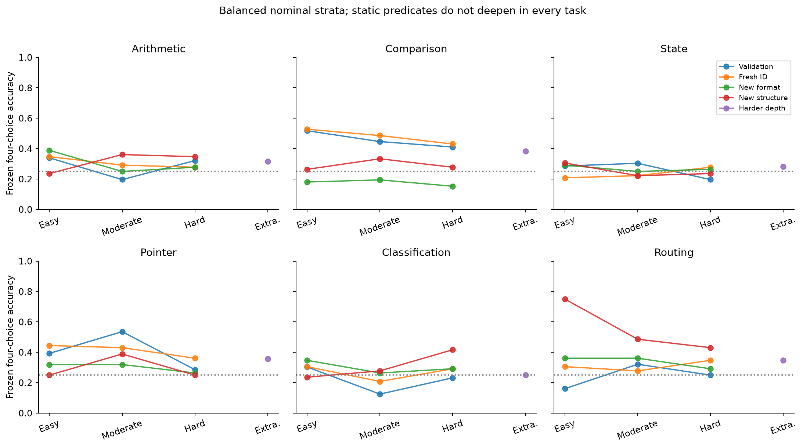
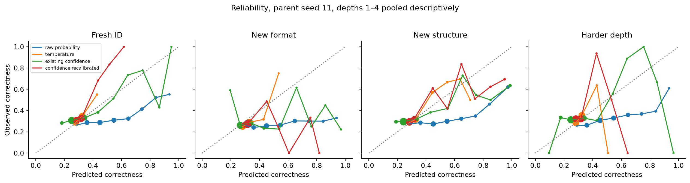
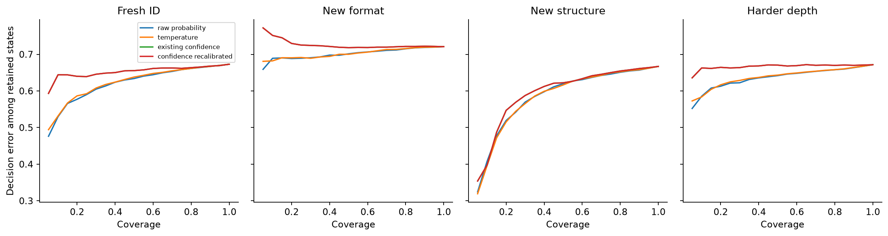
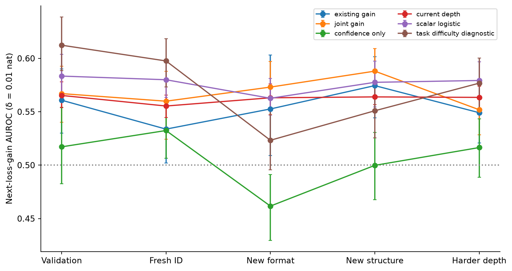
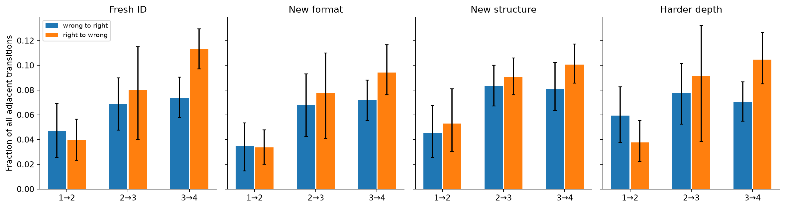
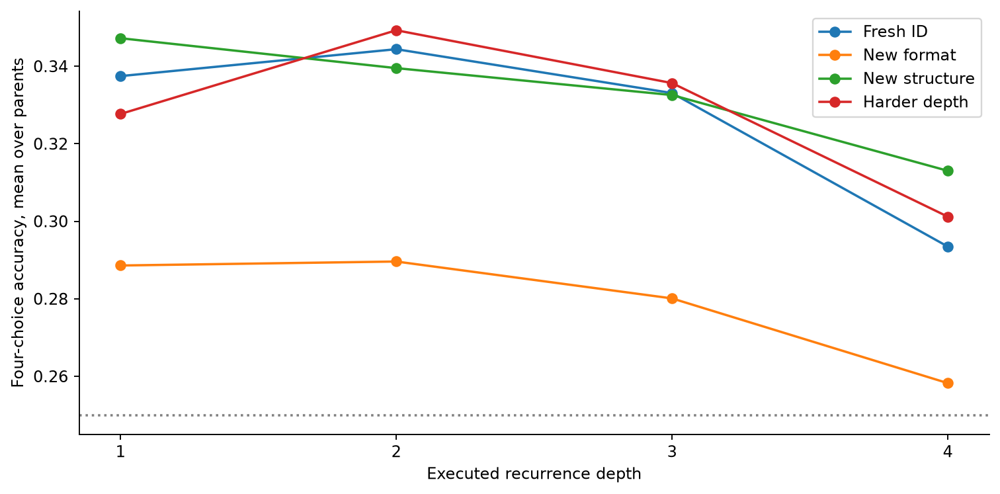
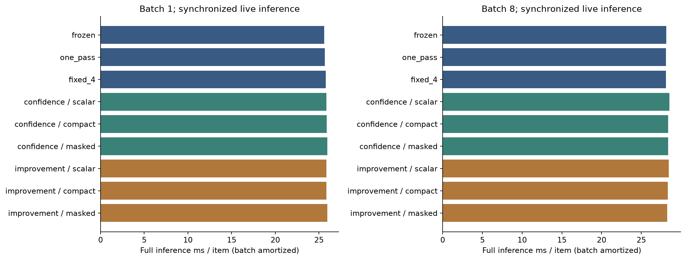
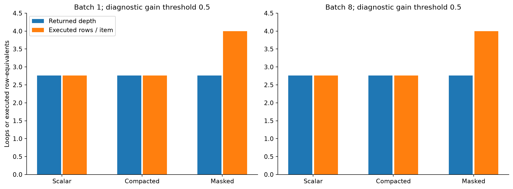

# Experiment 4A: foundation, generalization and measurement hardening

Recorded 2026-10-08T22:27:43.529181+00:00. Starting commit `701bcd4f2169d302259266156ee1a9cd06a05dae`; branch `research/exp04-foundation`. All original conclusions and files are preserved; this is a new robustness evaluation.

## Findings

The stronger benchmark substantially weakens the historical confidence and immediate-gain signals. Frozen Experiment 3 weights were reused for all three parents; no neural models were trained or selected on these final results. The tables below distinguish signal ranking, calibration, actual decision changes and paid computation. The historical 0.798 correctness / 0.762 gain AUROCs are exploratory reference points, not expectations for this distribution.

| Split | Frozen | One pass | Gain stopping | Loops | Confidence AUROC | Gain AUROC | Scalar gain AUROC |
| --- | --- | --- | --- | --- | --- | --- | --- |
| Validation | 31.25% | 31.22% | 32.14% | 1.000 | 0.509 | 0.561 | 0.583 |
| Fresh ID | 33.56% | 33.10% | 33.74% | 1.000 | 0.530 | 0.534 | 0.580 |
| New format | 28.16% | 28.76% | 28.86% | 1.000 | 0.497 | 0.553 | 0.563 |
| New structure | 33.72% | 32.82% | 34.72% | 1.000 | 0.577 | 0.574 | 0.578 |
| Harder depth | 32.25% | 34.16% | 32.77% | 1.000 | 0.505 | 0.549 | 0.579 |

Fresh ID means in-distribution relative to the *new 4A generator mixture*. It is already a transfer distribution for the historical refiner and heads. Structural shift additionally withholds one semantic generator per task; new format uses held-out structured presentations for the same 4A algorithms. These are different shifts, not controlled estimates of a single causal template effect.

## Historical audit and equal information

Recomputed 288 historical stopping-policy accuracy/NLL entries from saved predictions. Verified three distinct checkpoint hashes for each frozen component and 177 historical tracked files (only a README link may change). Reviewed old generators, refiner, confidence/gain probes, deployment features, stopping code and reproduction instructions. Historical artifacts were not rewritten.

All variants share each prompt, the same four candidates, the same pinned Qwen3-0.6B FP32 backbone representation and label-token decoder. The one-pass head and refiner retain their original weights. Current argmax decisions are held fixed when comparing correctness estimators; calibration does not rerank candidates. Runtime probes see only current/completed states. Task/difficulty controls are explicitly offline diagnostics. Every live policy must pay for the loops it executes.

Original candidate NLL clips tiny probabilities; this experiment uses stable, unclipped four-choice log-sum-exp NLL. Conditional accuracy is separate from unrestricted next-token accuracy; the latter here means the immediate next token after the frozen answer prefix, not free-form completion accuracy.

| Final split | Four-choice frozen accuracy | Unrestricted next-token accuracy | Option-token rate |
| --- | --- | --- | --- |
| Fresh ID | 33.56% | 31.79% | 95.37% |
| New format | 28.16% | 28.16% | 100.00% |
| New structure | 33.72% | 33.72% | 100.00% |
| Harder depth | 32.25% | 30.94% | 95.45% |

## Independent data and prospective lockbox

| Split | Instances | Per task | RNG seed | Role |
| --- | --- | --- | --- | --- |
| controller_train | 4032 | 672 | 440001 | Fit controls |
| controller_val | 1008 | 168 | 440101 | Calibrate/select |
| fresh_id | 1296 | 216 | 440201 | Final, now consumed |
| new_template | 1296 | 216 | 440301 | Final, now consumed |
| structural_shift | 1296 | 216 | 440401 | Final, now consumed |
| harder_depth | 1296 | 216 | 440501 | Final, now consumed |

| Task | Development approaches | Withheld structural approach | Independent solver |
| --- | --- | --- | --- |
| Arithmetic | Accumulator; expression tree | Parallel ledgers | Affine algebra; constructed integer expression; signed account balance |
| Comparison | Mixed units; resource filtering | Value per cost | Integer byte normalization; declarative eligibility; exact Fraction ratios |
| State | Register operations; inventory transfers | Boolean program | Homogeneous transition matrices; independent bit masks |
| Pointer | Functional graph; alternating maps | Symbolic modular walk | Transition-matrix powers; direct modular composition |
| Classification | Numeric conjunction; disjunction with negation | Weighted conditions | Independent declarative predicates |
| Routing | Capability constraints; incomplete/conflicting requests | Ordered rules | Eligible-set filters and priority rules |

Labels are generated by a direct simulator and checked by a separate deterministic solver. All public examples have four distinct choices. Entity names and candidate permutations are removed from structural fingerprints; constants, operations and queries are retained. Register renamings are minimized over permutations; directed rooted graph invariants conservatively reject isomorphic instances. A conservative collision can reject a distinct graph. ID/lexical tests intentionally share abstract algorithm archetypes; literal-free skeleton disjointness is not claimed.

All 10,224 generated instances have distinct prompt, instance and alpha-structure fingerprints across all six splits. Rejections: `{"exact_instance": 19, "historical_renamed_structure": 1, "prompt": 0, "renamed_structure": 5, "solver_or_uniqueness": 4439}`. A pre-freeze historical audit found one renamed pointer graph in the unopened draft fresh-ID set. The public historical fingerprint exclusion list removed it; development data remained unchanged. Comparable old accumulator, graph and normalized memory-max instances are excluded. Historical modulo-register, Boolean-only classifier and verb-registry semantics differ from the new generators. The integrity amendment is recorded without exposing final scores.

Protocol frozen at `2026-10-08T22:07:16.662885+00:00`; lockbox first opened at `2026-10-08T22:07:17.080770+00:00`. Source, configuration, dataset manifest, exclusion list, plan, selections and checkpoint hashes were fixed before final extraction/scoring. Train/validation were the only selection data. Final sets are now consumed evaluation data; **4B requires a fresh independently seeded prospective final set**. No final-driven changes to heads, tasks, thresholds or architecture were made.

## Competence and benchmark difficulty

Tasks, approaches and nominal difficulty strata are balanced by a fixed schedule. Easy/moderate/hard sequential tasks use 1/3/5 updates, and extrapolation uses 8. Expression trees use 1/3/7/15 operators at depth 1/2/3/4. Graphs expand from 8/10/12 to 16 nodes. Arithmetic includes negative values and different operand distributions. Actual operation count, depth, maximum absolute numeric input and token length are retained and evaluated independently.

Static comparison and classification approaches do not increase their predicate count across every nominal stratum; harder-depth is therefore a mixed extrapolation condition. Numbers and entity indices contribute to `numeric_max`, so it is a descriptive input-range measure. Program length also includes instructions that can be irrelevant to the queried variable. Difficulty labels do not establish minimum reasoning depth. No poor-performing task was dropped or replaced after observing model outcomes.

| Task | Fresh ID | New format | New structure | Harder depth |
| --- | --- | --- | --- | --- |
| arithmetic | 30.56% | 30.56% | 31.48% | 31.48% |
| comparison | 48.15% | 17.59% | 29.17% | 38.43% |
| state | 23.61% | 26.85% | 25.46% | 28.24% |
| pointer | 41.20% | 30.09% | 29.63% | 35.65% |
| classification | 26.85% | 30.09% | 31.02% | 25.00% |
| routing | 31.02% | 33.80% | 55.56% | 34.72% |

Balanced micro accuracy equals the mean over six task accuracies. Task-level gains can cancel substantial losses. Full per-generator, actual-depth, operation, numeric-range, template and token-length results are in the public metrics and summary JSON; low baseline competence limits claims about additional reasoning.

## Confidence: ranking versus calibration

Eight estimators use the same current decisions: raw maximum candidate probability, temperature-scaled probability, entropy and margin logistic calibration, frozen confidence and joint heads, and separately recalibrated versions of both heads. One temperature and four scalar logistic calibrators per parent are fitted only on validation states. Training-only gain controls contribute seven scalar fits per parent; total new statistical fits = 36, new neural fits = 0.

| Parent | Temperature | Confidence threshold | Gain threshold | Selected fixed depth |
| --- | --- | --- | --- | --- |
| 11 | 4.977 | 0 | 1 | 2 |
| 22 | 4.609 | 0 | 0.75 | 1 |
| 33 | 4.459 | 0 | 0.75 | 2 |

| Final split / estimator | AUROC [95%] | Brier | ECE | Binary log loss | Accuracy at 50% coverage | AURC |
| --- | --- | --- | --- | --- | --- | --- |
| Fresh ID / raw_probability | 0.564 [0.542, 0.583] | 0.265 | 0.197 | 0.733 | 0.366 | 0.614 |
| Fresh ID / temperature | 0.561 [0.538, 0.581] | 0.218 | 0.018 | 0.627 | 0.362 | 0.617 |
| Fresh ID / entropy_calibration | 0.558 [0.537, 0.578] | 0.218 | 0.023 | 0.627 | 0.360 | 0.617 |
| Fresh ID / margin_calibration | 0.562 [0.541, 0.582] | 0.218 | 0.023 | 0.627 | 0.364 | 0.614 |
| Fresh ID / existing_confidence | 0.530 [0.505, 0.556] | 0.226 | 0.061 | 0.646 | 0.345 | 0.644 |
| Fresh ID / confidence_recalibrated | 0.530 [0.505, 0.556] | 0.220 | 0.022 | 0.631 | 0.345 | 0.644 |
| Fresh ID / joint_confidence | 0.532 [0.506, 0.558] | 0.224 | 0.044 | 0.642 | 0.347 | 0.643 |
| Fresh ID / joint_recalibrated | 0.532 [0.506, 0.558] | 0.220 | 0.024 | 0.631 | 0.347 | 0.643 |
| New format / raw_probability | 0.530 [0.513, 0.551] | 0.291 | 0.268 | 0.804 | 0.299 | 0.700 |
| New format / temperature | 0.530 [0.512, 0.550] | 0.202 | 0.036 | 0.595 | 0.300 | 0.700 |
| New format / entropy_calibration | 0.528 [0.509, 0.549] | 0.203 | 0.031 | 0.595 | 0.296 | 0.701 |
| New format / margin_calibration | 0.530 [0.511, 0.552] | 0.202 | 0.031 | 0.594 | 0.297 | 0.700 |
| New format / existing_confidence | 0.497 [0.470, 0.524] | 0.212 | 0.067 | 0.625 | 0.282 | 0.727 |
| New format / confidence_recalibrated | 0.497 [0.470, 0.524] | 0.203 | 0.028 | 0.597 | 0.282 | 0.727 |
| New format / joint_confidence | 0.515 [0.491, 0.541] | 0.210 | 0.051 | 0.624 | 0.289 | 0.710 |
| New format / joint_recalibrated | 0.515 [0.491, 0.541] | 0.204 | 0.035 | 0.599 | 0.289 | 0.710 |
| New structure / raw_probability | 0.590 [0.568, 0.611] | 0.278 | 0.230 | 0.815 | 0.380 | 0.577 |
| New structure / temperature | 0.590 [0.567, 0.612] | 0.214 | 0.015 | 0.618 | 0.383 | 0.577 |
| New structure / entropy_calibration | 0.587 [0.565, 0.609] | 0.214 | 0.019 | 0.619 | 0.383 | 0.578 |
| New structure / margin_calibration | 0.590 [0.569, 0.610] | 0.217 | 0.021 | 0.625 | 0.384 | 0.578 |
| New structure / existing_confidence | 0.577 [0.552, 0.603] | 0.227 | 0.079 | 0.741 | 0.378 | 0.585 |
| New structure / confidence_recalibrated | 0.577 [0.552, 0.603] | 0.218 | 0.028 | 0.631 | 0.378 | 0.584 |
| New structure / joint_confidence | 0.574 [0.550, 0.599] | 0.224 | 0.059 | 0.724 | 0.369 | 0.582 |
| New structure / joint_recalibrated | 0.574 [0.550, 0.599] | 0.216 | 0.025 | 0.629 | 0.369 | 0.582 |
| Harder depth / raw_probability | 0.550 [0.527, 0.571] | 0.268 | 0.197 | 0.740 | 0.358 | 0.630 |
| Harder depth / temperature | 0.548 [0.526, 0.570] | 0.219 | 0.019 | 0.630 | 0.357 | 0.632 |
| Harder depth / entropy_calibration | 0.545 [0.521, 0.567] | 0.220 | 0.025 | 0.631 | 0.355 | 0.633 |
| Harder depth / margin_calibration | 0.550 [0.527, 0.569] | 0.219 | 0.024 | 0.631 | 0.358 | 0.629 |
| Harder depth / existing_confidence | 0.505 [0.481, 0.530] | 0.231 | 0.079 | 0.659 | 0.329 | 0.663 |
| Harder depth / confidence_recalibrated | 0.505 [0.481, 0.530] | 0.221 | 0.027 | 0.635 | 0.329 | 0.663 |
| Harder depth / joint_confidence | 0.511 [0.488, 0.538] | 0.227 | 0.056 | 0.650 | 0.335 | 0.656 |
| Harder depth / joint_recalibrated | 0.511 [0.488, 0.538] | 0.221 | 0.029 | 0.635 | 0.335 | 0.656 |

Ranking AUROC measures discrimination; Brier/ECE/log loss measure probability quality. Temperature minimizes candidate NLL and preserves each answer, but multiclass maximum-probability rankings can change between examples. Recalibration can improve Brier while leaving an uninformative ranking. Report all metrics rather than equating lower calibration error with better decisions. Reliability plots show parent 11 so bins with different occupancy are not averaged; marker areas indicate occupancy and sparse bins are imprecise. Tables average all parents. Risk-coverage curves average parents descriptively. Tied-score ordering makes selective metrics sensitive to tie resolution, especially constant controls.

Temperature scaling is a validation-based post-hoc method discussed by [Guo et al., 2017](https://arxiv.org/abs/1706.04599); that paper does not establish transfer calibration for this benchmark.

## Immediate gain and actual corrections

A useful loss gain is current exact conditional NLL minus next-loop NLL greater than 0.01 nat. It can improve probability on the true answer without changing the argmax decision. Gain supervision covers depths 1→2, 2→3 and 3→4; no fabricated depth-4 continuation label is included. Training controls predict gain from frozen confidence alone, entropy, margin, depth, all current scalar features, task/difficulty metadata, or metadata plus the frozen hidden-state gain score. The last two are diagnostic conditions, not deployable policies.

| Final split / predictor | Gain AUROC [95%] | AP | Brier | Log loss |
| --- | --- | --- | --- | --- |
| Fresh ID / existing_gain | 0.534 [0.502, 0.559] | 0.491 | 0.256 | 0.710 |
| Fresh ID / joint_gain | 0.560 [0.524, 0.588] | 0.516 | 0.267 | 0.738 |
| Fresh ID / confidence_only | 0.532 [0.506, 0.559] | 0.483 | 0.248 | 0.688 |
| Fresh ID / entropy | 0.538 [0.507, 0.570] | 0.482 | 0.248 | 0.689 |
| Fresh ID / margin | 0.512 [0.480, 0.541] | 0.468 | 0.248 | 0.690 |
| Fresh ID / current_depth | 0.555 [0.545, 0.566] | 0.497 | 0.246 | 0.685 |
| Fresh ID / scalar_logistic | 0.580 [0.563, 0.596] | 0.530 | 0.244 | 0.680 |
| Fresh ID / task_difficulty_diagnostic | 0.598 [0.573, 0.618] | 0.539 | 0.241 | 0.675 |
| Fresh ID / diagnostic_plus_hidden_gain | 0.599 [0.575, 0.618] | 0.541 | 0.241 | 0.675 |
| Fresh ID / train_prior | 0.500 [0.500, 0.500] | 0.463 | 0.248 | 0.690 |
| New format / existing_gain | 0.553 [0.509, 0.603] | 0.555 | 0.253 | 0.723 |
| New format / joint_gain | 0.573 [0.547, 0.597] | 0.581 | 0.255 | 0.719 |
| New format / confidence_only | 0.462 [0.430, 0.491] | 0.490 | 0.253 | 0.699 |
| New format / entropy | 0.582 [0.560, 0.607] | 0.580 | 0.248 | 0.689 |
| New format / margin | 0.567 [0.543, 0.591] | 0.572 | 0.249 | 0.691 |
| New format / current_depth | 0.563 [0.547, 0.576] | 0.550 | 0.247 | 0.688 |
| New format / scalar_logistic | 0.563 [0.547, 0.581] | 0.564 | 0.247 | 0.688 |
| New format / task_difficulty_diagnostic | 0.523 [0.496, 0.553] | 0.532 | 0.252 | 0.698 |
| New format / diagnostic_plus_hidden_gain | 0.526 [0.500, 0.552] | 0.536 | 0.252 | 0.698 |
| New format / train_prior | 0.500 [0.500, 0.500] | 0.511 | 0.251 | 0.695 |
| New structure / existing_gain | 0.574 [0.544, 0.602] | 0.533 | 0.260 | 0.864 |
| New structure / joint_gain | 0.588 [0.564, 0.609] | 0.542 | 0.265 | 0.805 |
| New structure / confidence_only | 0.500 [0.468, 0.531] | 0.474 | 0.250 | 0.693 |
| New structure / entropy | 0.507 [0.477, 0.540] | 0.461 | 0.251 | 0.695 |
| New structure / margin | 0.506 [0.478, 0.538] | 0.459 | 0.250 | 0.693 |
| New structure / current_depth | 0.564 [0.557, 0.573] | 0.509 | 0.246 | 0.685 |
| New structure / scalar_logistic | 0.578 [0.555, 0.597] | 0.532 | 0.246 | 0.685 |
| New structure / task_difficulty_diagnostic | 0.551 [0.526, 0.577] | 0.515 | 0.250 | 0.693 |
| New structure / diagnostic_plus_hidden_gain | 0.563 [0.535, 0.587] | 0.520 | 0.248 | 0.690 |
| New structure / train_prior | 0.500 [0.500, 0.500] | 0.470 | 0.249 | 0.692 |
| Harder depth / existing_gain | 0.549 [0.521, 0.578] | 0.516 | 0.255 | 0.708 |
| Harder depth / joint_gain | 0.552 [0.528, 0.574] | 0.518 | 0.271 | 0.752 |
| Harder depth / confidence_only | 0.516 [0.489, 0.543] | 0.487 | 0.249 | 0.691 |
| Harder depth / entropy | 0.544 [0.515, 0.568] | 0.502 | 0.248 | 0.690 |
| Harder depth / margin | 0.520 [0.494, 0.545] | 0.489 | 0.249 | 0.691 |
| Harder depth / current_depth | 0.563 [0.552, 0.574] | 0.512 | 0.246 | 0.685 |
| Harder depth / scalar_logistic | 0.579 [0.563, 0.597] | 0.537 | 0.244 | 0.681 |
| Harder depth / task_difficulty_diagnostic | 0.577 [0.550, 0.600] | 0.535 | 0.246 | 0.685 |
| Harder depth / diagnostic_plus_hidden_gain | 0.580 [0.556, 0.602] | 0.538 | 0.246 | 0.685 |
| Harder depth / train_prior | 0.500 [0.500, 0.500] | 0.474 | 0.249 | 0.691 |

| Split | Useful gain | W→R [95%] | R→W [95%] | W→R given useful gain [95%] | Unchanged prediction | Confidence ↑ without correction |
| --- | --- | --- | --- | --- | --- | --- |
| Fresh ID | 46.33% | 6.301 [5.247, 7.373]% | 7.767 [5.657, 9.542]% | 12.898 [9.984, 15.484]% | 74.99% | 35.97% |
| New format | 51.11% | 5.838 [4.586, 6.962]% | 6.850 [4.938, 8.436]% | 11.022 [8.013, 13.754]% | 74.82% | 34.43% |
| New structure | 47.01% | 6.996 [5.898, 8.136]% | 8.136 [7.073, 9.285]% | 14.408 [11.798, 16.856]% | 72.63% | 34.20% |
| Harder depth | 47.38% | 6.919 [5.718, 8.034]% | 7.802 [6.250, 9.336]% | 14.007 [11.156, 16.534]% | 74.55% | 35.93% |

All four transition classes and all positive/harmful loss rates have problem/seed intervals in `summary.json`. Confidence increase means maximum candidate probability increased; an unchanged correct answer counts as no correction. Conditional correction rates retain the same clustered resampling in numerator and denominator.

Frozen hidden-state probes do not isolate a causal hidden-information effect: those probes were trained on historical data whereas scalar controls fit fresh 4A training data. The metadata controls diagnose task/difficulty mixtures; adding the frozen gain score to those controls tests incremental transfer information, not a newly trained hidden-state controller. Per-depth AUROCs help reveal easy ranking from current depth alone. No larger neural head was adopted.

## Paired policy comparisons and privileged trajectory ceilings

| Final split | Gain minus one pass [95%], pp | Selected fixed minus one pass [95%], pp | Gain minus selected fixed [95%], pp |
| --- | --- | --- | --- |
| Fresh ID | 0.643 [-1.800, 3.242] pp | 1.235 [-1.287, 3.755] pp | -0.592 [-2.083, 0.412] pp |
| New format | 0.103 [-2.160, 2.444] pp | 0.154 [-2.160, 2.392] pp | -0.051 [-1.235, 1.029] pp |
| New structure | 1.903 [-0.698, 4.321] pp | 1.260 [-0.799, 3.421] pp | 0.643 [-0.335, 2.135] pp |
| Harder depth | -1.389 [-4.091, 1.390] pp | 0.077 [-3.216, 3.396] pp | -1.466 [-3.421, 0.000] pp |

| Final split | Depth 1 | Depth 2 | Depth 3 | Depth 4 | Oracle min-loss | Oracle first-correct | First-correct paid loops |
| --- | --- | --- | --- | --- | --- | --- | --- |
| Fresh ID | 33.74% | 34.44% | 33.31% | 29.35% | 51.18% | 52.65% | 1.405 |
| New format | 28.86% | 28.96% | 28.01% | 25.82% | 45.65% | 46.37% | 1.388 |
| New structure | 34.72% | 33.95% | 33.26% | 31.30% | 54.63% | 55.68% | 1.455 |
| Harder depth | 32.77% | 34.93% | 33.56% | 30.12% | 52.31% | 53.52% | 1.426 |

Both oracles use labels/future information and are privileged evaluation bounds. Min-loss depth need not select a correct argmax even when another depth is correct. First-correct chooses the earliest correct depth or depth 1 when none is correct, paying every loop needed to reach that depth; its stopping knowledge is unavailable at inference. A deployed selector would also pay to acquire any later states it inspects. These ceilings do not establish an achievable value-head improvement.

Intervals jointly resample the same independent problem indices across all parents and all depths, and resample three parent seeds. Mean/rate and paired accuracy use 1,000 replicates; AUROC and paired AUROC use 400. Depth states and duplicated backbone results are not independent samples. Only three parents weakly characterize training variability; intervals are descriptive and no multiplicity-adjusted significance claim is made. Comparisons from training or calibration validation are apparent/development results.

## Full inference timing and executed work

Full input tokenization, array materialization, right-padded frozen backbone, label decoding, live auxiliary inference and host stopping barriers, final Metal sync and output conversion. Model loading excluded. Auxiliary-only uses h/base already on device and includes output conversion.

Three warmups and 5 repeats per variant/batch, interleaved deterministic order, 24 validation prompts balanced across six tasks and three parent seeds. Batch 1 and batch 8 use the same prompts. Prompt-length padding changes work; amortized batch time is throughput, not single-request latency. Model load and model download are excluded. No unrelated process was terminated or reconfigured.

| Variant | Batch-1 ms/item | Batch-8 amortized ms/item | Batch-8 auxiliary ms/batch | Returned depth | Paid rows/item | Host barriers/batch |
| --- | --- | --- | --- | --- | --- | --- |
| frozen | 25.586 | 28.141 | 0.420 | 0.000 | 0.000 | 0.000 |
| one_pass | 25.681 | 28.109 | 1.475 | 1.000 | 1.000 | 0.000 |
| fixed_1 | 25.689 | 28.044 | 2.028 | 1.000 | 1.000 | 0.000 |
| fixed_2 | 25.691 | 28.068 | 1.136 | 2.000 | 2.000 | 0.000 |
| fixed_3 | 25.732 | 28.153 | 1.032 | 3.000 | 3.000 | 0.000 |
| fixed_4 | 25.790 | 28.117 | 2.281 | 4.000 | 4.000 | 0.000 |
| confidence:scalar | 25.841 | 28.543 | 2.565 | 1.000 | 1.000 | 8.000 |
| confidence:compact | 25.896 | 28.389 | 0.905 | 1.000 | 1.000 | 1.000 |
| confidence:masked | 25.954 | 28.401 | 3.029 | 1.000 | 4.000 | 0.000 |
| improvement:scalar | 25.848 | 28.466 | 2.519 | 1.000 | 1.000 | 8.000 |
| improvement:compact | 25.842 | 28.338 | 0.845 | 1.000 | 1.000 | 1.000 |
| improvement:masked | 25.948 | 28.248 | 2.138 | 1.000 | 4.000 | 0.000 |
| confidence:scalar@0.5 | 26.617 | 29.147 | 7.488 | 3.847 | 3.847 | 23.333 |
| confidence:compact@0.5 | 26.638 | 28.507 | 1.343 | 3.847 | 3.847 | 3.000 |
| confidence:masked@0.5 | 25.979 | 28.167 | 2.195 | 3.847 | 4.000 | 0.000 |
| improvement:scalar@0.5 | 26.290 | 29.100 | 5.880 | 2.764 | 2.764 | 18.444 |
| improvement:compact@0.5 | 26.389 | 28.466 | 1.382 | 2.764 | 2.764 | 3.000 |
| improvement:masked@0.5 | 25.978 | 28.189 | 2.115 | 2.764 | 4.000 | 0.000 |

Scalar halting performs a host extraction per active example/depth. Compaction extracts one Boolean continue-vector per completed depth and actually shrinks active GPU rows; it still pays synchronization, indexing and Python assembly overhead. Masked selection stays on device during loops but executes all four refinements and three probe invocations for every row. Early returned depth is not saved computation in that condition. Neutral threshold-0.5 variants are diagnostic and never substituted for validation-selected policies.

| Paired full-latency difference, ms/item [95%] | Batch 1 | Batch 8 |
| --- | --- | --- |
| improvement:compact_minus_one_pass | 0.161 [0.079, 0.242] | 0.229 [-0.028, 0.491] |
| improvement:compact_minus_fixed_4 | 0.052 [-0.044, 0.145] | 0.221 [0.009, 0.458] |
| improvement:compact@0.5_minus_improvement:scalar@0.5 | 0.099 [-0.021, 0.223] | -0.634 [-0.798, -0.497] |

Padding token-work ratio is 1.000 for batch 1 and 1.692 for batch 8. Batch 8 did not improve amortized full latency on this heterogeneous sample. At diagnostic gain threshold 0.5 it reduces scalar host barriers from 18.44 to 3.00 per batch; auxiliary cost changes from 5.880 to 1.382 ms per batch. Full backbone cost remains dominant. The paired timing bootstrap uses parent seeds and prompt groups; batch 8 has only three groups and cannot support strong precision claims.

Timing ran under existing system load and overlapped CPU public-artifact verification/bootstrap analysis for part of the run. No unrelated jobs were changed. Interleaving balances within-run comparisons but does not establish idle-system performance.

Every timed output/depth is checked against independently cached trajectories; all three halting mechanisms agree within 0.002 logit absolute tolerance. Compact/scalar paid-row counts match actual returned depths; masked counts are four rows per item. Separate controller-only samples and component synchronization diagnostics are stored; extra diagnostic barriers do not represent additive normal-path cost. [MLX lazy evaluation documentation](https://ml-explore.github.io/mlx/build/html/usage/lazy_evaluation.html) explains why explicit evaluation/synchronization is needed for measurement.

System load averages: start `[13.1982421875, 6.54638671875, 4.3740234375]`, end `[1.77490234375, 3.56396484375, 3.70263671875]`. Full warmup/repeat records, p10/p90 across batch medians, prompt lengths and executed rows are public. Twenty-four prompts are too few for hardware-wide latency claims; load, thermal state, dispatch noise and prompt lengths limit small speed differences. This is FP32 final-vector recurrence on one M4 Max, not a general kernel optimization result.

## Trajectory deliverable, verification and resources

Published 122,688 versioned state records and 92,016 adjacent transition labels for 10,224 distinct problems × three parents × four depths. The public verifier independently checked all solver labels, every trajectory transition/loss/probability, and 1,242 metric entries without hidden arrays or MLX. All checks passed. Hidden states and checkpoint files remain outside Git with SHA256 references.

Measured peak MLX allocation: **3.892 GiB**; measured peak process RSS across extraction/timing: **1.508 GiB**, under the configured 48 GiB allocation limit. RSS is process memory, not total machine usage; peak MLX and RSS have different scopes. Extraction commands took 133.7 s (development) and 159.5 s (final); timing took 393.2 s. Wall time through this report: 47.0 min. Later verification/commit time is recorded in completion metadata.

The first development metrics pass hit a Boolean-label log-loss dtype error after feature/trajectory extraction. It was fixed before protocol freeze; cached features were reused. Final data were still sealed. No neural retraining, workstation connection or external publication occurred.

## Reproduction and limitations

See [4B handoff](experiment_04b_handoff.md) for exact paths/schema and commands. CPU report regeneration uses only committed public files; model extraction uses pinned public dependencies plus locally regenerated historical checkpoints. Historical model weights are not distributed. Their original hashes support local exact reuse; independent retraining can differ and needs a new declared protocol rather than silently accepting different weights.

The benchmark is synthetic, answer-conditioned and operates on the final hidden vector without generated reasoning. Constants/name rejection does not make tasks natural or prove unseen algorithms. Structured templates simultaneously change syntax, length and representation. Static nominal strata are not matched increasing depths. Poor backbone competence, historical refiner transfer failure, three seeds, four-loop horizon, few timing prompts and multiple exploratory summaries restrict inference. Calibrators trained on validation may fail under new structures. Event scarcity and differing correction/degradation rates complicate the decision-value target.

The infrastructure is ready for 4B, with scientifically useful negative transfer evidence and explicit correction labels. It does not validate the proposed decision-value architecture. Keep architecture/feature selection on development data, compare against one-pass and scalar controls, and establish a new prospective final lockbox before any 4B scoring. No 4B model or trajectory selector was implemented.
