# D: Learning Whether Another Thought Changes the Answer

Experiment 4B — decision-value prediction and recurrent trajectory selection.

A fresh learned D head ranks decision transitions, but deployed benefit must be judged separately. A fresh-ID accuracy advantage over one pass is not established by the paired interval. The prespecified ranker does not establish an improvement over the same visited final answer.

The locked fresh-ID result is D stopping **34.85%**, D plus the CVD ranker **34.88%**, and one pass **33.31%**. A single recurrent step already reaches **34.70%**; D minus that control is +0.15 [-1.34, +1.44] percentage points. D pays 1.673 loops; selection pays the identical 1.673 loops even when it returns depth 1.067 on average.

## Boundaries and prospective status

Parent scientific commit: `29140bd101e8a0c80ba5ef4cadf7000100e13327`. Branch: `research/exp04-decision-value`. Scientific commit hash: recorded by the local commit receipt after completing the scientific snapshot. Protocol frozen at `2026-10-09T00:30:58.385007+00:00`; final lockbox opened at `2026-10-09T00:30:58.895407+00:00`. All 296 historical tracked files remain unchanged except the README addition. No backbone/refiner weights were trained, no workstation was accessed, and no remote was created or pushed.

The confirmatory targets were fixed in the written plan: fresh-ID direct D versus one pass, CVD ranker versus the final state on the same D-visited trajectory, and correction/degradation AP versus a scalar C+V control. Everything else is prespecified secondary or descriptive: shift tests, seven signal stacks, alternative classifiers, utility, max-C, ranker masks, failure examples, and oracle diagnostics. The same final examples evaluate several policies; intervals are not adjusted for multiple comparisons. No final ranking selected a deployment winner.

The 4A final lockbox was already consumed. 4B generated five independently seeded sealed sets, each with 1,296 problems and 216 per task: fresh ID, new linguistic templates, unseen structural generator families, harder reasoning depth, and numerical-range changes. All 6,480 instance IDs, normalized structures, and prompts are distinct from prior data and from each other. Training reuses 4,032 4A problems; validation reuses 1,008, partitioned by task into 336 checkpoint, 336 calibration/stack, and 336 policy examples. Sealed final labels were not used for any choice.

Numerical-range tests scale actual operands, thresholds, resources, capacities, or inventories by 17 where the task permits it. Pointer graphs remain fresh nominal-range controls; this split is not a uniform range intervention across all six tasks. Tree labels are independently recursively solved, sequential tasks independently simulated, and invalid/nonunique choices rejected. Abstract algorithms overlap within ID/format/range shifts; alpha-equivalent exact instances do not. Structural shift switches to a held-out generator approach. Harder-depth extrapolation also changes prompt lengths and difficulty.

## Architecture, targets and fitting

The frozen FP32 Qwen3-0.6B checkpoint and three frozen E3 tied residual refiners supply four decision states. Inputs are the current RMS-normalized 1,024-dimensional hidden vector, four candidate probabilities, entropy, margin, relative change from the already observed previous state, and depth/4: 1,032 features. Conditional logits cover the same single-token option letters A–D. No generated reasoning tokens are used.

D is a width-32 gated MLP: `Linear_out(silu(Linear_value(x)) * sigmoid(Linear_gate(x)))`, with four outputs WW, WR, RW, RR. Its target is `2*current_correct + next_correct` for depths 1→2, 2→3, 3→4. Expected decision gain is `P(WR)-P(RW)` in accuracy-probability units. Correctness supervises training and offline diagnostics only; runtime APIs have no correctness, loss, label, or future-state argument.

Ordinary cross entropy and inverse-square-root class-weighted cross entropy are compared on original-distribution checkpoint NLL. All three parents chose ordinary CE. A width-64 plain MLP is parameter matched. Independently trained width-16 WR/RW gated binary heads have nearly equal total capacity. Every neural model uses AdamW, learning rate 0.001, weight decay 0.01, batches of 512, at most 40 epochs, gradient norm clipping at 1, and epoch checkpoints with optimizer state. Original prevalence is retained at evaluation.

| Neural condition | Fits | Parameters per parent |
|---|---:|---:|
| Ordinary four-class D | 3 | 66,244 |
| Weighted four-class D | 3 | 66,244 |
| Plain parameter-matched classifier | 3 | 66,372 |
| Independent WR head | 3 | 33,073 |
| Independent RW head | 3 | 33,073 |
| Three grouped OOF D folds | 9 | 66,244 |
| Ranker C | 3 | 33,201 |
| Ranker CV | 3 | 33,201 |
| Ranker CD | 3 | 33,201 |
| Ranker CVD | 3 | 33,201 |

This is 36 supervised neural fits: 27 main fits plus 9 OOF nuisance fits, across three parent seeds (11, 22, 33). Three untouched random initializations are controls and do not count as fits. Eight substantive fitted neural conditions are compared, plus the OOF D procedure. Small statistical calibrators and event policies are additional fits recorded completely in each selection JSON; they are not folded into the neural count.

C is the frozen E3 correctness head, recalibrated separately at depths 1–4 by logistic fitting. V is the frozen E3 regression head predicting expected next conditional-loss improvement, restored to its training loss scale; it is not the binary useful-loss head. That older binary gain controller is retained separately as `legacy_gain`.

Four-class calibration fits a positive temperature plus centered class offsets by NLL on calibration validation, with a small offset penalty. Binary WR/RW logits receive separate logistic calibration. Two event probabilities are projected if their sum exceeds one; the residual WW/RR mass is split using the training non-event prior. Their four-class NLL/Brier is therefore a diagnostic completion, not a learned estimate of both residual classes. Event AP/AUROC and expected decision gain remain the meaningful comparisons.

Seven tiny validation-trained event stacks use C, V, D, CV, CD, VD, and CVD. Their inputs are only head predictions. Logistic scalar controls trained on 4A training data use C+V, entropy, margin, all scalar observables (including depth and completed hidden change), and task/difficulty metadata. Task metadata is an offline diagnostic control, excluded from deployment. Different fitting sample sizes and frozen versus fresh heads limit causal attribution; parameter-matched fresh models address head capacity separately.

For ranker training, all states of each training problem stay within one of three OOF folds. A D model trained on the other folds supplies that problem’s D features; its architecture and fixed epoch budget were selected using checkpoint validation. Calibration/stack fitting also cross-fits calibration transforms within its own 336-problem group. The final deployment calibrators use all calibration validation. Policy thresholds use only the disjoint 336-problem policy group.

The shared width-16 ranker scores a current state independently, using the same 1,032 base features plus four masked extra slots C, V, P(WR), P(RW). All four ranker variants have equal capacity. C/CV/CD/CVD names describe extra signals; their base hidden/candidate features remain identical. The architecture is permutation safe when state rows and explicit depth tags are permuted. Pointwise correctness BCE plus 0.5 times pairwise correct-versus-incorrect softplus loss is trained on random visible prefixes of lengths 1–4. Ranker checkpoints minimize this combined validation objective, although the generic training field is named `best_validation_nll`. At terminal depth 4, unavailable continuation V/D features are zero.

## Validation choices and stopping rules

Direct D continues when `P(WR)-P(RW)>threshold`. C continues below a correctness threshold; V above a next-loss-gain threshold; each event stack above its WR−RW threshold. Thresholds maximize policy-validation accuracy, with lower paid loops then lower NLL as ties. The utility alternative continues when `D-lambda*1>0`: incremental cost is one normalized recurrent loop, and lambda is accuracy probability per loop. Lambda selection maximizes the prespecified validation objective `accuracy-0.01*mean_paid_loops` (0.01 is one percentage point per loop). It is an illustrative utility preference, not a monetary or latency-optimal cost.

| Parent | D | Direct D threshold | Utility lambda | Validation-selected combination | Validation accuracy |
|---|---|---:|---:|---|---:|
| 11 | d4_plain | 0 | 0.001 | d_utility + final | 38.10% |
| 22 | d4_plain | 0.1 | 0.05 | stack_CD + final | 38.69% |
| 33 | d4_plain | 0 | 0.005 | d_utility + final | 39.88% |

The validation-selected best combination is a per-parent selection procedure, not one universal post-test champion. All three selected final-state answers. The prespecified CVD ranker remains evaluated even though validation did not choose it.

## Transition discrimination and calibration

| Predictor | WR AUROC | WR AP | RW AUROC | RW AP | Four-class NLL | Multiclass Brier |
|---|---:|---:|---:|---:|---:|---:|
| selected_D | 0.779 | 0.147 | 0.794 | 0.229 | 0.924 | 0.525 |
| d4_weighted | 0.770 | 0.139 | 0.794 | 0.238 | 0.926 | 0.525 |
| matched | 0.781 | 0.149 | 0.795 | 0.248 | 0.922 | 0.522 |
| binary_pair | 0.757 | 0.140 | 0.766 | 0.232 | 0.969 | 0.554 |
| stack_C | 0.590 | 0.081 | 0.522 | 0.086 | 1.027 | 0.565 |
| stack_V | 0.499 | 0.058 | 0.558 | 0.095 | 1.028 | 0.564 |
| stack_D | 0.776 | 0.141 | 0.793 | 0.217 | 0.985 | 0.556 |
| stack_CV | 0.592 | 0.083 | 0.579 | 0.101 | 1.025 | 0.564 |
| stack_CD | 0.775 | 0.141 | 0.793 | 0.218 | 0.985 | 0.556 |
| stack_VD | 0.776 | 0.143 | 0.790 | 0.215 | 0.985 | 0.556 |
| stack_CVD | 0.775 | 0.143 | 0.790 | 0.217 | 0.985 | 0.556 |
| scalar_CV | 0.590 | 0.081 | 0.581 | 0.103 | 1.022 | 0.564 |
| entropy_control | 0.689 | 0.107 | 0.696 | 0.140 | 0.993 | 0.562 |
| margin_control | 0.751 | 0.125 | 0.743 | 0.159 | 0.971 | 0.558 |
| scalar_all | 0.765 | 0.133 | 0.761 | 0.174 | 0.964 | 0.558 |
| task_diagnostic | 0.773 | 0.136 | 0.772 | 0.181 | 0.961 | 0.557 |
| prevalence | 0.500 | 0.060 | 0.500 | 0.080 | 1.029 | 0.565 |
| no_transition | 0.500 | 0.060 | 0.500 | 0.080 | 4.481 | 0.641 |
| random_raw | 0.516 | 0.062 | 0.485 | 0.078 | 1.401 | 0.757 |

Fresh-ID original class prevalence WW/WR/RW/RR: 59.66%, 6.04%, 8.02%, 26.28%. A constant predictor’s AP equals event prevalence; four-class accuracy alone can conceal useless transition prediction. Train/validation prevalence by task/depth is recorded before fitting in `results/experiment_04b/prevalence/`; final shift prevalence is measured after the freeze, never used to set class weights.

| Event | D AUROC, 95% interval | D AP, 95% interval | AP difference versus scalar CV, 95% interval |
|---|---:|---:|---:|
| WR | +0.78 [+0.74, +0.82] | +0.15 [+0.13, +0.18] | +0.07 [+0.04, +0.09] |
| RW | +0.79 [+0.76, +0.84] | +0.23 [+0.20, +0.28] | +0.13 [+0.10, +0.17] |

These intervals resample independent problems and parent seeds jointly, preserving all depths of a problem. Unconditional discrimination can partly identify whether the current answer is right. The conditional tests below use ground truth only to define evaluation subsets, never as a runtime input.

| D conditional diagnostic | Event prevalence | AUROC | AP |
|---|---:|---:|---:|
| WR_given_current_wrong | 0.092 | 0.775 | 0.211 |
| RW_given_current_right | 0.235 | 0.853 | 0.605 |

| D event | Precision at 0.5 | Recall at 0.5 | Fraction selected | Precision at top 10% | Recall at top 10% | ECE | Brier |
|---|---:|---:|---:|---:|---:|---:|---:|
| WR | undefined (no predictions) | 0.000 | 0.000 | 0.151 | 0.259 | 0.012 | 0.054 |
| RW | undefined (no predictions) | 0.000 | 0.000 | 0.250 | 0.320 | 0.014 | 0.068 |

Top-10% is a prespecified descriptive coverage diagnostic, not a test-tuned deployment threshold. Proper four-class NLL/Brier and raw-versus-calibrated event results are retained in the metric files. Equal-count plots expose signed-gain calibration; low ECE for rare events alone does not establish useful discrimination.

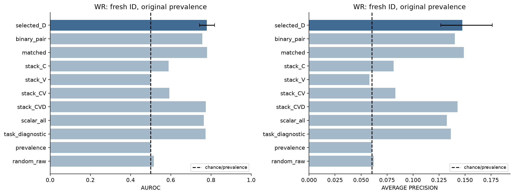

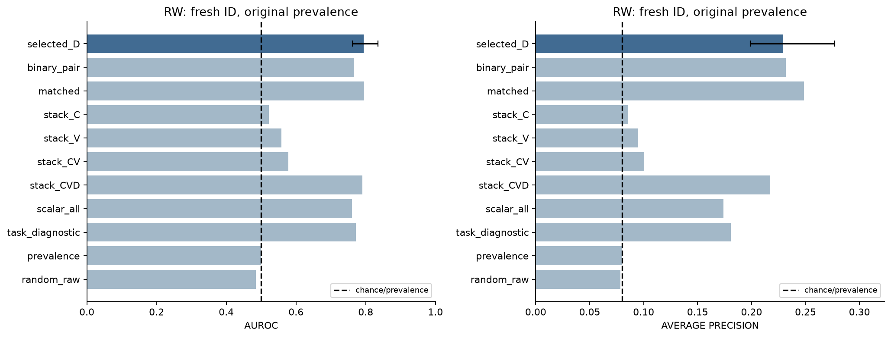

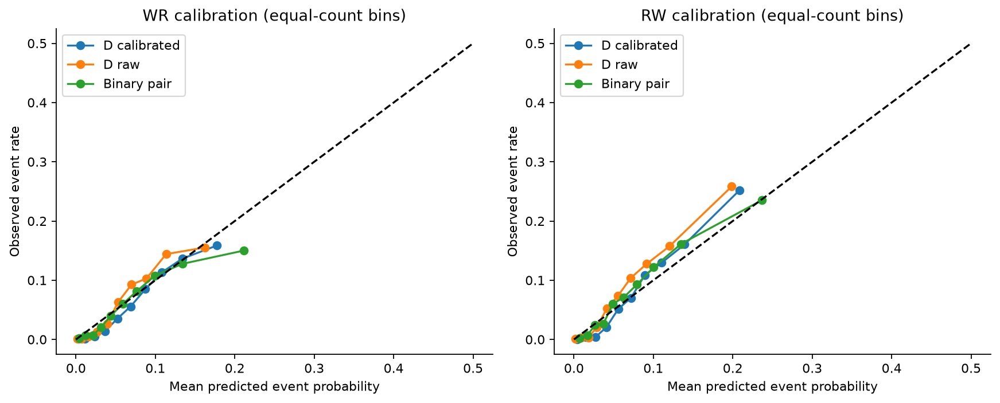

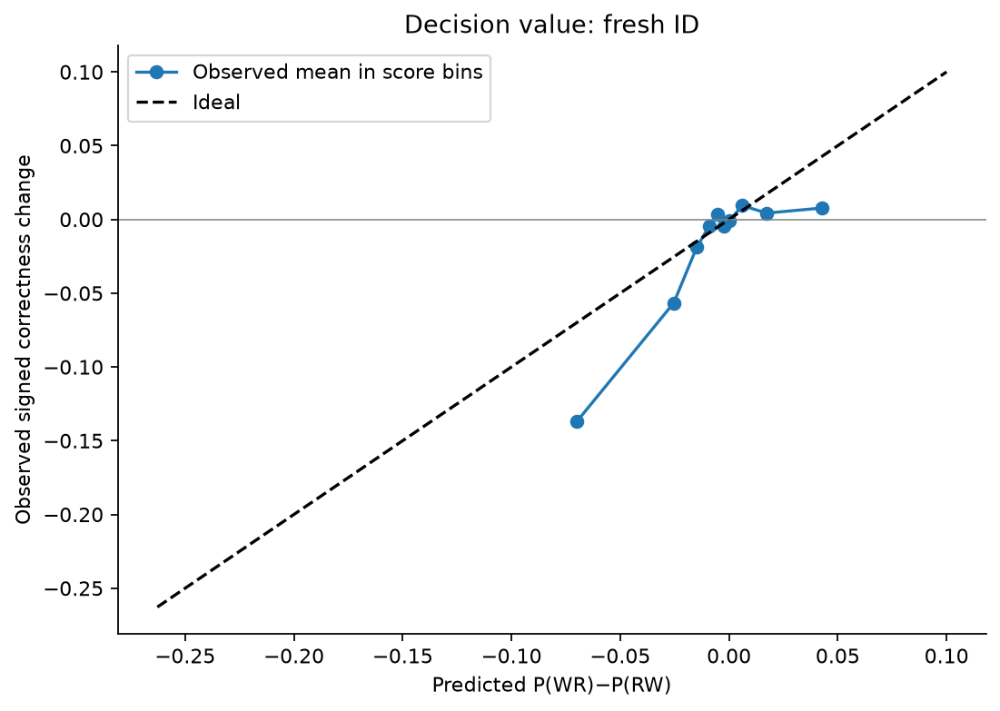

## Deployed accuracy, paid computation and selection

| System | Fresh-ID accuracy | Mean paid loops | Mean selected depth |
|---|---:|---:|---:|
| Frozen | 33.80% | 0 | 0 |
| One pass | 33.31% | 1 | 1 |
| fixed_1 + final | 34.70% | 1.000 | 1.000 |
| fixed_2 + final | 34.21% | 2.000 | 2.000 |
| fixed_3 + final | 33.98% | 3.000 | 3.000 |
| fixed_4 + final | 28.78% | 4.000 | 4.000 |
| fixed_selected + final | 34.75% | 1.333 | 1.333 |
| confidence + final | 34.70% | 1.000 | 1.000 |
| value + final | 34.70% | 1.000 | 1.000 |
| legacy_gain + final | 34.75% | 1.003 | 1.003 |
| stack_C + final | 34.70% | 1.000 | 1.000 |
| stack_V + final | 34.72% | 1.021 | 1.021 |
| stack_D + final | 34.67% | 2.097 | 2.097 |
| stack_CV + final | 34.72% | 1.020 | 1.020 |
| stack_CD + final | 34.83% | 1.045 | 1.045 |
| stack_VD + final | 34.34% | 1.608 | 1.608 |
| stack_CVD + final | 34.47% | 1.587 | 1.587 |
| d_direct + final | 34.85% | 1.673 | 1.673 |
| d_utility + final | 34.75% | 1.536 | 1.536 |
| matched_d_direct + final | 33.23% | 1.688 | 1.688 |
| fixed_4 + max_C | 34.77% | 4.000 | 2.091 |
| fixed_4 + ranker_C | 35.11% | 4.000 | 1.395 |
| fixed_4 + ranker_CV | 34.57% | 4.000 | 1.021 |
| fixed_4 + ranker_CD | 34.90% | 4.000 | 1.120 |
| fixed_4 + ranker_CVD | 35.11% | 4.000 | 1.264 |
| d_direct + max_C | 34.88% | 1.673 | 1.332 |
| d_direct + ranker_C | 35.03% | 1.673 | 1.296 |
| d_direct + ranker_CV | 34.67% | 1.673 | 1.003 |
| d_direct + ranker_CD | 34.83% | 1.673 | 1.098 |
| d_direct + ranker_CVD | 34.88% | 1.673 | 1.067 |
| stack_CVD + ranker_CVD | 34.80% | 1.587 | 1.045 |

Validation-selected combination: 34.88% at 1.567 paid loops.

| Paired comparison | Difference [95% interval], percentage points |
|---|---:|
| D_minus_frozen | +1.05 [-0.59, +2.80] |
| one_pass_minus_frozen | -0.49 [-3.22, +2.11] |
| D_minus_one_pass | +1.54 [-0.95, +3.88] |
| D_minus_fixed1 | +0.15 [-1.34, +1.44] |
| D_minus_matched | +1.62 [-0.15, +4.48] |
| D_minus_fixed_selected | +0.10 [-1.41, +1.42] |
| selector_minus_final | +0.03 [-1.13, +1.47] |
| selector_minus_max_C | +0.00 [-1.21, +0.93] |
| selector_minus_one_pass | +1.57 [-1.08, +4.06] |
| selector_minus_matched_selector | +0.18 [-0.10, +0.67] |
| fixed4_selector_minus_final | +6.33 [+2.65, +10.11] |
| fixed4_selector_minus_max_C | +0.33 [-2.01, +2.55] |
| fixed4_CVD_minus_ranker_C | +0.00 [-1.47, +1.31] |
| CVD_minus_CV | -0.26 [-1.23, +0.21] |
| oracle_gap | +4.55 [+0.00, +10.96] |

Matched controls randomize adjacent fixed depths from a stable ID hash and the adaptive mean paid depth, without labels, task identity, or per-problem controller outputs. The mean uses final paid work only as a descriptive compute match, frozen in the algorithm before final labels opened. Finite-sample realized means can differ slightly and are explicitly recorded. Controllers carry additional head/synchronization cost, so matched loops do not imply matched latency.

The best-visited oracle after D stopping reaches 39.43% at 1.673 loops; the deployable CVD selector leaves 4.55 points of that opportunity unexploited. The best-allowed four-depth oracle reaches 52.83%, charged four loops. Both use supervised correctness and are privileged diagnostics. A selected depth of two after visiting four states still costs four states.

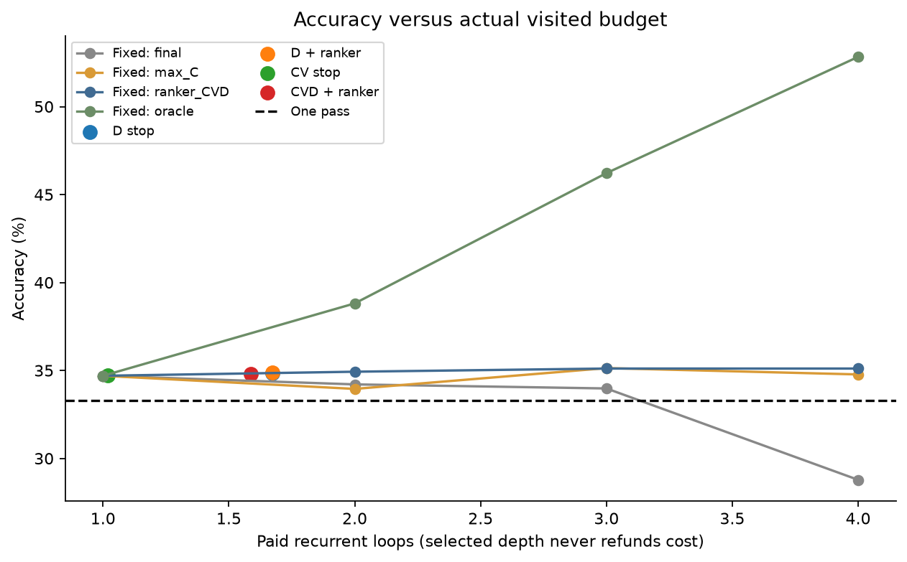

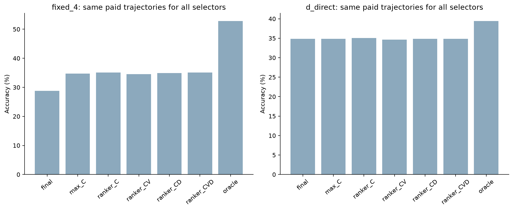

## Full native MLX timing and memory

Timing reuses 4A’s right-padded backbone, live state-feature, synchronization, and active-compaction mechanics. The measured path includes tokenization, input arrays, frozen backbone, candidate projection, needed C/V/D heads, native calibration and event policies, selector scores, host continuation barriers, final Metal synchronization, and output conversion. Model loading is excluded. Auxiliary timings start from h/base already on device. Three warmups and five repeats cover 24 task-balanced validation problems at batches 1 and 8, across three parents. Variant order is randomized; every repeat is checked against cached label-free paid/selected depths and logits. No bootstrap runs during timing.

| Variant | Full batch-1 ms/item | Full batch-8 ms/item | Auxiliary batch-1 ms | Timed paid loops |
|---|---:|---:|---:|---:|
| frozen | 24.84 | 27.11 | 0.202 | 0.000 |
| one_pass | 24.91 | 27.10 | 0.333 | 1.000 |
| fixed_1 | 24.93 | 27.04 | 0.404 | 1.000 |
| fixed_2 | 25.06 | 27.16 | 0.499 | 2.000 |
| fixed_3 | 25.10 | 27.24 | 0.612 | 3.000 |
| fixed_4 | 25.22 | 27.20 | 0.719 | 4.000 |
| confidence | 25.11 | 27.28 | 0.576 | 1.000 |
| value | 25.05 | 27.36 | 0.536 | 1.000 |
| d_direct | 25.27 | 27.33 | 0.733 | 1.736 |
| d_utility | 25.21 | 27.48 | 0.678 | 1.514 |
| stack_CV | 25.16 | 27.27 | 0.646 | 1.042 |
| stack_CD | 25.16 | 27.29 | 0.654 | 1.042 |
| stack_CVD | 25.43 | 27.34 | 0.854 | 1.625 |
| fixed_4:max_C | 25.36 | 27.20 | 1.221 | 4.000 |
| fixed_4:ranker_CVD | 25.54 | 27.21 | 1.468 | 4.000 |
| d_direct:max_C | 25.45 | 27.49 | 0.868 | 1.736 |
| d_direct:ranker_CVD | 25.57 | 27.44 | 0.961 | 1.736 |
| stack_CVD:ranker_CVD | 25.49 | 27.37 | 0.943 | 1.625 |
| validation_best | 25.28 | 27.32 | 0.707 | 1.514 |

Peak recorded Metal allocation is 3.892 GiB; peak recorded extraction/timing/report process RSS is 1.553 GiB, under the 48-GiB configurable budget. Full timing command: 486.7 seconds; final extraction: 184.2 seconds; neural fitting: 15.0 seconds. Implementation/reporting time is additional. Timed paid depths can differ from final average depths because timing uses validation examples. The accuracy-versus-latency figure therefore pairs independent final accuracy with validation latency and labels that distinction. It is not a final-set latency claim. Prompt-length distributions and native host barriers remain in the raw timing records.

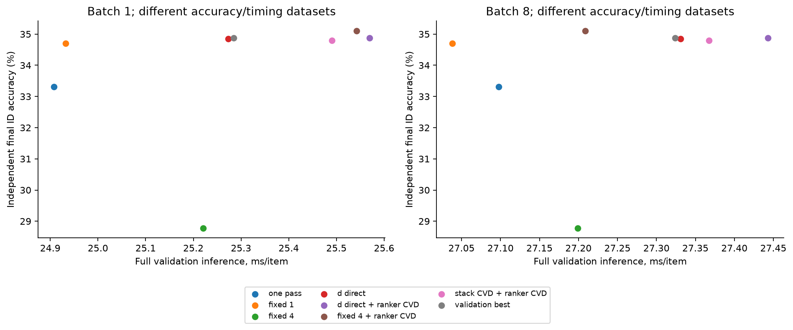

## Generalization and error analysis

| Split | Frozen | One pass | D stop | D + ranker | Paid D loops | D versus one pass [95% points] |
|---|---:|---:|---:|---:|---:|---:|
| Fresh ID | 33.80% | 33.31% | 34.85% | 34.88% | 1.673 | +1.54 [-0.95, +3.88] |
| New format | 27.78% | 27.19% | 28.03% | 28.42% | 2.069 | +0.85 [-1.18, +3.16] |
| New structure | 32.95% | 33.77% | 34.08% | 33.95% | 1.594 | +0.31 [-2.01, +2.55] |
| Harder depth | 35.03% | 32.54% | 35.52% | 35.60% | 1.583 | +2.98 [+0.23, +6.02] |
| New range | 30.17% | 31.25% | 30.53% | 31.02% | 1.575 | -0.72 [-3.19, +2.03] |

Task-level metrics, difficulty strata, transition depth, event prevalence, and all classifier/selector combinations are preserved in the per-seed JSON results. Structural and harder-depth shifts are distinct from new wording. A numerical-range split with unchanged pointer ranges should not be described as universal range robustness.

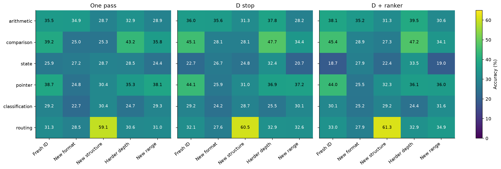

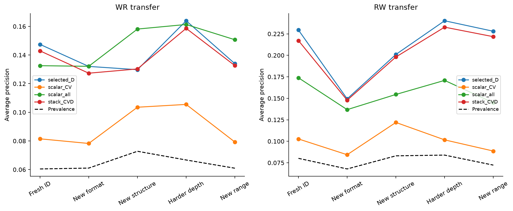

| Category | Occurrences, mean per parent | Rate | Mean C | Predicted D | Actual D | Selected depth | Paid loops |
|---|---:|---:|---:|---:|---:|---:|---:|
| A | 235.0 | 6.04% | 0.296 | -0.003 | 1.000 | 1.078 | 1.763 |
| B | 311.7 | 8.02% | 0.303 | -0.022 | -1.000 | 1.028 | 1.534 |
| C | 1334.7 | 34.33% | 0.303 | -0.002 | 0.000 | 1.053 | 1.668 |
| D | 985.0 | 25.33% | 0.306 | -0.005 | 0.000 | 1.106 | 1.813 |
| E | 41.0 | 3.16% | 0.306 | -0.009 | -1.000 | 1.029 | 1.104 |
| F | 59.3 | 4.58% | — | — | — | — | — |
| G | 50.3 | 3.88% | — | — | — | — | — |
| H | 56.7 | 4.37% | — | — | — | — | — |

A=WR; B=RW; C=WW with any positive loss gain; D=WW with any negative loss gain; E=correct stopped state whose next allowed loop would damage it; F=damage on a visited continuation; G=correct earlier state replacing wrong final visited state; H=wrong earlier state despite any correct later visited state. A–D rates divide all three eligible transitions per problem. E–H count events per problem; a problem can contain multiple F events. A–D diagnostics include unvisited transitions only offline; controller/selection remain visited-only. For G/H the D diagnostic refers to the selected state’s next eligible transition. The broad table is recomputed from frozen public traces in supplemental_analysis.json; raw per-seed metrics also preserve the meaningful ±0.01-nat C/D subgroups and the narrower wrong-earlier/correct-final H subgroup. Broad H includes later intermediate correct states even if the final answer is wrong.

All rows in this failure table refer to direct D plus the prespecified CVD ranker. Representative examples use the lexicographically earliest instance IDs within each category and parent/split, rather than choosing dramatic outcomes. Public prompts, choices, logits, correctness/loss traces, controller predictions, paid loops, selected depth, and stop/continue logs are saved in `results/experiment_04b/examples/`. They illustrate mechanisms and do not prove aggregate performance.

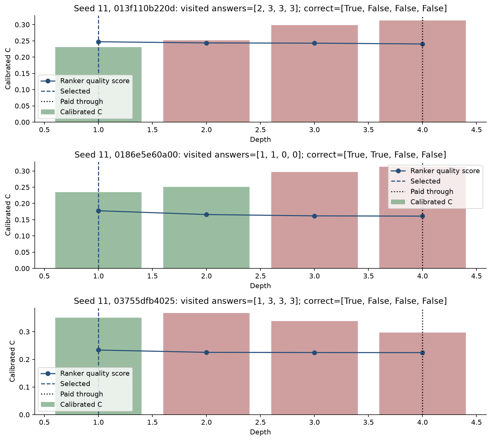

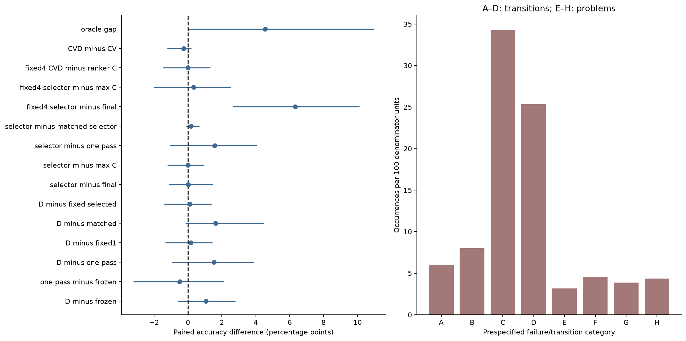

## Answers to the research questions

1. **Can D predict WR corrections?** Fresh-ID AUROC/AP is 0.779/0.147, compared with WR prevalence 0.060. WR AP versus scalar C+V: +0.07 [+0.04, +0.09] (absolute AP units).
2. **Can D predict RW damage?** Fresh-ID AUROC/AP is 0.794/0.229; prevalence is 0.080. RW AP versus scalar C+V: +0.13 [+0.10, +0.17] (absolute AP units).
3. **Beyond C and V?** Event tables compare all seven stacks; the paired CVD-minus-CV WR/RW AP differences are +0.06 [+0.03, +0.09] and +0.12 [+0.09, +0.16]. D minus the stronger scalar entropy/margin/depth/change control gives WR/RW AP differences +0.01 [-0.01, +0.04] and +0.06 [+0.01, +0.10]. The plain parameter-matched classifier is competitive; this does not establish a gated-architecture advantage. These are predictive information tests, not causal attribution.
4. **Does D stopping improve accuracy?** A fresh-ID accuracy advantage over one pass is not established by the paired interval. Difference versus one pass: +1.54 [-0.95, +3.88] points.
5. **Does it prevent harmful recurrence?** Per 1,296 fresh-ID problems (mean across parents), stopping avoids 41.0 reachable damage events and also misses 39.0 reachable corrections. Continued steps deliver 61.3 corrections and 59.3 degradations, almost cancelling. Immediate damage is protected in category E (3.16%); visited damage remains in F (4.58% occurrences per problem). Aggregate accuracy and matched controls determine utility.
6. **Can selection recover earlier answers?** Yes when category G occurs: 3.88% of problems in the primary path. It also loses a correct final answer on 3.86%. Broader category H misses a correct later visited state on 4.37%; some of those later correct states are intermediate rather than final.
7. **Does it beat the final state?** The prespecified ranker does not establish an improvement over the same visited final answer. Paired difference: +0.03 [-1.13, +1.47] points. After four paid loops, CVD ranker versus final is +6.33 [+2.65, +10.11] points; versus simple maximum-C it is +0.33 [-2.01, +2.55]. Extra V/D signals versus the equally sized C ranker give +0.00 [-1.47, +1.31] points.
8. **Does it beat one pass?** D plus ranker minus one pass is +1.57 [-1.08, +4.06] points.
9. **At matched compute?** D versus its adjacent-depth mixture is +1.62 [-0.15, +4.48] points; D plus ranker versus the mixture plus the same ranker is +0.18 [-0.10, +0.67] points. Measured full latency includes overhead.
10. **New templates and structures?** The five-split table and task heatmap report transfer without changing any threshold. Claims must be bounded by the structural and harder-depth results, not the old synthetic pilot.
11. **How close to the visited oracle?** The primary selector remains 4.55 points below its privileged visited-state oracle.
12. **What is worth retaining?** Retain the independent lockbox, transition labels, causal visited-prefix controls, grouped OOF procedure, full timing/work accounting, and simple one-pass reference. Predictive event heads merit further investigation only where their held-out signal survives strong scalar controls. Avoid adding state memory in this core study; no deployable reasoning or architectural novelty claim follows from these probes.

## Limitations and publication readiness

These are six public synthetic algorithms around one small frozen backbone and three historical refiners. Three seeds give weak estimates of training variability; the parent representations were learned on older synthetic templates. Fresh auxiliary supervision is local to the 4A training families. Conditional four-choice accuracy does not measure open-ended generation. No natural-language benchmark, new backbone scale, model retraining, learned history attention, or out-of-budget depth is tested. Utility uses a chosen normalized-loop preference, not measured latency costs. Oracle access to labels and complete future trajectories is unavailable at deployment. Selecting states is not evidence of reasoning, and better probe confidence is not necessarily better decisions.

This is ready for public review as a bounded synthetic experiment with preserved negative results and a prospective final protocol. It is not sufficient for broad language-model reasoning or architectural novelty claims. All code, recipes, public datasets, trajectory labels, prediction/policy logs, confidence intervals, figures and portable audits are included; model weights and large hidden caches remain excluded. No personal paths, credentials, private company data, or external unlicensed implementation were added.

## Reproduction

Use Python 3.12 and the pinned `requirements-lock.txt`; install the package with `pip install -e ".[apple,test]"`. A compatible 4A local workspace is required for frozen checkpoints and development hidden caches. To regenerate those from scratch, follow the preserved [4A handoff](../experiment_04a/experiment_04b_handoff.md) and its staged reproduction commands first; do not substitute consumed 4A final data for the new 4B lockbox.

```sh
.venv/bin/python -m pytest -q
LATENT_LOOP_MLX_TESTS=1 .venv/bin/python -m pytest -q
.venv/bin/python -m latent_loop.experiment04b.pipeline prepare --restart-budget
.venv/bin/python -m latent_loop.experiment04b.pipeline development --restart-budget
.venv/bin/python -m latent_loop.experiment04b.pipeline freeze
.venv/bin/python -m latent_loop.experiment04b.pipeline final --restart-budget
.venv/bin/python -m latent_loop.experiment04b.pipeline timing --restart-budget
.venv/bin/python -m latent_loop.experiment04b.pipeline report
.venv/bin/python -m latent_loop.experiment04b.pipeline verify
```

The checked-in protocol is already frozen and consumed: development refuses reselection after consumption. For an independent rerun, use a new copy/run namespace with fresh independent final seeds and new protocol manifests; keep the recorded snapshot intact. Budget restart changes only the runtime clock, never the scientific protocol. Existing completed public results can be audited and reports regenerated with CPU scientific dependencies alone; the public audit does not require weights or hidden caches. Fits verify source/config/input hashes before resume; extraction verifies dataset/model signatures, resumes batch shards, and rejects mismatched caches. Timing preserves complete batches and verifies its protocol/source/config signature on resume. Safe interrupts stop at a batch/epoch boundary. Reporting never changes frozen model or policy choices.

Portable audit rechecked 6,480 final problems, 77,760 new trajectory states, 58,320 adjacent labels, and 5,280 metric comparisons. OOF integrity, visited-state boundaries, and every stop/continue log are checked. The new exports reuse 4A’s trajectory schema; the 60,480 development states remain referenced in the compatibility audit rather than duplicated.

## Prior work and provenance

The preserved [literature review](../../docs/literature_review.md) includes [RecurTrace](https://arxiv.org/html/2609.03379v2), [Universal Transformers](https://arxiv.org/abs/1807.03819), [ACT](https://arxiv.org/abs/1603.08983), [PonderNet](https://arxiv.org/abs/2107.05407), Encode-Think-Decode, Think-at-Hard, uncertainty probes and process supervision. This continues an independent final-vector adaptation; it is not an official RecurTrace reproduction. Probability calibration follows the general post-hoc calibration question studied by [Guo et al., On Calibration of Modern Neural Networks](https://arxiv.org/abs/1706.04599); our temperature-plus-offset fit is broader than scalar temperature scaling. These citations motivate methods and do not provide empirical evidence for the present results. Qwen model provenance and Apache-2.0 terms remain in the preserved third-party license document; original code and generated synthetic artifacts use the repository MIT license.

Source measurements: [summary](../../results/experiment_04b/summary.json), [public audit](../../results/experiment_04b/public_audit.json), [latency](../../results/experiment_04b/latency.json), [protocol](../../experiments/experiment_04b/frozen_protocol.json), [dataset manifest](../../experiments/experiment_04b/dataset_manifest.json).
