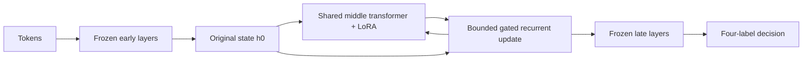
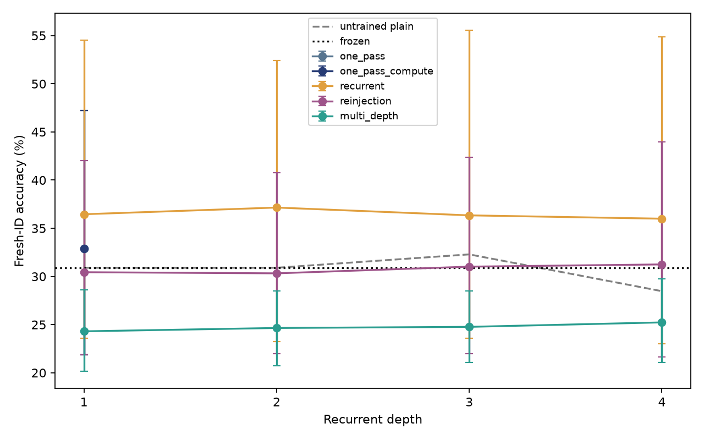
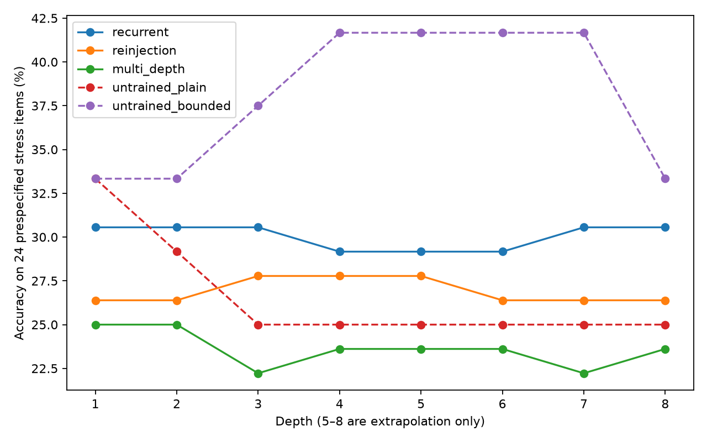
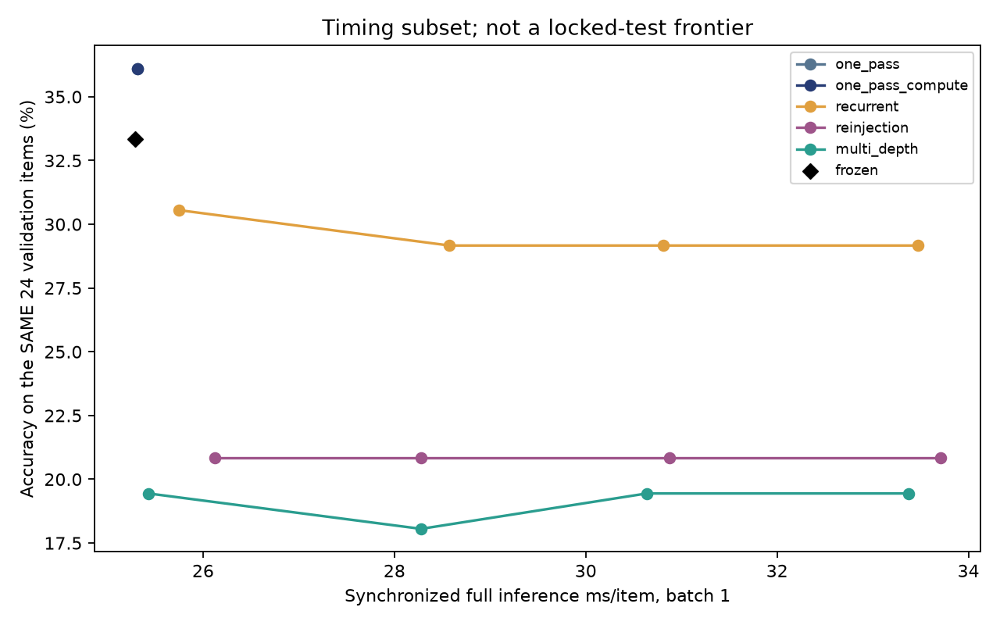
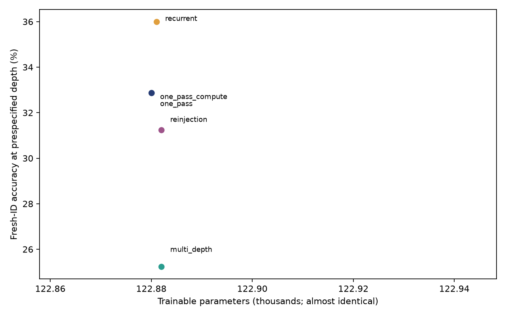
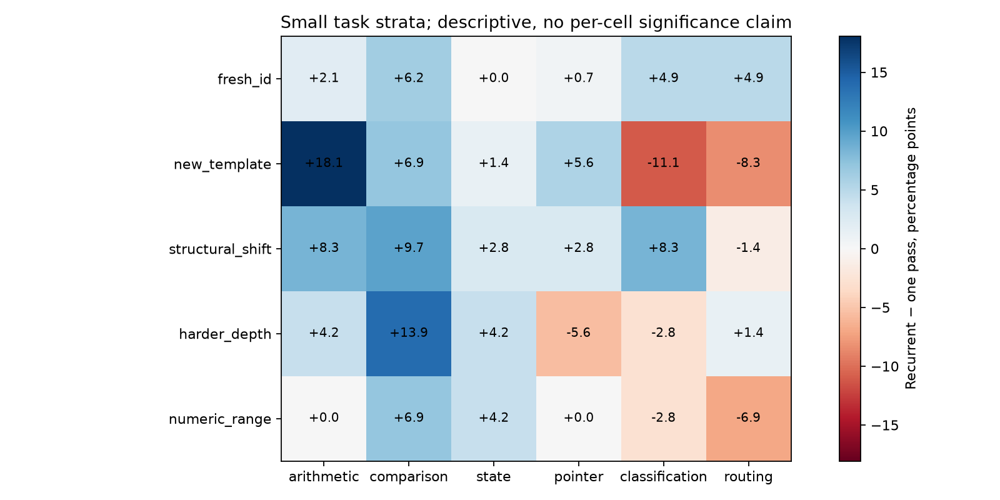
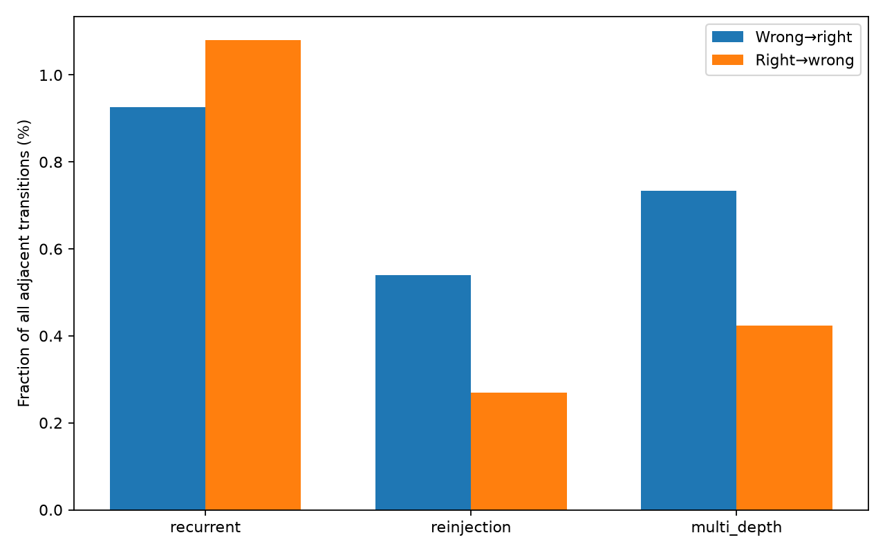
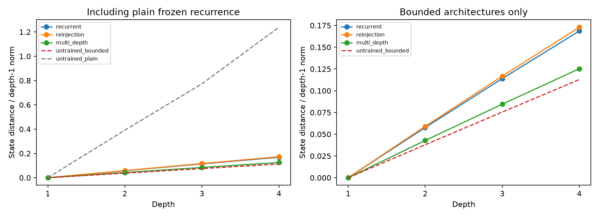
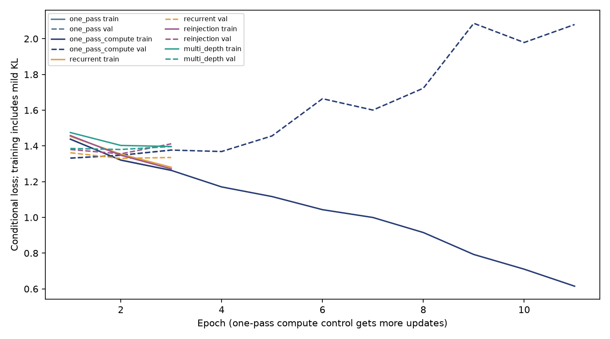

# Experiment 5 — Train the Loop, Not the Judge

## Executive summary

Trainable recurrence did not establish an accuracy advantage over the validation-selected one-pass adapter. This is the main result; better supervised loss or a favorable point estimate does not establish useful repeated reasoning.

Selected before final opening: recurrent family **recurrent**, fixed depth **4**; one-pass family **one_pass**, depth **1**. Fresh-ID accuracies are **36.00%** versus **32.87%**; paired difference **+3.13 [-2.90, +8.91] percentage points**.

Completed 15 main fits (five conditions × three seeds), plus two separate pilot fits. Seeds [11, 22, 33]. Active study time through report: 107.0 minutes, within the six-hour active budget. Calendar elapsed time: 10.44 hours, including a documented 8.66-hour session idle interval after training finished. See [budget receipt](../../experiments/experiment_05/resume_budget.json). Synchronized fitting excludes evaluation/checkpoint/report overhead. Peak MLX allocation 15.99 GiB; process RSS 1.51 GiB. All Experiment 5 work is local and excluded from the public v0.1.0 release.

The selected recurrent model scores 36.46% at depth one. Depth four minus depth one is -0.46 [-3.13, +1.50] percentage points. The simultaneous multi-depth condition scores 25.23% at depth four; its unfavorable result remains part of the main study.

## Architecture

Frozen pinned Qwen3-0.6B: 28 layers, hidden width 1,024, 16 query heads, eight KV heads, 128-dimensional attention heads, SwiGLU width 3,072, tied embeddings. These are inspected model configuration values, not loader assumptions. Early layers 0–11 feed shared middle layers 12–14, followed by late layers 15–27. Rank-8 query/value LoRA is shared across loops. All original arrays stay frozen. No final-state MLP substitutes for the recurrent transformer block.

Depth one runs the adapted block once. Later passes RMS-match the original block input to the current token state, optionally convexly reinject it with r in [0, 0.25], apply the same adapted transformer block, cap proposal norm at twice that token's depth-one norm, and mix using sigmoid(u), initialized to 0.1. Reinjection initializes to 0.05. Gates are shared global learned scalars, not input-dependent networks. This bounds growth relative to the learned first state; it does not guarantee preservation of the original model at later depths. LoRA zero-output B gives depth-one initialization parity, while the open update path permits learning.



## Research motivation

Earlier probes recognized correctness, loss gains and decision transitions, while additional recurrence often damaged answers. This experiment trains the computation itself. A gain can reflect task-specific adaptation, calibration, extra capacity or computation; shared weights and additional loops do not by themselves demonstrate reasoning.

## Differences from RecurTrace

See the [primary-source review](../../experiments/experiment_05/research_references.md). This is a small LoRA/gate study, with bounded updates and four-depth CE rather than a reproduction of loop memory, stochastic-depth large-mixture training, or halting distillation. No author implementation is copied. There is no memory or controller in the primary study.

## Training methodology

AdamW, learning rate 0.0005, decay 0.01, clipping 1, batch 4. D/E/F/G train 3 epochs. E/F uniformly sample one supervised depth 1–4 per batch; G averages equal-weight losses at all four. Configured weights are normalized by their sum. No model trains only at deepest depth. Mild KL preservation (alpha 0.02) applies only where frozen training decisions are correct, averaging zero for other examples over the full batch. Labels supervise fitting and offline metrics; the model inference API receives tokens/lengths only. Confidence increases are not rewarded independently of correctness.

The additional one-pass control receives 11 epochs, fixed before main training as ceil(3 × pilot multi-depth/one-pass batch time ratio). This approximates optimization cost, not exact FLOPs or equal wall time. Measured fit seconds are retained. It may select an earlier checkpoint; extra optimization can overfit. All conditions share initial adapter seeds, example order, rank and optimizer. Checkpoints minimize mean validation NLL over their supervised inference depths. Family selection uses mean validation NLL at the prespecified final inference depth, not final accuracy.

## Dataset methodology

Fresh 4A generators: 576 training, 144 validation, 864 prospective final problems across five splits. Six task families and nominal difficulty cells stay balanced; no poor-performing task is removed. Independent reference solvers verify labels. Public historical IDs/prompts/alpha structures and compatible original structure exclusions reject prior instances. ID/template shifts share abstract algorithms; structural shift holds out a generator per family. Static predicates do not always become deeper under nominal hard strata. Numeric-range pointer items are unchanged-range controls.

Frozen competence before fitting: training 28.30%, validation 27.08%. Several tasks remain near/below four-choice chance. This limits the study and may make calibration dominate adaptation. Final labels did not select data, hyperparameters, seeds, checkpoints, or depths.

## Causal correctness checks

Real depth-one max absolute logit error 0.00001049; trained depth-four prefix error 0.00001860. Tiny-Qwen checks compare identical prefixes with different future suffixes, truncated prefixes and repeated calls at depths 1/2/4/8. The original GQA/QK normalization/RoPE/residual behavior remains in mlx-lm. Every pass uses cache=None and the same causal positions. Only right padding is used; outputs gather the last real token. Incremental KV inference is not implemented.

## Gradient-flow verification

Rank 8 and 16 pass numerical compatibility/count checks. Initial B and gate gradients are nonzero; A is initially zero-gradient because B is zero, as expected. Shared adapters are single arrays reused at every depth, not cloned. Original frozen-weight samples remain identical after updates. Deterministic evaluation, exact real adapter reload and exact tiny-model optimizer resume passed. The complete suite has 33 passing tests with MLX integration enabled.

## Experimental configurations

| Condition | Objective / reinjection | Trainable parameters | Measured fit seconds, three seeds | Training examples/s |
|---|---|---:|---:|---:|
| one_pass | depth 1 / none | 122,880 | 316.2 | 16.39 |
| one_pass_compute | depth 1 / none | 122,880 | 1165.5 | 16.31 |
| recurrent | uniform sampled depth / none | 122,881 | 423.3 | 12.25 |
| reinjection | uniform sampled depth / learned | 122,882 | 398.4 | 13.01 |
| multi_depth | equal depths 1–4 / learned | 122,882 | 1020.5 | 5.08 |

One-pass and recurrent LoRA matrices have exactly equal capacity; recurrence adds one update scalar and gated variants add one reinjection scalar. The one-pass update scalar is frozen and excluded from trainable counts. This negligible difference is disclosed. Parameter count alone does not match inference cost.

The inspected model contains 596,172,802 parameters including rank-8 adapters and two scalar gates; rank 16 would train 245,762 parameters and was compatibility-tested only.

| Family | Mean validation NLL at prespecified depth | Best epoch per seed (one-based) |
|---|---:|---|
| one_pass | 1.328497 | 2, 1, 1 |
| one_pass_compute | 1.328497 | 2, 1, 1 |
| recurrent | 1.326089 | 2, 3, 1 |
| reinjection | 1.344127 | 2, 1, 2 |
| multi_depth | 1.380284 | 2, 2, 1 |

These validation scores, recorded before opening final data, select the reported families. Epoch selection is by NLL, so a later epoch with higher accuracy can remain unselected.

## Accuracy results

Every value below is measured on the new Experiment 5 problems. The old one-pass head is a transferred frozen historical checkpoint, not a reused historical test score.

| Split | Frozen | Old one-pass head (transfer) | Trained one pass | Extra-budget one pass | Selected recurrence, depth 4 | Difference vs selected one pass [95%], pp |
|---|---:|---:|---:|---:|---:|---:|
| fresh_id | 30.90% | 28.47% | 32.87% | 32.87% | 36.00% | +3.13 [-2.90, +8.91] |
| new_template | 31.94% | 32.41% | 27.08% | 27.08% | 29.17% | +2.08 [-6.02, +10.42] |
| structural_shift | 37.50% | 34.72% | 26.62% | 26.62% | 31.71% | +5.09 [-5.79, +16.90] |
| harder_depth | 29.86% | 32.18% | 28.01% | 28.01% | 30.56% | +2.55 [-6.95, +12.50] |
| numeric_range | 27.78% | 31.48% | 35.88% | 35.88% | 36.11% | +0.23 [-6.72, +7.18] |

The old head was trained on a different distribution, so it provides a transfer reference and cannot isolate where adaptation belongs.

| Fresh-ID paired comparison | Difference [95% interval], pp |
|---|---:|
| selected_minus_one_pass | +3.13 [-2.90, +8.91] |
| selected_minus_one_pass_compute | +3.13 [-2.90, +8.91] |
| selected_depth1_minus_one_pass_matched_inference | +3.59 [-2.44, +9.38] |
| selected_depth1_minus_one_pass_compute_matched_inference | +3.59 [-2.44, +9.38] |
| selected_minus_frozen | +5.09 [-10.30, +22.92] |
| selected_depth4_minus_depth1 | -0.46 [-3.13, +1.50] |
| selected_minus_untrained_plain | +7.52 [-7.76, +25.69] |
| selected_minus_untrained_bounded | +5.44 [-10.53, +23.62] |

| Training seed | One pass | Selected recurrence, depth 1 | Selected recurrence, depth 4 |
|---|---:|---:|---:|
| 11 | 26.04% | 25.00% | 25.00% |
| 22 | 48.61% | 55.56% | 55.90% |
| 33 | 23.96% | 28.82% | 27.08% |

Intervals jointly resample three training seeds and the same unique problem indices across all conditions/depths; repeated depths stay clustered. The 288 fresh-ID problems are not 864 independent seed examples. Intervals condition on this training/validation set and the frozen selection. Three seeds and small task strata limit power; multiple comparisons have no multiplicity adjustment. Shift results are secondary. Depth-one comparisons match the forward architecture and parameter budget, testing variable-depth training effects without additional inference recurrence; they are secondary descriptive controls, not the primary hypothesis. Conditional option NLL is not language-model perplexity or free generation accuracy.

| Fresh-ID system / depth | Accuracy | NLL | ECE | Brier |
|---|---:|---:|---:|---:|
| one_pass / 1 | 32.87% | 1.3391 | 0.0589 | 0.7216 |
| one_pass_compute / 1 | 32.87% | 1.3391 | 0.0589 | 0.7216 |
| recurrent / 1 | 36.46% | 1.2975 | 0.0537 | 0.6971 |
| recurrent / 2 | 37.15% | 1.2967 | 0.0606 | 0.6965 |
| recurrent / 3 | 36.34% | 1.2964 | 0.0571 | 0.6964 |
| recurrent / 4 | 36.00% | 1.2965 | 0.0537 | 0.6969 |
| reinjection / 1 | 30.44% | 1.3533 | 0.0573 | 0.7299 |
| reinjection / 2 | 30.32% | 1.3515 | 0.0558 | 0.7288 |
| reinjection / 3 | 31.02% | 1.3501 | 0.0635 | 0.7279 |
| reinjection / 4 | 31.25% | 1.3490 | 0.0677 | 0.7272 |
| multi_depth / 1 | 24.31% | 1.3988 | 0.0535 | 0.7561 |
| multi_depth / 2 | 24.65% | 1.3989 | 0.0493 | 0.7561 |
| multi_depth / 3 | 24.77% | 1.3989 | 0.0473 | 0.7560 |
| multi_depth / 4 | 25.23% | 1.3989 | 0.0438 | 0.7559 |

## Recurrence depth results



The selected depth is fixed at four before final opening. Every trained depth is reported; the highest final point is not a newly selected inference policy. Adjacent paired differences are stored for each family. Eight-loop results below use only 24 prespecified balanced items and are extrapolation diagnostics, never selection data.



## Compute comparisons

Full tokenization, padded input arrays, encoder, shared recurrent middle block, late decoder, four-label projection, Metal synchronization and host output conversion; model loading excluded

| System | Depth | Batch-1 ms/item | Batch-8 amortized ms/item |
|---|---:|---:|---:|
| frozen | 1 | 25.29 | 24.30 |
| one_pass | 1 | 25.32 | 24.17 |
| one_pass_compute | 1 | 25.31 | 24.23 |
| recurrent | 1 | 25.74 | 24.73 |
| recurrent | 2 | 28.58 | 27.16 |
| recurrent | 3 | 30.81 | 29.70 |
| recurrent | 4 | 33.47 | 32.27 |
| reinjection | 1 | 26.12 | 25.30 |
| reinjection | 2 | 28.28 | 27.01 |
| reinjection | 3 | 30.87 | 30.33 |
| reinjection | 4 | 33.71 | 32.93 |
| multi_depth | 1 | 25.43 | 24.63 |
| multi_depth | 2 | 28.28 | 26.83 |
| multi_depth | 3 | 30.64 | 29.16 |
| multi_depth | 4 | 33.38 | 31.68 |

For the selected recurrent family, depth four adds 7.73 ms per batch-one request over depth one (1.30× latency). Only the requested depth is decoded during timing; recording all four analysis outputs is excluded. Every timing group also has one untimed reference call for exact repetition checks.

Timing uses 24 validation prompts, batches 1/8, 2 warmups and 3 synchronized repeats, three seeds, and randomized condition order. Condition runs remain sequential, so between-run thermals/load are not fully controlled. Batch-8 amortization measures throughput; variable prompt lengths add padding work. Model load is excluded. This is full four-candidate decision inference, not open-ended generation with a full-vocabulary output projection. The latency figure uses accuracy on the **same timed validation items**, not final accuracy from different prompts. Matrix FLOPs are not used to claim speedups.





## Generalization



All families, nominal strata, withheld structural approaches and numeric shifts remain in the public summary. Cells contain few examples and are descriptive. Added compute, calibrated answer probabilities, memorized templates, or task-specific readouts remain alternative explanations for any accuracy gain.

| Fresh-ID nominal difficulty | Selected one pass | Selected recurrence, depth 4 |
|---|---:|---:|
| easy | 32.64% | 37.15% |
| moderate | 36.46% | 35.42% |
| hard | 29.51% | 35.42% |

Difficulty is a predefined generator descriptor, not an independently established reasoning-depth scale. Harder-depth shift and every task family are also reported without filtering.

## Corrected/degraded decision analysis

| Family | W→R rate [95%] | R→W rate [95%] | W→R given wrong | R→W given right |
|---|---:|---:|---:|---:|
| recurrent | +0.93 [+0.00, +1.81]% | +1.08 [+0.00, +2.08]% | 1.46% | 2.95% |
| reinjection | +0.54 [+0.00, +1.62]% | +0.27 [+0.00, +0.93]% | 0.78% | 0.88% |
| multi_depth | +0.73 [+0.12, +1.62]% | +0.42 [+0.00, +1.08]% | 0.97% | 1.73% |

Rates cover three adjacent recurrent transitions per problem, retaining their dependence in bootstrap. Initial frozen→trained-depth-one transitions are reported separately as adaptation, not evidence for additional loops. WW/RR, loss, correct-answer probability, confidence, margin, entropy, state distance and norm are recorded per example/depth. No labels or future states enter inference.





The bounded untrained control helps inspect stabilization from the cap and gated update. It uses fixed 0.05 reinjection and therefore matches the gated families' initialization more closely than the selected no-reinjection model. Differences against the latter do not isolate adaptation alone. Small state drift does not demonstrate better decisions.

## Failure analysis

Trainable recurrence did not establish an accuracy advantage over the validation-selected one-pass adapter. This is the main result; better supervised loss or a favorable point estimate does not establish useful repeated reasoning.

Low backbone competence and CE near the four-choice uniform baseline restrict interpretation. A lower NLL may largely soften incorrect overconfident decisions. Norm bounds prevent unbounded growth but can also restrict useful adaptation; first-state norms are learned and do not guarantee closeness to the original model. Validation-selected models can generalize poorly from 144 items. Reinjection ablations below use the same trained weights, so they are diagnostics rather than independently fitted causal comparisons.

| Family | Learned gate depth-4 accuracy | Fixed gate ablation | No reinjection ablation |
|---|---:|---:|---:|
| reinjection | 31.25% | 31.25% | 31.25% |
| multi_depth | 25.23% | 25.23% | 24.88% |

Exploratory answer-position diagnostic, specified during validation before final opening: a constant prior fitted solely from training labels achieves 23.96% fresh-ID accuracy and NLL 1.3936. Uniform four-option CE is 1.3863. The prior does not select any trained model.

| Fresh-ID family at reported depth | Prediction frequencies A/B/C/D (%) | Mean option entropy (nats) | Accuracy SD across seeds, pp |
|---|---|---:|---:|
| one_pass | 5.0 / 28.7 / 32.6 / 33.7 | 1.3169 | 13.67 |
| one_pass_compute | 5.0 / 28.7 / 32.6 / 33.7 | 1.3169 | 13.67 |
| recurrent | 8.0 / 16.6 / 46.4 / 29.1 | 1.2224 | 17.27 |
| reinjection | 1.9 / 7.2 / 52.8 / 38.2 | 1.3385 | 11.74 |
| multi_depth | 0.0 / 0.7 / 44.7 / 54.6 | 1.3730 | 0.53 |

| Family | Selected update gates by seed | Selected reinjection gates by seed | Median / maximum gradient norm before clipping |
|---|---|---|---|
| one_pass | — / — / — | — / — / — | 1.637 / 52.260 |
| one_pass_compute | — / — / — | — / — / — | 1.884 / 79.036 |
| recurrent | 0.1012 / 0.1011 / 0.1019 | — / — / — | 0.893 / 24.610 |
| reinjection | 0.1016 / 0.1007 / 0.1041 | 0.0511 / 0.0516 / 0.0497 | 1.823 / 26.520 |
| multi_depth | 0.1010 / 0.1006 / 0.1038 | 0.0511 / 0.0511 / 0.0505 | 0.770 / 15.756 |

Gate values and nonzero saved LoRA B norms are checkpoint measurements. A gate staying near initialization is a limitation to investigate, not proof that it caused a failure. All reported gradients were clipped to norm one before the optimizer update.



## Limitations

Checkpoint and family selection by NLL can favor calibrated probabilities over decision accuracy. That criterion was preserved after final opening; this study does not evaluate final accuracy of unselected checkpoints.

This is a completed small controlled study, not an exhaustive hyperparameter sweep or broad reasoning benchmark. Only rank-8 attention adapters, one block, three short main epochs, one optimizer schedule and few synthetic instances were tested. The additional one-pass control uses approximate training-cost matching; exact hardware budgets differ. A fixed-depth compute control is also available by comparing the same adapted model at depths 1–4, but there is no separate larger nonshared backbone. No full-model fine-tuning, natural task suite, incremental cache optimization, controller retraining, trajectory objective or loop memory was run. Saved weights and large hidden arrays remain ignored. The preserved historical release and reports are unchanged.

## Future work

Use a larger fresh training/validation set and a separately reported diagnostic task mixture where the frozen representation has intermediate competence. Retain the original hard mixture as primary. Test longer training and a small gate-strength ablation before investing in memory/halting. Compare against matched one-pass optimization, and require paired structural-transfer evidence before attributing gains to recurrence. Old C/V/D probes are not assumed compatible with the newly trained states; transfer/recalibration is deferred until useful fixed-depth computation is established. This experiment prioritizes the thinker.

## Reproduction and local status

Verified Python 3.12.15, MLX 0.32.3, mlx-lm 0.32.0, FP32 on Apple Silicon. [Exact dependency versions](../../results/experiment_05/runtime_environment.json) include the clean CPU report environment, which has no MLX installed.

```sh
LATENT_LOOP_MLX_TESTS=1 .venv/bin/python -m pytest -q
.venv/bin/python -m latent_loop.experiment05.validate
.venv/bin/python -m latent_loop.experiment05.train pilot
.venv/bin/python -m latent_loop.experiment05.train main
.venv/bin/python -m latent_loop.experiment05.evaluate freeze
.venv/bin/python -m latent_loop.experiment05.evaluate final
.venv/bin/python -m latent_loop.experiment05.evaluate timing
.venv/bin/python -m latent_loop.experiment05.report
```

The completed config/protocol is consumed: fitting refuses after final opening. Use a new independent namespace, fresh seeds/runtime clock and manifests for a new experiment, rather than overwriting these files. CPU report regeneration reads saved measurements without MLX. Training resumes adapter/optimizer checkpoints and deterministic batch/depth schedules after safe interruptions. Source/config/data hashes reject incompatible resume. No Experiment 5 commit is pushed. Public v0.1.0 is `0a637eb97d66eebbd740b612ab92e9095c496931`.

[Protocol](../../experiments/experiment_05/frozen_protocol.json) · [Dataset manifest](../../experiments/experiment_05/dataset_manifest.json) · [Summary](../../results/experiment_05/summary.json) · [Public audit](../../results/experiment_05/public_audit.json) · [Primary references](../../experiments/experiment_05/research_references.md)
