# Experiment 5.1 — Think Again: learning to navigate

## Executive summary

**A tiny learned grid network makes better decisions after more internal updates over an unchanged board.** The validation-selected `rec_simultaneous` reaches 61.83%, 86.00%, 98.28%, and 99.56% at loops 1/2/4/8 on 600 new balanced-ID layouts, averaged over seeds 11/22/33. The prespecified primary depth-4 minus depth-1 difference is **+36.44 pp [+32.55, +40.50]**. Secondary improvements occur from 1→2 and 2→4 too. Full-maze completion rises from 23.89% at one loop to 75.00% at four and 98.33% at eight on 60 independent starting mazes.

**A recurrence advantage over ordinary deeper feedforward computation is not established.** At four hops, recurrent minus validation-selected same-width feedforward accuracy is -0.06 pp [-0.89, +0.83]. The recurrent model has 18,884 parameters versus 74,660 for the same-width four-block control; the narrower four-block control has 18,900. Extra spatial computation is useful; weight sharing is an efficient parameterization, with no established accuracy superiority or measured speedup claim. The eight-loop result is a prespecified secondary comparison for a model trained at eight, not a final-selected deployment depth.

This is a small synthetic spatial-planning study, independent of pretrained language-model reasoning. Qwen findings are reported separately below. Snake completed a separate prospective learned-policy comparison after its initial simulator smoke. All work remains local pending review; public v0.1.0 is unchanged.

## Motivation and architecture

[Experiment 5](../experiment_05/train_the_thinker.md) trained shared Qwen middle layers but did not establish reliable gains from extra depth. Here local message passing supplies a concrete computational mechanism: a goal signal can travel at most one free-space edge per loop. Internal loops do not move the agent or reveal new observations.

Track A uses four channels (wall/free/agent/goal), a pointwise width-32 encoder, shared cardinal-neighbor gated updates, and a pointwise action head at the agent cell. Each update uses separate north/east/south/west states, original pointwise encoding, sigmoid reset/update gates, layer normalization and a tanh candidate. Hidden states on walls are zero. Convex gated updates keep states bounded; no global pooling, coordinates, distance inputs, visible reasoning tokens or across-action memory are used. Gates are open at initialization. The observation and original encoding remain unchanged throughout a decision. Models reset state at each environment action.

This is a GRU-style local message-passing network, not a handcrafted BFS update. A separate deterministic one-hop min-plus propagation reference converges to exact BFS distances and is reported as a privileged classical algorithm, never a learned-model input. It reads the same public board, with an explicit Manhattan fallback before propagation reaches the agent. Track A is not a RecurTrace reproduction. Track B reuses Experiment 5's frozen Qwen3-0.6B, shared middle layers 12–14 and rank-8 q/v LoRA; unlike loop-time-memory architectures, neither track uses explicit history attention or adaptive halting.

## Dataset and supervision

Training contains 3,600 independent 5×5 wall layouts; validation 600. Final sets: balanced ID 600, natural occupancy 600, connected-growth structural shift 360, 7×7 360, denser walls 360, and longer 7×7 paths 360. Each starts at a distinct nonterminal, solvable agent/goal placement. Four actions have explicit N/E/S/W coordinates. Boundaries/walls leave the maze agent in place with a penalty. Every equally optimal first move is accepted. Loss is negative log total probability of the optimal-action set; no arbitrary tie-breaking label is learned. BFS maps supervise and score only; deployed learned policies receive four observation channels, never labels/maps/paths. No legality mask hides invalid predictions.

The six balanced nominal families are straight corridors, one/two turns, misleading greedy moves, return-through-agent dead-end branches, multiple routes, and initial-away long detours. Families can overlap semantically. Actual BFS length, Manhattan distance, detour ratio, cycle rank, legal moves, trap membership and first-action regret are retained. In an undirected unweighted maze, a wrong legal first move has regret 2; this metric does not measure the entire cost of exploring a trap. Traps are branches requiring a return through the current cell, not necessarily single leaves.

D4-canonical WALL-LAYOUT hashes reject rotations/reflections and any other start/goal placement of a previously used layout across all splits. This is stricter than exact observation deduplication. Structural shift uses connected frontier growth rather than independent occupancy. Density shift changes wall probability from 0.30 to 0.44. Larger boards are processed at native 7×7 resolution. Long-path evaluation requires BFS distance ≥10. The natural split is unfiltered beyond solvability and layout exclusion; its task/action prevalence is retained. Balanced accuracy is a diagnostic benchmark, not a claim about natural prevalence. Training optimal-action membership counts N/E/S/W are 1026/1045/1053/1011, with ties counted for every acceptable action; exact equality is not claimed.

Difficulty is imperfect: 46.8% of training Level-5 examples have one legal move, so they require no first-action planning. On balanced final ID, all 71 single-legal examples are correct at every depth; the 529 branching examples improve from 56.71% to 98.05%. The 200 branching-detour examples improve from 42.67% to 96.50%; paired +53.83 pp [+45.50, +62.00]. These descriptive strata overlap and were not used for checkpoint selection.

## Training, causal checks and prospective evaluation

All seven grid conditions use 20 epochs, batch 64, AdamW 0.001, decay 0.0001, clip 1, three seeds. Final4 trains only depth 4; variable samples 1/2/4/8 uniformly per batch; simultaneous averages their set losses; curriculum stages families 0–1/depth1, then 0–3/depth1–2, then all/depth1–2–4. The curriculum samples its eligible pool with replacement to retain batch count; exposure frequencies differ. Checkpoints minimize depth-4 validation set loss (depth1 for one-pass). Simultaneous training was best on mean validation depth-4 accuracy and selected before final opening. Its success here contrasts with the failed simultaneous condition in Experiment 5; this is architecture/task-specific evidence.

The [frozen protocol](../../experiments/experiment_05b/frozen_protocol.json) records code/config/data/checkpoint hashes and validation choices. It froze at `2026-10-09T12:55:19.318594+00:00`; final opening is separately recorded. Primary comparison is depth4−depth1 for the selected recurrent objective; 2−1, 4−2, other objectives, shifts, and eight loops are secondary/descriptive. No final depth, checkpoint or architecture was reselected. Fixed-depth full rollouts reset hidden state, commit one action after k internal loops, then observe the new board. Step budget is max(24,4×optimal starting distance), fixed before evaluation.

Tests verify BFS against independent Floyd–Warshall distances, full optimal sets, illegal/terminal actions, D4 exclusion, exact local receptive fields, no environment mutation, zero wall states, nonzero finite gradients, deterministic depth evaluation, exact weight and optimizer restoration, and native larger-grid shapes. Real Qwen checks confirm depth-one parity, no future-token leakage, fixed-position full-prefix recomputation with cache=None, open-gate adapter gradients and exact checkpoint restoration. All original weights remain frozen. First-pass LoRA-A gradients can be zero because LoRA-B initializes to zero; LoRA-B and the recurrent gate receive gradients. Gradient-conflict diagnostics compare raw per-depth gradients on 64 training examples, before/after training, all seeds; no final labels influence fitting.

Intervals resample paired independent maze layouts and training seeds (2,000 crossed bootstrap replicates). Repeated depths share each item, and 3×600 is not 1,800 independent mazes. Rollout uncertainty clusters whole initial episodes; individual action steps are never independent samples. Only three seeds and unadjusted secondary comparisons limit inference. Descriptive activation cases, goal interventions and rotation diagnostics were produced after evaluation with fixed models.

## Accuracy, extra depth and negative variants

| Condition | Trainable parameters | Loop 1 | Loop 2 | Loop 4 | Loop 8 |
| --- | --- | --- | --- | --- | --- |
| Recurrent: final-4 | 18884 | 50.22% | 81.83% | 98.06% | 91.78% |
| Recurrent: variable | 18884 | 61.39% | 85.22% | 97.78% | 99.28% |
| Recurrent: curriculum | 18884 | 61.72% | 85.22% | 98.28% | 96.06% |
| Recurrent: simultaneous | 18884 | 61.83% | 86.00% | 98.28% | 99.56% |
| One-hop feedforward | 18884 | 61.00% | — | — | — |
| Four-hop FF, parameter matched | 18900 | — | — | 97.72% | — |
| Four-hop FF, same width | 74660 | — | — | 98.33% | — |

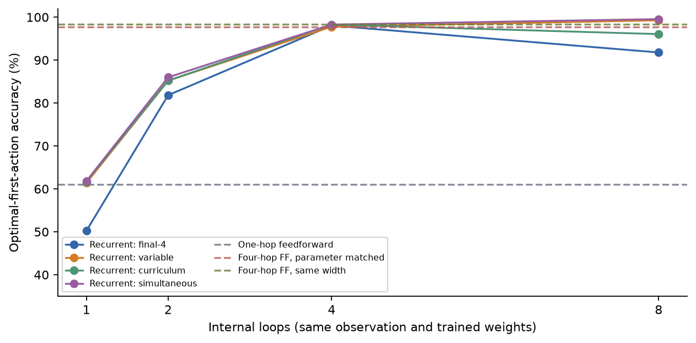

Selected-condition seed-level accuracy (the same 600 test layouts):

| Seed | Loop 1 | Loop 2 | Loop 4 | Loop 8 | Four-hop FF |
| --- | --- | --- | --- | --- | --- |
| 11 | 62.83% | 85.00% | 98.33% | 99.33% | 98.33% |
| 22 | 62.67% | 86.33% | 98.33% | 99.83% | 98.83% |
| 33 | 60.00% | 86.67% | 98.17% | 99.50% | 97.83% |

Static feedforward controls have one or four distinct blocks; nonexistent recurrent depths are marked —. One-hop matches the recurrent parameter count exactly; four-hop width16 differs by only 16 parameters. Same-width four-hop has identical local computation structure with untied weights, four times as many update parameters. No full-board global CNN or eight-block untied control was trained.

Recurrent4 minus the 18,900-parameter narrow four-block control is +0.56 pp [-0.50, +1.67] (secondary). Its interval also includes zero.

| Classical reference | Balanced-ID first-action accuracy |
| --- | --- |
| BFS oracle | 100.00% |
| Greedy Manhattan | 67.67% |
| Local min-plus propagation 1 steps + Manhattan fallback | 67.67% |
| Local min-plus propagation 2 steps + Manhattan fallback | 69.17% |
| Local min-plus propagation 4 steps + Manhattan fallback | 76.00% |
| Local min-plus propagation 8 steps + Manhattan fallback | 97.17% |

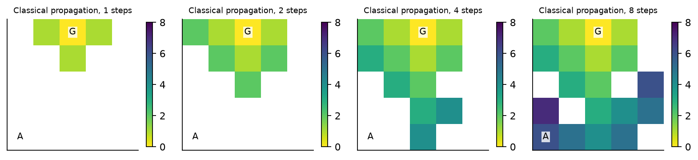

Classical maps above are a deterministic reference on the demonstration board, not learned activations or inference features. White cells include unreached cells/walls.

| Depth comparison | Paired accuracy difference, 95% CI | Wrong→right, all items | Right→wrong, all items |
| --- | --- | --- | --- |
| 1->2 | +24.17 pp [+19.67, +28.50] | 30.28% | 6.11% |
| 2->4 | +12.28 pp [+9.83, +15.17] | 12.89% | 0.61% |
| 1->4 | +36.44 pp [+32.55, +40.50] | 37.50% | 1.06% |
| 4->8 | +1.28 pp [+0.50, +2.17] | 1.44% | 0.17% |

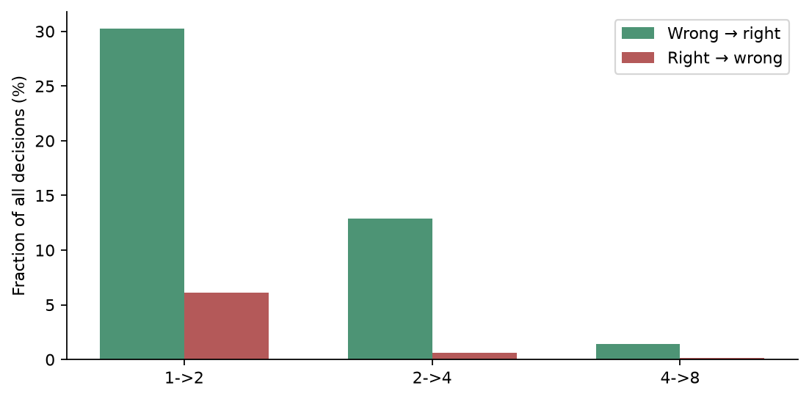

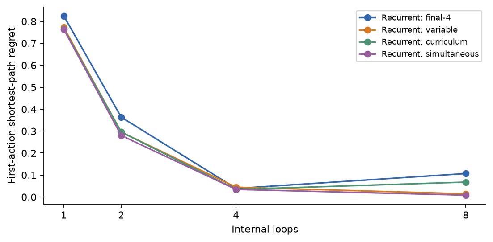

At 1→4, conditional correction among previously wrong predictions is 98.25%; conditional degradation among previously right predictions is 1.71%. Fractions in the table use all paired items and have different denominators. For the selected model, first-action regret at 1/2/4/8 is 0.7633 / 0.2800 / 0.0344 / 0.0083. Calibration ECE is 0.0381 / 0.0318 / 0.0199 / 0.0135. Accuracy, confidence calibration and set loss remain distinct.

Final-depth-only training extrapolates poorly: its fresh-ID accuracy falls from 98.06% at four loops to 91.78% at eight, and long-path accuracy falls to 72.78%. More iterations are not automatically useful. Variable/simultaneous objectives train explicitly at eight; their eight-loop results are within trained budgets. Curriculum and final4 eight-loop results are extrapolation. No distance-map auxiliary loss was needed or used.

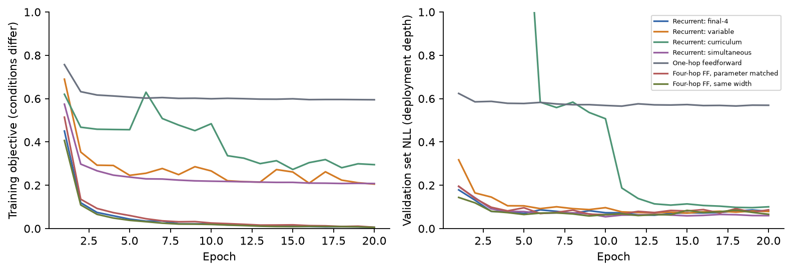

## Difficulty and generalization

| Nominal family | Loop 1 | Loop 2 | Loop 4 | Loop 8 |
| --- | --- | --- | --- | --- |
| 0 | 75.67% | 96.33% | 100.00% | 100.00% |
| 1 | 71.00% | 80.00% | 97.33% | 98.33% |
| 2 | 39.33% | 86.33% | 97.67% | 99.33% |
| 3 | 45.00% | 76.67% | 98.00% | 100.00% |
| 4 | 67.00% | 85.67% | 98.67% | 100.00% |
| 5 | 73.00% | 91.00% | 98.00% | 99.67% |

| Split | Loop 1 | Loop 2 | Loop 4 | Loop 8 | Four-hop FF | Rec4 minus FF4, 95% CI |
| --- | --- | --- | --- | --- | --- | --- |
| fresh_id | 61.83% | 86.00% | 98.28% | 99.56% | 98.33% | -0.06 pp [-0.89, +0.83] |
| natural | 72.94% | 89.56% | 98.11% | 99.83% | 98.00% | +0.11 pp [-0.83, +1.00] |
| structure | 64.54% | 91.94% | 99.17% | 99.91% | 99.54% | -0.37 pp [-1.39, +0.56] |
| larger | 58.15% | 78.89% | 91.94% | 97.78% | 91.02% | +0.93 pp [-1.94, +3.89] |
| dense | 65.74% | 87.69% | 98.70% | 99.72% | 98.43% | +0.28 pp [-0.83, +1.39] |
| long_paths | 70.37% | 81.11% | 91.30% | 94.35% | 91.39% | -0.09 pp [-2.22, +2.04] |

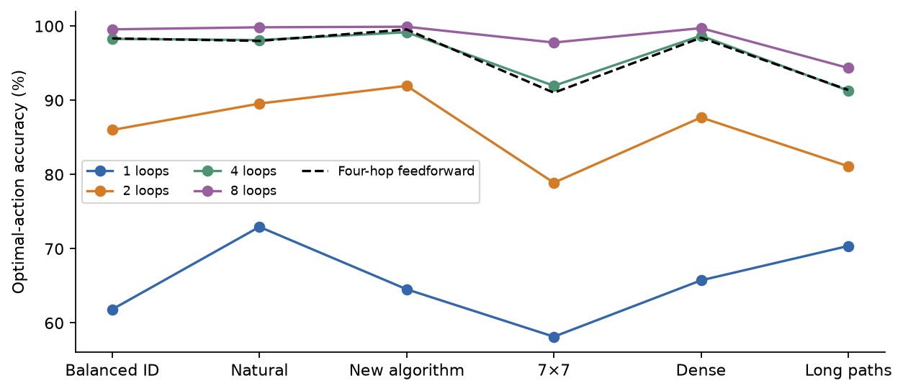

Depth gains persist on new wall layouts, new start/goal placements, denser walls and a different generation algorithm. Larger/longer layouts reduce accuracy. Improvements are particularly large for branching detours, but the path-length strata are not monotonic evidence of abstract reasoning difficulty. Explicit D4 robustness diagnostics evaluate eight views of each of 120 final layouts; these are correlated views, not 960 independent mazes. No transformed copy crosses a training/validation/final boundary.

## Full maze gameplay

| Split (60 mazes) | 1 loop | 2 loops | 4 loops | 8 loops | Four-hop FF | Greedy |
| --- | --- | --- | --- | --- | --- | --- |
| fresh_id | 23.89% | 46.67% | 75.00% | 98.33% | 73.33% | 53.33% |
| natural | 39.44% | 70.56% | 95.00% | 98.89% | 93.89% | 85.00% |
| structure | 26.11% | 52.78% | 84.44% | 99.44% | 87.22% | 58.33% |
| larger | 9.44% | 24.44% | 57.78% | 95.00% | 56.67% | 48.33% |
| long_paths | 0.00% | 0.00% | 8.89% | 54.44% | 11.11% | 11.67% |

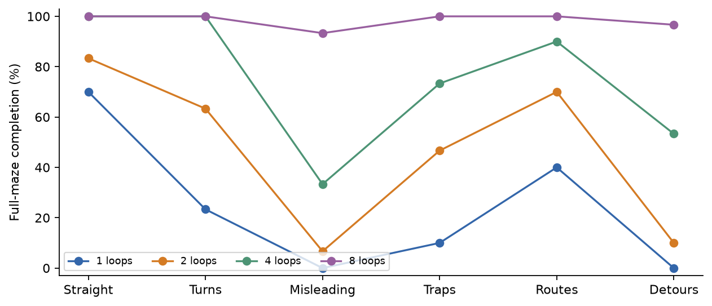

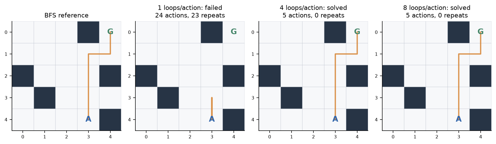

Single-step accuracy substantially overstates full-game reliability. Four-loop mistakes often produce stable repeated-position cycles; a stateless deterministic policy cannot recover without a decision changing. Long-path eight-loop completion remains only 54.44% despite high first-action accuracy. Saved trajectories include invalid actions, positions, step/optimal ratios, repeated positions, episode inference time and success/failure. Example figures are illustrative selected cases, not aggregate evidence.

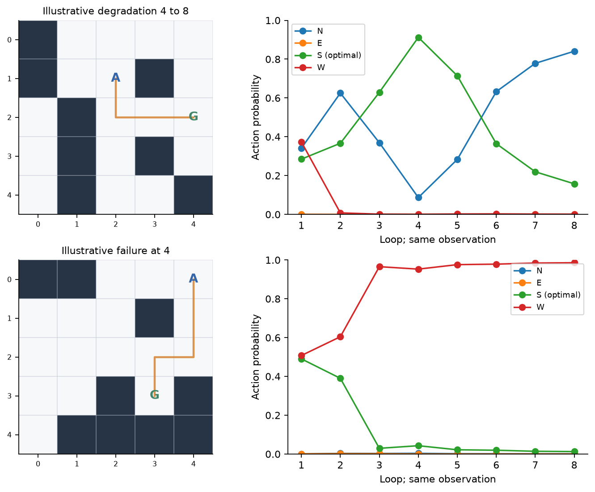

Whole-episode paired balanced-ID completion differences are +51.11 pp [+40.00, +62.78] for four versus one loop, and +1.67 pp [-3.89, +8.33] for four-loop recurrence versus four-block feedforward. These use 60 episode clusters and three seeds, not individual navigation steps.

## What the hidden computation contains

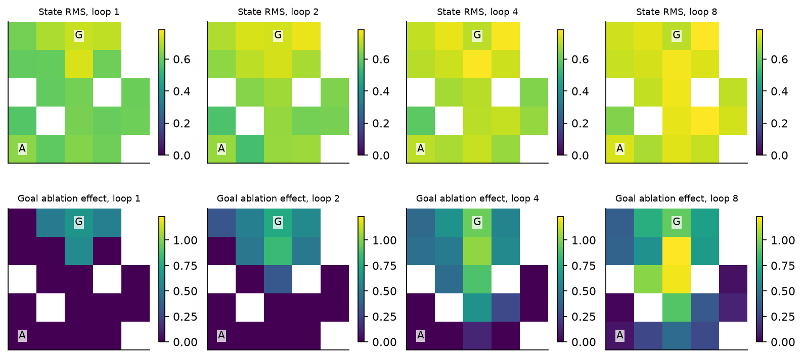

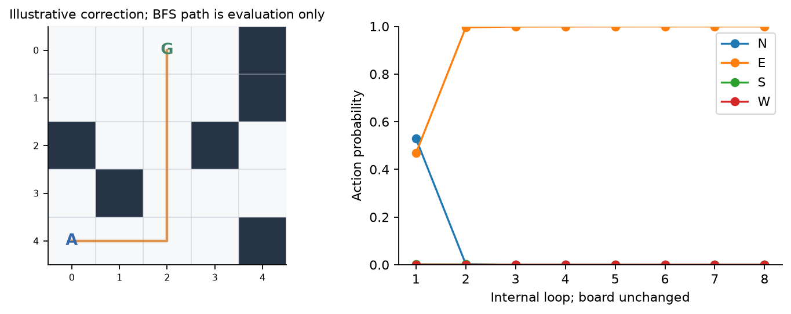

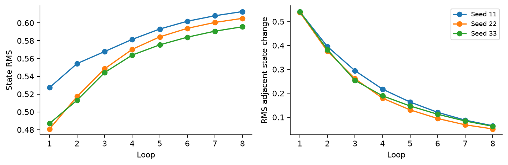

A fixed ridge probe (L2=10), fitted only on first 600 training layouts, decodes reachable-cell BFS distance from hidden states. Final-ID descriptive seed means:

| Loop | Distance R² | Distance MAE (edges) |
| --- | --- | --- |
| 1 | 0.428 | 1.430 |
| 2 | 0.586 | 1.197 |
| 4 | 0.695 | 1.034 |
| 8 | 0.618 | 1.182 |

Cells within a maze are correlated; no cell-level uncertainty claim is made. Reachability rankings and goal-removal effects are also recorded. The spatial figures show actual state RMS and the change caused by removing the goal marker. Ablation is out of distribution. Decodability, bounded goal influence and visually expanding maps support local information propagation, but do not establish that learned states implement BFS. The distance probe is never a policy input. Walls mask all states, and each loop expands the reachable information radius by at most one graph edge.

## Measured computation and parameter controls

| Model | Loops/blocks | Batch1 ms | Batch8 ms/item |
| --- | --- | --- | --- |
| Recurrent: final-4 | 4 | 0.581 | 0.090 |
| Recurrent: variable | 4 | 0.795 | 0.126 |
| Recurrent: curriculum | 4 | 0.599 | 0.090 |
| Recurrent: simultaneous | 1 | 0.419 | 0.064 |
| Recurrent: simultaneous | 2 | 0.481 | 0.073 |
| Recurrent: simultaneous | 4 | 0.615 | 0.091 |
| Recurrent: simultaneous | 8 | 0.890 | 0.131 |
| One-hop feedforward | 1 | 0.449 | 0.065 |
| Four-hop FF, parameter matched | 4 | 0.616 | 0.087 |
| Four-hop FF, same width | 4 | 0.622 | 0.093 |

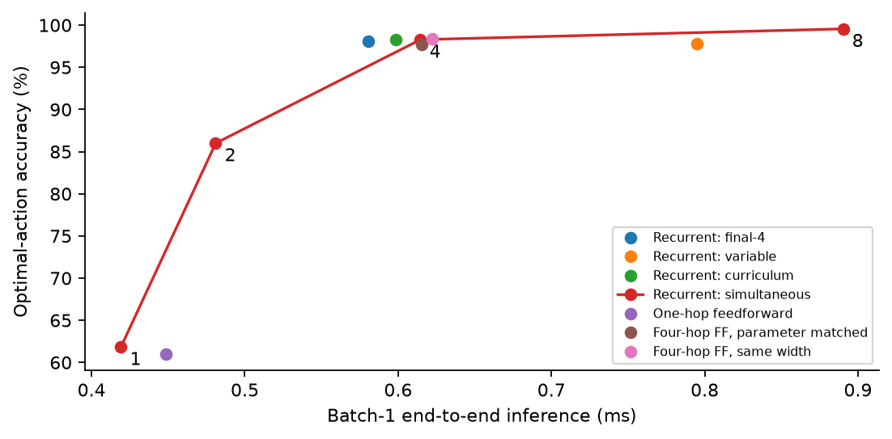

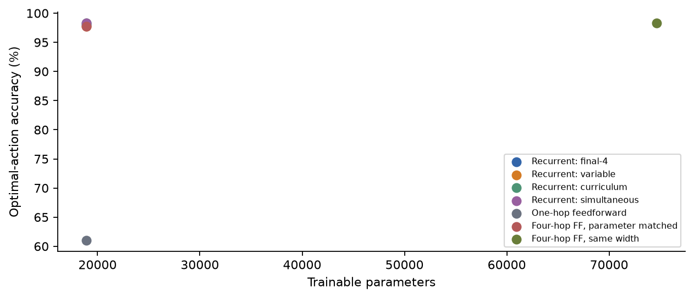

Grid main-fit epoch wall time totals 53.24 seconds, including synchronized updates and validation, excluding process startup/data loading/checkpoint I/O. Tiny matrix operations are fast on this device; this figure is not total project duration. Grid training peak MLX allocation is 0.097 GiB; grid evaluation peak 0.170 GiB. Batch1/8 timing includes fresh observation construction, array transfer, complete policy, host argmax and synchronization; three warmups/five repeats/three seeds, fixed validation observations. Measurements are device- and dispatch-dependent; serial condition order and very small samples limit speed comparisons. Parameter sharing does not imply fewer executed updates or a speedup.

## Track B: frozen Qwen3 middle-layer recurrence

Four actions use fixed A=N/B=E/C=S/D=W next-token labels. The prompt contains the entire grid and explicit zero-based coordinates, no solved paths. Frozen native revision is `c1899de289a04d12100db370d81485cdf75e47ca`, FP32. Both adapters train on identical 720/120 examples, three seeds, three epochs; recurrence trains at fixed four loops, one-pass at one. The one-pass adapter has 122,880 trainable parameters, recurrent 122,881 including its scalar gate; total recurrent parameters 596,172,801. The pretrained architecture is inspected, not assumed. All backbone tensors are frozen. Recurrent states share original middle weights/adapters and use the original bounded residual update; no loop memory or adaptive controller.

| Split (120 layouts) | Frozen | One-pass | Rec1 | Rec2 | Rec4 | Rec8 | Rec4 minus one-pass, 95% CI |
| --- | --- | --- | --- | --- | --- | --- | --- |
| fresh_id | 31.67% | 47.78% | 29.44% | 28.89% | 28.33% | 30.00% | -19.44 pp [-34.44, -7.78] |
| natural | 35.00% | 48.61% | 36.11% | 33.33% | 33.89% | 37.22% | -14.72 pp [-30.28, +1.67] |
| structure | 25.00% | 44.72% | 39.44% | 35.56% | 35.56% | 36.67% | -9.17 pp [-30.01, +10.56] |
| larger | 30.83% | 33.33% | 35.00% | 33.06% | 32.50% | 31.39% | -0.83 pp [-13.89, +11.67] |

Qwen's within-model depth4−depth1 paired difference is -1.11 pp [-8.06, +7.22]. Its recurrent-versus-one-pass result is -19.44 pp [-34.44, -7.78]. This small-budget transformer study does not establish transfer of the tiny grid planner's useful iterative spatial computation. Grid and Qwen receive different representations and training budgets; their aggregate accuracies are not a controlled architecture comparison. No Qwen gradient/caching failure occurred. Limited task competence/optimization and the prior architecture remain possible bottlenecks. Qwen eight-loop results are extrapolation diagnostics for fixed-four training, not selected depths.

| Seed | One-pass | Rec1 | Rec2 | Rec4 | Rec8 |
| --- | --- | --- | --- | --- | --- |
| 11 | 53.33% | 17.50% | 20.83% | 22.50% | 22.50% |
| 22 | 52.50% | 43.33% | 44.17% | 40.00% | 40.00% |
| 33 | 37.50% | 27.50% | 21.67% | 22.50% | 27.50% |

Qwen transitions, fractions of all seed/item decisions:

| Depths | Wrong→right | Right→wrong |
| --- | --- | --- |
| 1->2 | 7.50% | 8.06% |
| 2->4 | 1.94% | 2.50% |
| 1->4 | 8.89% | 10.00% |
| 4->8 | 5.56% | 3.89% |

| Qwen model | Loops | Batch1 ms | Batch8 ms/item |
| --- | --- | --- | --- |
| qwen_onepass | 1 | 18.88 | 12.76 |
| qwen_recurrent | 1 | 18.86 | 12.98 |
| qwen_recurrent | 2 | 21.12 | 14.45 |
| qwen_recurrent | 4 | 25.27 | 17.06 |
| qwen_recurrent | 8 | 33.41 | 22.27 |

Qwen fit epoch wall time totals 7.03 minutes; peak training MLX allocation 4.43 GiB, evaluation 3.69 GiB. Timings include chat serialization/tokenization and full-prefix model computation, two warmups/three repeats/three seeds. No cached feature scoring is compared with full inference. The one-pass control matches parameters/data/epochs, but not total recurrent training compute; no extra-epoch Qwen compute control was trained.

Small Qwen gameplay diagnostic (12 independent starting layouts, three seeds; wide uncertainty, no selection):

| Split | Model@loops | Completion | Invalid moves/episode | Inference s/episode |
| --- | --- | --- | --- | --- |
| fresh_id | qwen_onepass@1 | 11.11% | 16.64 | 0.395 |
| fresh_id | qwen_recurrent@1 | 8.33% | 21.53 | 0.399 |
| fresh_id | qwen_recurrent@2 | 13.89% | 21.00 | 0.428 |
| fresh_id | qwen_recurrent@4 | 8.33% | 22.19 | 0.565 |
| fresh_id | qwen_recurrent@8 | 8.33% | 21.97 | 0.765 |
| larger | qwen_onepass@1 | 2.78% | 18.89 | 0.649 |
| larger | qwen_recurrent@1 | 2.78% | 25.92 | 0.650 |
| larger | qwen_recurrent@2 | 2.78% | 25.94 | 0.689 |
| larger | qwen_recurrent@4 | 2.78% | 26.47 | 0.826 |
| larger | qwen_recurrent@8 | 2.78% | 26.50 | 1.091 |

Alternative spaced-grid serialization is exploratory: qwen_onepass 42.78%, qwen_recurrent 29.44% on the same 120 final-ID examples. Format sensitivity cannot be separated from task competence with this small sample.

## Snake: initial simulator smoke

Ordered body segments, moving-tail collision logic, one food target, growth, fixed heading, prohibited reversal, wall/self collision and terminal behavior are tested. Reverse attempts terminate as illegal collisions; no food respawns. A bounded exhaustive teacher searches the actual simulator at horizons 2/4/6. Frozen lexicographic utility prioritizes survival steps, food collected, reachable space, then negative food distance. Sixty exact 4×4 starting states (straight bodies of length 2–4, no obstacles) and 12-step episodes are preserved. This is a deliberately simple baseline smoke distribution, separate from the learned-policy study below.

| Policy | Survival steps | Food collected | Collision rate | Inference ms/episode |
| --- | --- | --- | --- | --- |
| oracle_h2 | 12.00 | 1.000 | 0.00% | 1.31 |
| oracle_h4 | 12.00 | 0.600 | 0.00% | 5.94 |
| oracle_h6 | 12.00 | 0.533 | 0.00% | 20.53 |
| random_legal | 2.13 | 0.083 | 96.67% | 0.08 |
| safe_greedy | 11.87 | 1.000 | 1.67% | 0.20 |

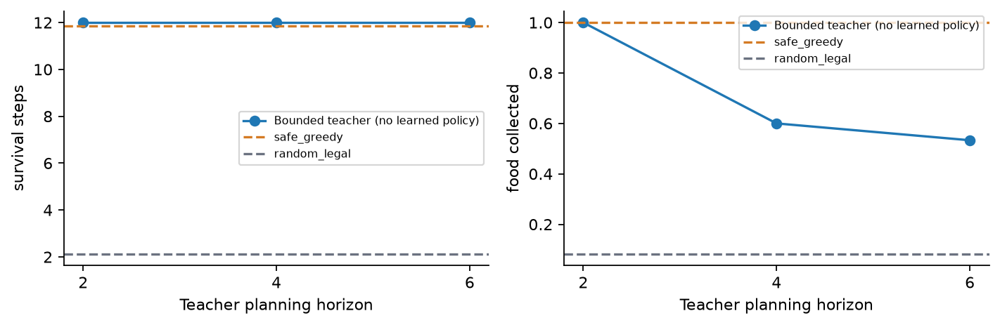

Longer-horizon receding search collects less food here despite perfect finite-episode survival. With the frozen utility, horizon-dependent tie-breaking and postponement are plausible explanations; the reward was not changed after observing this. Those initial smoke baselines are followed by a separately generated prospective learned-policy study below.

## Snake: prospective learned-policy study

After the maze models/results were frozen, remaining budget supported 12 additional fits on independent Snake data. The [Snake protocol](../../experiments/experiment_05b/snake_config.json) was fixed before generating its prospective final set, and the [Snake checkpoint freeze](../../experiments/experiment_05b/snake_frozen_protocol.json) preceded opening that set. Maze choices were not changed. The original lexicographic utility remains unchanged.

Training/validation/final contain 3,600/600/600 D4-disjoint ordered-body states on 4×4 boards with 0.10 wall probability and length 2–4, including bent bodies. Twenty percent generator probability represents post-food states (no respawn), avoiding an entirely unseen state type after eating. Full episodes start only with food present: the first 60 such final states, fixed by protocol. Head/neck determine heading. Nine input channels include walls/free/head/food, ordered segment index, and four heading indicators; no teacher utility or future states enter the policy. Original grid recurrence code and maze checkpoints are untouched.

The primary planning network uses the same local gated family, width32, 19,044 parameters; four-block feedforward has 74,820. Planning targets are full optimal sets of the horizon-6 teacher; horizons2/4 agreement is secondary. A separate safety network trains the full safe-action set. Shared models sample training loops1/2/4/8, 20 epochs, batch64, three seeds; checkpoints minimize depth4 validation set NLL. Feedforward controls receive identical examples/epochs. Eight percent of final states have no safe immediate action: safety training masks them with an all-action zero-loss target, while evaluation explicitly counts their unavoidable collisions. Planning ties in impossible states can accept colliding actions; teacher agreement is not a survival guarantee.

| Policy | Parameters | Loop1 H6 | Loop2 H6 | Loop4 H6 | Loop8 H6 |
| --- | --- | --- | --- | --- | --- |
| snake_safety_rec | 19044 | 93.44% | 93.67% | 94.00% | 94.00% |
| snake_plan_rec | 19044 | 94.50% | 96.61% | 96.61% | 96.78% |
| snake_plan_ff1 | 19044 | 94.00% | — | — | — |
| snake_plan_ff4 | 74820 | — | — | 96.61% | — |

Planning recurrence depth4−depth1 is +2.11 pp [+0.33, +3.67]; depth4−depth2 is +0.00 pp [-0.94, +0.78]. Recurrence4−four-block feedforward4 is +0.00 pp [-0.83, +0.78]. This is a small depth benefit over one internal update, without a sharing advantage. All learned policies attain 92% immediate safety, the ceiling on these final states.

| Loops | Teacher H2 agreement | Teacher H4 agreement | Teacher H6 agreement |
| --- | --- | --- | --- |
| 1 | 83.33% | 87.33% | 94.50% |
| 2 | 84.06% | 89.67% | 96.61% |
| 4 | 83.67% | 89.28% | 96.61% |
| 8 | 83.11% | 89.17% | 96.78% |

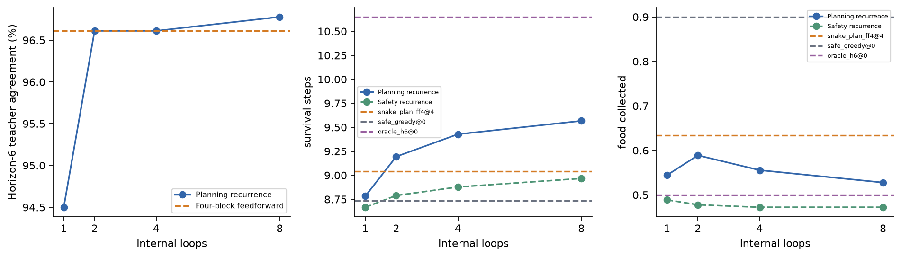

| Policy@loops | Survival steps | Food collected | Collision rate | Illegal actions/episode | Inference ms/episode |
| --- | --- | --- | --- | --- | --- |
| snake_safety_rec@1 | 8.67 | 0.489 | 41.67% | 0.083 | 3.58 |
| snake_safety_rec@2 | 8.79 | 0.478 | 40.00% | 0.144 | 4.95 |
| snake_safety_rec@4 | 8.88 | 0.472 | 38.33% | 0.139 | 5.49 |
| snake_safety_rec@8 | 8.97 | 0.472 | 38.33% | 0.111 | 8.08 |
| snake_plan_rec@1 | 8.78 | 0.544 | 41.67% | 0.100 | 3.67 |
| snake_plan_rec@2 | 9.19 | 0.589 | 35.56% | 0.039 | 4.45 |
| snake_plan_rec@4 | 9.43 | 0.556 | 32.22% | 0.050 | 7.44 |
| snake_plan_rec@8 | 9.57 | 0.528 | 30.56% | 0.050 | 10.00 |
| snake_plan_ff1@1 | 9.22 | 0.522 | 33.89% | 0.100 | 3.59 |
| snake_plan_ff4@4 | 9.04 | 0.633 | 38.33% | 0.033 | 6.34 |
| random_legal@0 | 1.87 | 0.167 | 98.33% | 0.000 | 0.01 |
| safe_greedy@0 | 8.73 | 0.900 | 45.00% | 0.000 | 0.17 |
| oracle_h6@0 | 10.65 | 0.500 | 11.67% | 0.000 | 10.96 |

Episode-clustered recurrence4−recurrence1 survival difference: +0.644 steps, 95% CI [-0.184, +1.517]. Food difference: +0.011, CI [-0.106, +0.128]. Each uses 60 initial-state clusters and three seeds. Survival and food gains are not interchangeable. The four-block control collects more food than four-loop recurrence; the simple safe greedy policy collects 0.90 versus recurrence4 0.556. More loops improve teacher agreement modestly but do not establish a superior food-collecting policy. The teacher itself collects only 0.50 while surviving longer, reflecting the frozen survival-first finite-horizon utility and receding decisions.

Horizon6 optimal-set sizes 1/2/3/4 occur on 281/200/71/48 final states. Many ties and impossible starting states inflate teacher agreement relative to unique-action planning. No learned Snake generalization to larger boards was tested. All three compressed Snake datasets regenerated byte-identically in the clean CPU environment.

## Failures, limitations and next phase

The main limitation is **no established accuracy advantage over a comparably deep untied feedforward model**. Strong within-model depth gains show that this local architecture can use extra spatial computation, but receptive-field expansion is a designed advantage over the one-hop baseline. It does not distinguish planning algorithms from learned local topology heuristics, memorized synthetic regularities or repeated nonlinear processing. The parameter-matched narrow control performs similarly too. No unrestricted global CNN, eight-block compute control, auxiliary distance supervision, larger training boards, RL training or broad real-world reasoning test was included.

Harder path lengths and full rollouts remain difficult; near-perfect first moves do not guarantee navigation. Curriculum did not improve the selected objective. Final-depth-only training damages extrapolated depth. Qwen transfer was not established. Three seeds, near-ceiling ID accuracy, family overlap, weak one-legal examples, finite rollout subsets, unadjusted secondary intervals and small serial latency samples all constrain claims. The two serialization bugs were corrected before training; their failure record is retained. Unsuccessful training conditions were not removed. C/V/D heads were not reused or retrained.

The next phase should prospectively compare **shared eight-hop recurrence with an eight-block untied and a global CNN control**, at matched measured compute and data, on larger branching mazes constructed to make identical local neighborhoods require different distant-goal decisions. Train on mixed 5×5/7×7 sizes, evaluate a new larger locked set, and retain full episodes. Separately test whether a compact grid encoder or better text curriculum improves Qwen competence before adding controllers. Snake now includes bent bodies/obstacles and trained controls; a new prospective utility/episode design is needed to address postponement and distinguish teacher agreement from food collection.

## Reproduction and local status

See [reproduction commands](../../experiments/experiment_05b/README.md), [configuration](../../experiments/experiment_05b/config.json), [plan](../../experiments/experiment_05b/plan.md), [raw public results](../../results/experiment_05b/summary.json), [representation diagnostics](../../results/experiment_05b/representation_analysis.json), and [complete seed-level trajectories](../../results/experiment_05b/trajectories). All eight dataset gzip files regenerated byte-identically in an isolated CPU environment. Public recorded classification metrics regenerate exactly from saved logits; hidden-state interventions and retraining require ignored adapter checkpoints, with regeneration commands provided. No full independent retraining replication is claimed. No model weights or large hidden-state caches are committed.

The CPU report audit independently recomputed 6,840 maze labels, verified 6,840 distinct canonical layouts and checked 290,640 depth decisions across 154 trajectory files. Markdown/HTML/figures use recorded measurements only. Public `v0.1.0` remains at `0a637eb97d66eebbd740b612ab92e9095c496931`. Experiment 5 and 5.1 remain local and require review before publication. Original code is MIT; separately downloaded Qwen weights retain Apache-2.0 terms.

Through the recorded report QA checkpoint, elapsed project time was 47.7 minutes, with 8.35 minutes of recorded fit epochs across 39 main fits and one grid pilot. This remained within the six-hour budget. MLX integration: 48 tests passed. Clean CPU environment: 31 passed, 13 skipped. The local/public boundary, frozen artifacts, 72 trained-state locality checks and relative report links passed verification. The protocol receipt's single absolute path was normalized without changing frozen content hashes or decisions; the original is preserved privately.

The secondary Snake audit additionally recomputed 4,800 states' safety and horizon2/4/6 teacher targets and 18,000 neural teacher-agreement decisions from recorded logits.

Research lineage and source attribution are recorded in [Experiment 5's verified references](../../experiments/experiment_05/research_references.md), including Qwen3, RecurTrace, Universal Transformers, ACT, PonderNet and LoRA. This experiment reuses the project's own middle-layer implementation and independently implements the grid environment/message-passing planner. It does not claim architectural novelty or reproduce those papers' experimental protocols.
