# Experiment 5.2 — Break the Thinker

## Executive summary

**More loops help on new larger mazes, but the learned policy does not scale into a reliable shortest-path planner.** The unchanged 18,884-parameter 5B network improves on the prespecified 600 branching 9×9 mazes from 88.72% at four loops to 94.39% at eight: **+5.67 pp [+3.56, +8.00]**, paired across maze instances and three historical training seeds. This is the only confirmatory comparison; other comparisons are secondary/exploratory.

Full navigation is much harder. Eight-loop frozen completion is 62.22% on 30 new 9×9 occupancy episodes and 19.44% on 24 DFS-shift episodes. On 24 long 15×15 DFS episodes it is zero at 4/8/16/32 loops; BFS completes every episode. The new variable model solves only one seed/maze pair at 16 and 32. Extra loops improve some decisions while persistent local mistakes create inescapable cycles.

Validation selected **rec_variable**, deployment depth 8, and feedforward **`ff8`** at eight blocks. On 9×9, new recurrence versus eight-block feedforward is -0.56 pp [-2.00, +0.83]; no first-action superiority is established. Episode performance differs and is separately reported. Sharing reduces parameters, not executed hops. Longer paths are not uniformly harder in occupancy mazes; local topology and generator selection create shortcuts.

Completed 15 new fits, five conditions×three seeds 101/202/303, 30 epochs each. Synchronized training/validation epoch time totals **157.84 seconds (2.63 minutes)**; this excludes generation, checkpoint I/O, evaluation, reporting and process startup. Maximum recorded MLX allocation **0.825 GiB**, under 48 GiB. Total study duration is in the completion receipt. No Qwen/Snake training was added. `v0.2.0` is published; this study remains local.

## Reproduction of Experiment 5B

All three historical simultaneous checkpoints reproduce all 600 archived ID examples exactly at 1/2/4/8 loops: maximum logit error 0. Original source/weights remain unchanged. The new executor extends the old guard 16→32, with exact logit/state/norm/change parity through 16. Native 5/7/9/11/15 shapes pass finite/bounded 32-loop feasibility. Original 5B recorded 98.28/99.56% at 4/8, with tied feedforward controls and negative Qwen transfer; those historical metrics are not overwritten or presented as this new benchmark.

Live QA also replayed 360 seed/maze episodes over 120 archived initial mazes, reproducing 95.00%7×7 completion and 54.44%long-path completion. Every action, position, outcome and non-timing metric matched the archive exactly. These easier historical populations differ from the new branching/distance-conditioned tests. [Archived gameplay verification](../../results/experiment_05c/archived_rollout_verification.json).

[Baseline verification](../../results/experiment_05c/baseline_verification.json) · [Publication receipt](../../experiments/experiment_05c/publication_receipt.json)

## New dataset methodology and leakage checks

Fresh 6,000 training and 960 validation examples use mixed 5×5/7×7 occupancy boards. New final sets:5×5=400,7×7=500,9×9=600,11×11=600,15×15=600,DFS 9×9=400,dense 9×9=400,long DFS 15×15=400; total 3,900 final. Every decision is solvable/nonterminal with at least two legal actions. All equally optimal actions are accepted; the loss is negative log summed probability over the optimal-action set. No distance-map auxiliary loss is used. Agent/start selection conditions on distance strata, making this a diagnostic distribution rather than natural task prevalence. Long paths on small occupancy boards require substantial rejection sampling; proposal counts and rejections are retained.

Distance ranges are 2–4/5–8/9–12/13–20/21–32/33–64 where feasible; long DFS uses 21–32/33–48/49–80/81–126. Training's longest target bin is 13–24. Board size alone is not a difficulty measure. Reports retain BFS distance, Manhattan detour, goal direction, traps, degree, junction/dead-end counts, cycle rank and optimal-action ties. A goal can influence an agent through this designed local mechanism no earlier than its graph distance in updates; this is an information bound, not a learned-algorithm claim.

Every new split excludes all 6,840 historical 5B wall layouts and conservative graph fingerprints. D4 wall hashes reject rotation/reflection and changed start/goal placements of a layout. Unrooted reachable-component WL8 invariants additionally reject differently embedded isomorphic graphs. Every matching invariant is rejected, including possible non-isomorphic collisions; equality is not asserted to prove isomorphism. Distinct invariants certify non-isomorphism, while conservative rejection can distort prevalence. Isolated unreachable components are ignored by this topology exclusion. No graph fingerprint repeats across new splits.

Queue-BFS labels were independently checked using heap Dijkstra during generation and in the public audit. All 10 dataset gzip files regenerated byte-identically in an independent CPU-only environment. Primary population and comparison were fixed before final opening; final outcomes did not alter fitting, depth or checkpoint selection. [Manifest](../../experiments/experiment_05c/dataset_manifest.json) · [Frozen protocol](../../experiments/experiment_05c/frozen_protocol.json)

## Architectures and training procedures

Frozen baseline and new recurrent models use the original width 32 pointwise encoder, shared one-hop cardinal gated update, wall masking and pointwise agent head. States remain convex combinations of tanh-bounded values. Hidden state resets for every decision; all loops receive the unchanged four-channel board. Environment advances once after the committed action. No labels, BFS values, future states, controller or visible reasoning tokens enter learned inference.

Variable training samples 1/2/4/8/16 uniformly per batch. Curriculum spends 10 epochs on distances≤8/depths 1/2/4,10 on distances≤12/depths 2/4/8, then 10 on all data/depths 4/8/16. Eligible examples are resampled to retain update counts. Both use action supervision at one sampled depth. AdamW 0.001, decay 0.0001, clip 1, batch 64, 30 epochs. All models share data and nominal optimizer-update budgets; computational budgets differ and are measured. Best checkpoint minimizes validation set loss at depth 8 for recurrence/FF8 or 4 for other controls. Model-family selection uses validation accuracy, then loss. No final-set re-selection occurs.

The narrow four-block control nearly matches parameters. FF8 uses eight independent width 32 updates with the same per-hop computation as recurrence. The global-context control has four width 32 untied blocks and broadcasts a learned pooled feature/agent-goal coordinate summary derived only from raw channels before local processing. It has a full-board input dependency but only a compressed global summary, not unrestricted global attention or an exact graph algorithm. Its larger capacity and positional summary are disclosed.

| Model | Parameters | Training seeds | Epoch fit seconds | Selection/deploy depth |
| --- | --- | --- | --- | --- |
| Frozen 5B | 18884 | 11/22/33 (frozen) | — | 8 |
| Variable recurrence | 18884 | 101/202/303 | 25.64 | 8 |
| Curriculum recurrence | 18884 | 101/202/303 | 24.19 | 8 |
| Four-block FF (narrow) | 18900 | 101/202/303 | 25.94 | 4 |
| Eight-block FF | 149028 | 101/202/303 | 47.45 | 8 |
| Global-context CNN | 75844 | 101/202/303 | 34.63 | 4 |

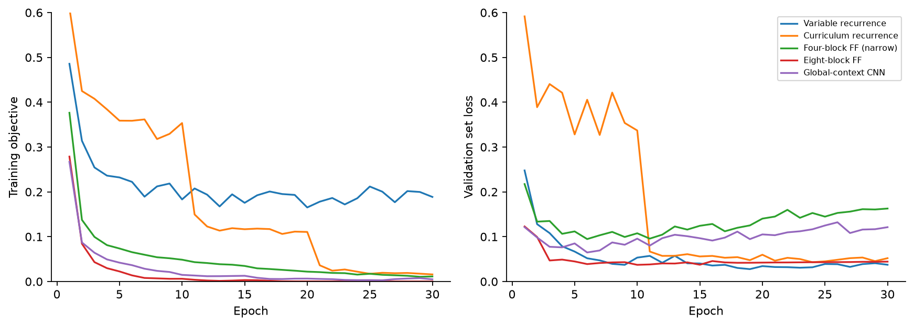

## Accuracy by loop count and scale

| Final split | Mazes | 1 | 2 | 4 | 8 | 12 | 16 | 24 | 32 |
| --- | --- | --- | --- | --- | --- | --- | --- | --- | --- |
| size 5 | 400 | 70.50% | 91.58% | 98.42% | 99.67% | 99.42% | 99.33% | 99.33% | 99.08% |
| size 7 | 500 | 56.67% | 79.60% | 94.80% | 97.87% | 98.13% | 97.73% | 96.47% | 96.00% |
| size 9 | 600 | 59.67% | 77.22% | 88.72% | 94.39% | 95.50% | 94.89% | 94.33% | 93.22% |
| size 11 | 600 | 56.11% | 75.61% | 87.17% | 92.78% | 93.83% | 93.39% | 92.44% | 92.00% |
| size 15 | 600 | 53.11% | 69.44% | 80.94% | 85.56% | 86.83% | 86.28% | 85.17% | 83.39% |
| structure 9 | 400 | 51.58% | 55.92% | 61.33% | 73.67% | 77.33% | 79.25% | 79.67% | 80.42% |
| dense 9 | 400 | 55.58% | 78.92% | 93.00% | 97.33% | 98.08% | 98.25% | 97.50% | 96.75% |
| long 15 | 400 | 49.50% | 55.42% | 65.83% | 71.42% | 73.25% | 73.42% | 73.83% | 73.42% |

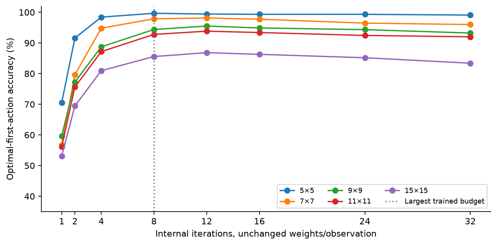

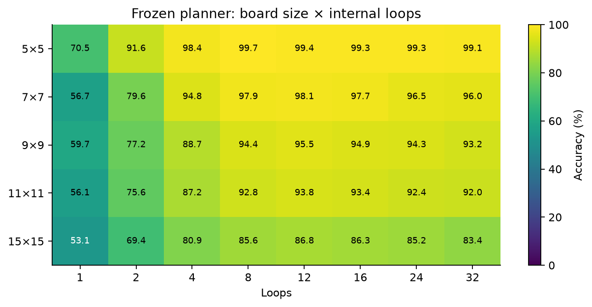

The size aggregates have different feasible path-bin mixtures. Comparisons of board size therefore combine size and difficulty composition. The descriptive analysis also reports a common 2–20-distance population across occupancy sizes. Every seed-specific metric and all 32 recurrent predictions are saved; repeated seed/example decisions are not independent mazes.

## Accuracy by shortest-path length

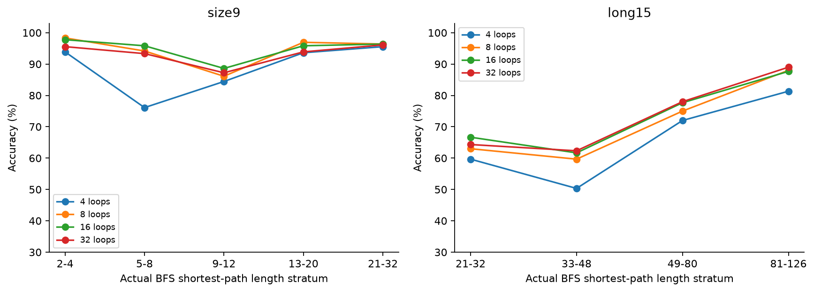

Longer occupancy paths can be easier to choose initially because winding, corridor-like topology narrows the useful local branch. Conditioning start/goal choice on a long distance can introduce local structural clues. More loops help most where newly available information changes action selection, not monotonically with raw path length. The DFS generator changes this relationship. High first-action accuracy beyond the goal influence radius demonstrates useful distributional/local heuristics, not full goal-to-agent planning.

| 9×9 path stratum | Mazes | Frozen 4 | Frozen 8 | Frozen 16 | Frozen 32 |
| --- | --- | --- | --- | --- | --- |
| 2-4 | 120 | 93.89% | 98.33% | 97.78% | 95.56% |
| 5-8 | 120 | 76.11% | 94.17% | 95.83% | 93.33% |
| 9-12 | 120 | 84.44% | 86.11% | 88.61% | 87.22% |
| 13-20 | 120 | 93.61% | 96.94% | 95.83% | 93.89% |
| 21-32 | 120 | 95.56% | 96.39% | 96.39% | 96.11% |

## Loss, calibration and shortest-path regret

| Frozen 9×9 loop | Set NLL | ECE | Invalid | First-action regret | Mean confidence |
| --- | --- | --- | --- | --- | --- |
| 1 | 0.668 | 0.097 | 0.00% | 0.807 | 0.499 |
| 2 | 0.444 | 0.054 | 0.00% | 0.456 | 0.802 |
| 4 | 0.369 | 0.071 | 0.06% | 0.225 | 0.929 |
| 8 | 0.242 | 0.043 | 0.11% | 0.111 | 0.965 |
| 12 | 0.229 | 0.041 | 0.11% | 0.089 | 0.971 |
| 16 | 0.238 | 0.041 | 0.00% | 0.102 | 0.975 |
| 24 | 0.283 | 0.046 | 0.00% | 0.113 | 0.974 |
| 32 | 0.335 | 0.050 | 0.22% | 0.133 | 0.974 |

A wrong legal first move has regret 2 in this undirected unweighted graph; an invalid move stays put and has regret 1. This metric does not capture the total cost of entering and exploring a trap. Full episodes provide that complementary failure evidence. Confidence/calibration and decision correction remain separate.

## Feedforward comparisons

| Split | Frozen 8 | New variable 8 | Curriculum 8 | NarrowFF4 | UntiedFF8 | GlobalCNN4 |
| --- | --- | --- | --- | --- | --- | --- |
| size 5 | 99.67% | 99.75% | 99.83% | 99.08% | 100.00% | 99.67% |
| size 7 | 97.87% | 98.40% | 98.20% | 94.27% | 98.07% | 96.67% |
| size 9 | 94.39% | 95.61% | 94.28% | 90.00% | 96.17% | 93.83% |
| size 11 | 92.78% | 94.28% | 93.44% | 87.83% | 94.89% | 93.17% |
| size 15 | 85.56% | 87.78% | 87.78% | 82.44% | 86.72% | 90.56% |
| structure 9 | 73.67% | 76.58% | 73.25% | 65.08% | 74.67% | 72.75% |
| dense 9 | 97.33% | 99.00% | 97.92% | 94.33% | 97.83% | 96.58% |
| long 15 | 71.42% | 74.58% | 71.25% | 64.25% | 74.08% | 66.92% |

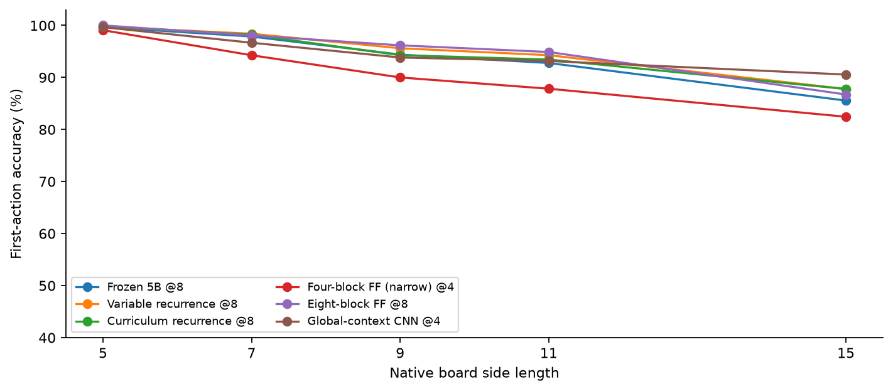

| 9×9 selected recurrence 8 minus control | Paired 95% interval |
| --- | --- |
| `ff4_params` | +5.61 pp [+3.50, +7.89] |
| `ff8` | -0.56 pp [-2.00, +0.83] |
| `global_cnn` | +1.78 pp [-0.22, +3.83] |

The narrower control is parameter-matched but has fewer hops/channels. Its gap does not isolate weight sharing. Recurrence and FF8 exchange local information the same number of times; FF8 has 149,028 parameters versus 18,884. GlobalCNN4 has 75,844 and a different global-information route. Equal epochs/data do not equalize fit seconds. Neither fewer parameters nor these accuracy comparisons establish a runtime speedup.

## Full navigation and maze completion

| Split | Initial mazes | Frozen 4 | Frozen 8 | Frozen 16 | Frozen 32 | Variable 8 | Variable 16 | FF8 | BFS |
| --- | --- | --- | --- | --- | --- | --- | --- | --- | --- |
| size 5 | 24 | 55.56% | 81.94% | 94.44% | 91.67% | 97.22% | 98.61% | 63.89% | 100.00% |
| size 7 | 30 | 34.44% | 71.11% | 72.22% | 66.67% | 66.67% | 85.56% | 40.00% | 100.00% |
| size 9 | 30 | 26.67% | 62.22% | 72.22% | 64.44% | 57.78% | 76.67% | 36.67% | 100.00% |
| size 11 | 36 | 24.07% | 47.22% | 56.48% | 49.07% | 40.74% | 61.11% | 28.70% | 100.00% |
| size 15 | 36 | 27.78% | 35.19% | 40.74% | 40.74% | 31.48% | 40.74% | 16.67% | 100.00% |
| structure 9 | 24 | 9.72% | 19.44% | 38.89% | 37.50% | 30.56% | 45.83% | 26.39% | 100.00% |
| dense 9 | 30 | 33.33% | 56.67% | 72.22% | 68.89% | 61.11% | 86.67% | 45.56% | 100.00% |
| long 15 | 24 | 0.00% | 0.00% | 0.00% | 0.00% | 0.00% | 1.39% | 0.00% | 100.00% |

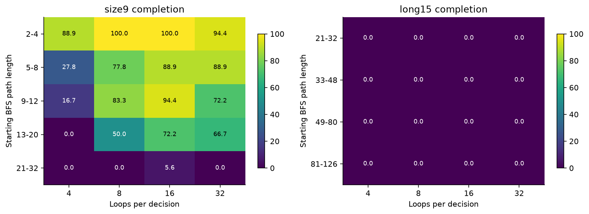

Rollouts use the first six independent layouts per distance stratum, all seeds, fixed budgets. Maximum 256 environmental steps; a repeated position terminates as failure because a deterministic stateless policy will repeat that cycle forever. Failed episodes therefore record time/steps to detected cycle, not 256 wasted actions. This shortcut preserves completion outcomes but changes failure durations; do not compare those durations with a full 256-step benchmark. Successful step ratios, invalid moves, repeated positions, action regret, inference time and whole trajectories are retained. BFS is used only as separately labeled reference/offline scorer.

| 9×9 episode comparison (30 maze clusters) | Paired completion difference 95% |
| --- | --- |
| Frozen 8 minus frozen 4 | +35.56 pp [+20.00, +50.03] |
| New recurrence 8 minus FF8 | +21.11 pp [+7.75, +34.44] |

First-action ties do not guarantee safe future decisions. New recurrence and feedforward models with similar initial accuracy can differ on later agent positions in the same maze. Any episode advantage is secondary, with small episode samples and unadjusted comparisons. No rollout-based model/depth selection was made.

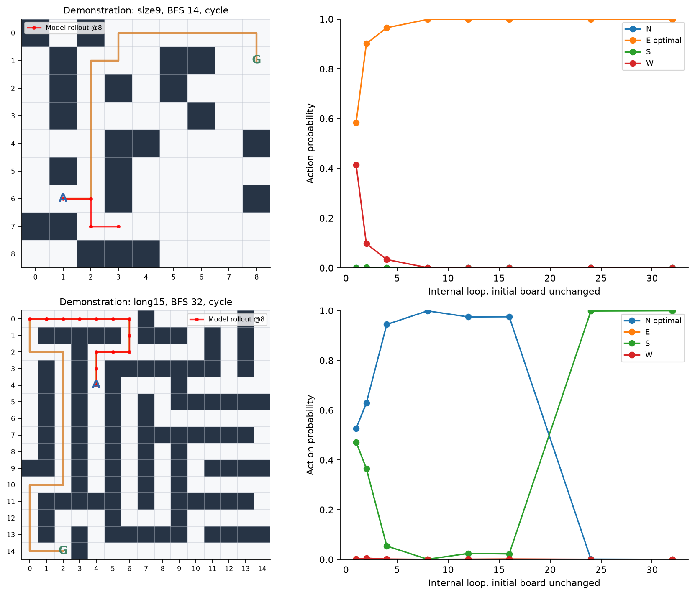

## Hidden-state propagation and interventions

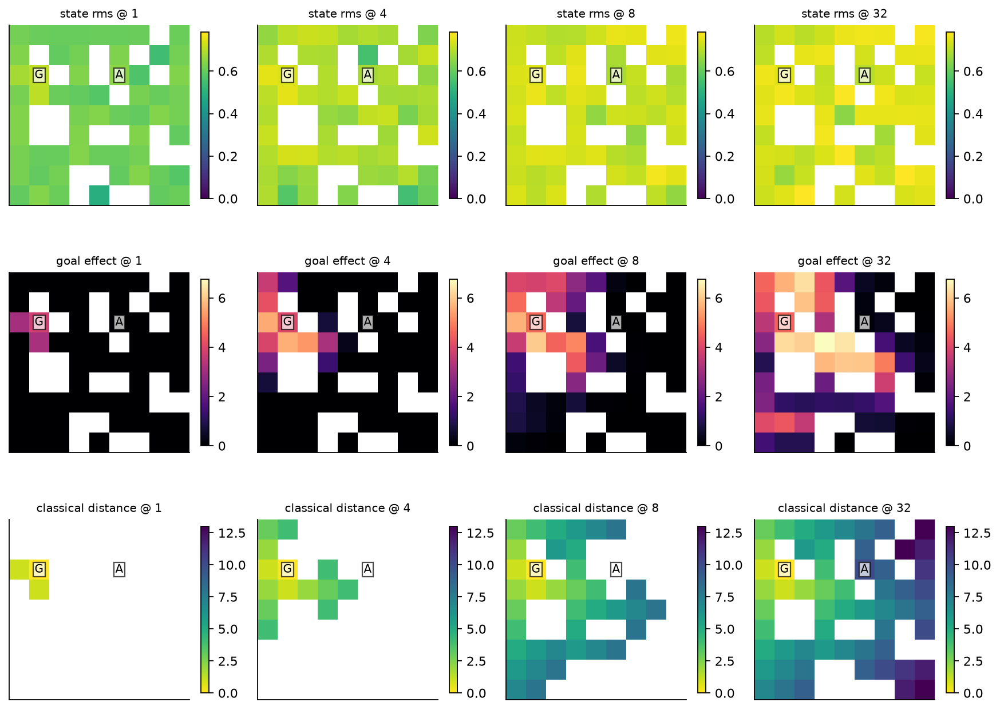

The first two rows show actual learned states/goal effects; the third shows recorded nonlearned one-hop min-plus distance propagation, never model input. White reference cells are walls or not yet reached. These are different quantities with separate color scales. Illustrative examples were selected separately from population summaries. A fixed ridge probe(L2=10) fits BFS distance from hidden channels plus intercept on the first 200 training mazes only. It is evaluated on 40 independent mazes per split/seed; cells are correlated, and no cell-level significance is claimed. Goal removal is out of distribution. Hidden-message cuts on a shortest-path intermediate cell are compared with approximately agent-distance-matched off-path sham cuts, also under goal removal to isolate goal-dependent effects. These are controlled perturbations, not equivalent natural inputs. A single cell cut can fail to block alternate routes; reduced/greater logit effects alone do not establish algorithm identity.

| Frozen probe, split | Loop 4 R² | Loop 8 R² | Loop 32 R² | Loop 32 MAE |
| --- | --- | --- | --- | --- |
| size 5 | 0.591 | 0.565 | 0.322 | 2.34 |
| size 9 | 0.092 | 0.191 | -0.115 | 4.05 |
| size 15 | -0.818 | -0.773 | -0.922 | 9.12 |
| structure 9 | -0.515 | -0.294 | -0.631 | 9.34 |
| long 15 | -1.344 | -1.178 | -1.419 | 27.95 |

Goal effects are exactly zero outside each loop’s permitted graph radius, verifying designed locality. Same-board distant-goal counterfactual pairs require disjoint optimal actions while both goals are outside radius 4. Their loop 1/2/4 logits are exactly identical; no policy with those local observations can choose both correctly. Later differences show that goal information can become available, without proving that it is used optimally.

| Model, paired far-goal diagnostic | Loop 1 | Loop 2 | Loop 4 | Loop 8 | Loop 16 | Loop 32 |
| --- | --- | --- | --- | --- | --- | --- |
| Frozen 5B | 45.00% | 45.56% | 48.89% | 77.22% | 76.67% | 71.11% |
| Variable recurrence | 43.33% | 48.33% | 50.00% | 73.89% | 82.78% | 82.22% |

| Goal-dependent logit effect: intervention diagnostic | Loop | Mazes×seeds | Uncut mean norm | Path-cut mean norm | Sham-cut mean norm |
| --- | --- | --- | --- | --- | --- |
| Frozen 5B | 8 | 90 | 1.322 | 0.060 | 1.137 |
| Frozen 5B | 16 | 90 | 1.751 | 0.183 | 1.506 |
| Frozen 5B | 32 | 90 | 1.735 | 0.302 | 1.574 |
| Variable recurrence | 8 | 90 | 0.895 | 0.032 | 0.886 |
| Variable recurrence | 16 | 90 | 1.518 | 0.222 | 1.402 |
| Variable recurrence | 32 | 90 | 1.894 | 0.353 | 1.743 |

These paired diagnostics reuse 30 original boards per model and perturb goal placement within each board; they are not new independent aggregate-test mazes. Decodability and propagation fronts support reusable local information exchange. Distance-probe failure on longer structures, imperfect counterfactual decisions and failed rollouts constrain a shortest-path-procedure interpretation.

## Generalization beyond trained depth

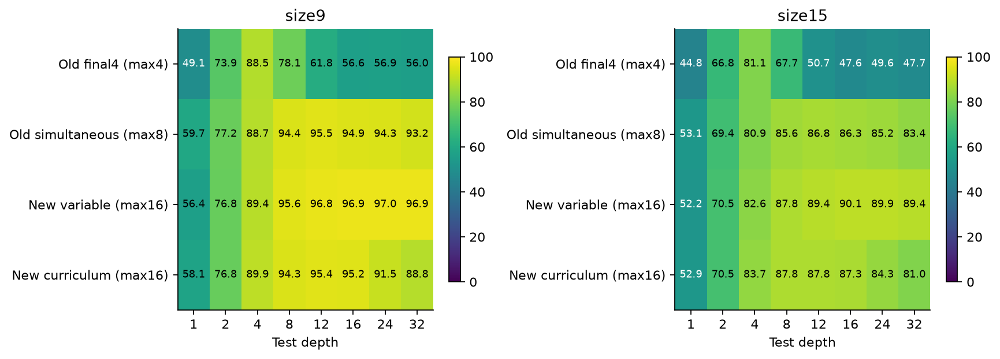

Historical final 4-only, historical simultaneous(max 8), new variable(max 16) and new curriculum(max 16) share the small architecture, but differ in data/objective; the heatmap is descriptive and cannot isolate one training ingredient. Beyond 8, frozen accuracy can plateau or decline; new variable training is more stable beyond 16, while curriculum often deteriorates. Extrapolated 24/32 budgets were not selected from final performance. More loops need not improve decisions even though state values remain bounded.

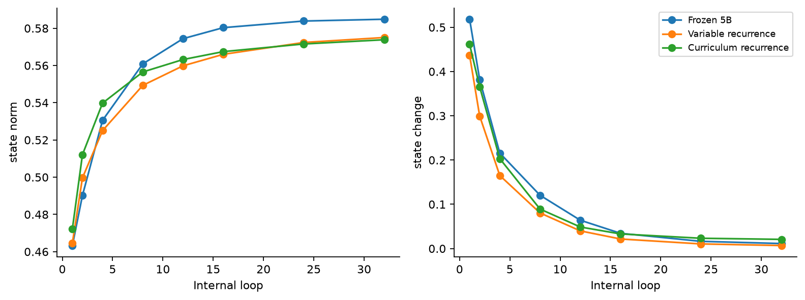

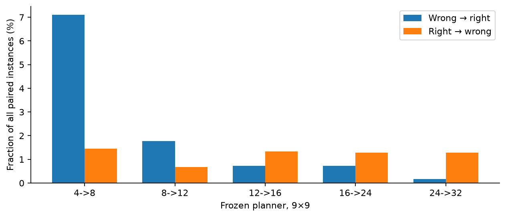

The saved trajectories include norm, adjacent-state cosine, change/drift, logits, loss, confidence/calibration and prediction oscillation. Bounded activations rule out amplitude explosion in these tests; they do not rule out harmful attractors, oscillation or representational degradation.

## Failure frontier and negative findings

Engineering thresholds were fixed prospectively:90% first-action accuracy and 80% completion. These are descriptive thresholds, not significance tests. All tested size×distance×junction×loop cells and counts appear in [failure frontier](../../results/experiment_05c/failure_frontier.json). Six rollout mazes per distance bin are too few for precise frontier estimation. No continuous untested boundary is inferred.

| Population | Frozen 8 action | Frozen 8 completion | Pass 90% /80% | Frozen 32 action | Frozen 32 completion |
| --- | --- | --- | --- | --- | --- |
| size 5 | 99.67% | 81.94% | True / True | 99.08% | 91.67% |
| size 7 | 97.87% | 71.11% | True / False | 96.00% | 66.67% |
| size 9 | 94.39% | 62.22% | True / False | 93.22% | 64.44% |
| size 11 | 92.78% | 47.22% | True / False | 92.00% | 49.07% |
| size 15 | 85.56% | 35.19% | False / False | 83.39% | 40.74% |
| structure 9 | 73.67% | 19.44% | False / False | 80.42% | 37.50% |
| dense 9 | 97.33% | 56.67% | True / False | 96.75% | 68.89% |
| long 15 | 71.42% | 0.00% | False / False | 73.42% | 0.00% |

Observed long-path distances range from 21 to 101 edges.

A goal farther than 32 edges cannot influence this strictly local policy within the tested maximum 32 loops. Failure beyond that bound alone cannot distinguish poor learning from insufficient communication time. More diagnostic: in the 21–32-edge DFS stratum, frozen 32-loop accuracy is 64.33% and completion is 0% on six independent mazes×three seeds. The new variable 32-loop condition completes one of 18 seed/maze rollouts(5.56%). Those cases fit inside the nominal information radius and still expose a learned-computation failure.

The sharpest failure is near-zero complete navigation on the long-path DFS population, despite 70–78% first-action accuracy. Geometry/structure matters as much as scale. New curriculum does not robustly improve extrapolation; frozen/final-depth-only models can degrade beyond training. A compressed global-context CNN does not solve the scaling problem. No model demonstrates a reusable exact BFS procedure or reliable large-maze navigation.

## Latency, parameters and actual computation

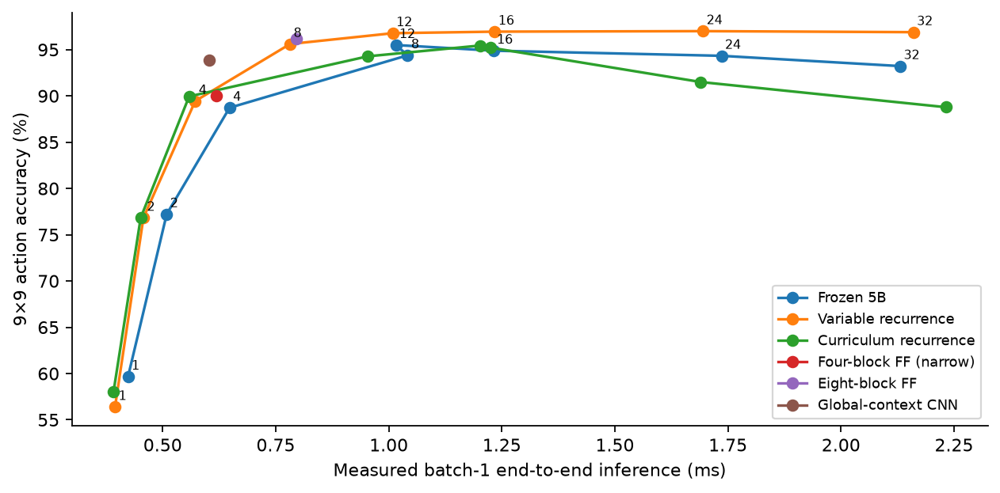

| Model@loops | Parameters | 9×9 B1 ms | 9×9 B8 ms/item | 9×9 accuracy |
| --- | --- | --- | --- | --- |
| Frozen 5B@1 | 18884 | 0.423 | 0.064 | 59.67% |
| Frozen 5B@2 | 18884 | 0.509 | 0.080 | 77.22% |
| Frozen 5B@4 | 18884 | 0.648 | 0.124 | 88.72% |
| Frozen 5B@8 | 18884 | 1.042 | 0.140 | 94.39% |
| Frozen 5B@12 | 18884 | 1.016 | 0.191 | 95.50% |
| Frozen 5B@16 | 18884 | 1.231 | 0.230 | 94.89% |
| Frozen 5B@24 | 18884 | 1.736 | 0.309 | 94.33% |
| Frozen 5B@32 | 18884 | 2.131 | 0.405 | 93.22% |
| Variable recurrence@8 | 18884 | 0.782 | 0.136 | 95.61% |
| Curriculum recurrence@8 | 18884 | 0.953 | 0.175 | 94.28% |
| Four-block FF (narrow)@4 | 18900 | 0.619 | 0.086 | 90.00% |
| Eight-block FF@8 | 149028 | 0.795 | 0.137 | 96.17% |
| Global-context CNN@4 | 75844 | 0.603 | 0.098 | 93.83% |

Timing uses three warmups/ten synchronized full-policy repetitions, raw observation construction, transfer and host argmax; medians, serial model order, one prespecified seed. Model loading is excluded. Batch 8 is amortized per item. Timing uses standardized native-size open boards, while accuracy uses the locked maze population; size/batch are matched, topology is not. Small dispatch/device-load differences do not establish speedups. Maximum recorded MLX 0.825 GiB is distinct from process RSS; counters are not added as physical memory. Per-stage resource records retain peak counters and synchronized fit durations.

## Statistical and scientific limitations

Primary inference resamples paired maze instances within fixed path strata and historical training seeds jointly, 4,000 replicates. New-condition comparisons pair the same maze and matched new seed indices; three seeds limit precision. Episode intervals resample whole initial mazes and seeds, never navigation steps. Secondary/exploratory comparisons are unadjusted; no final-best depth is designated. All final examples are a one-time prospective evaluation with checkpoint selection frozen beforehand.

The benchmark is synthetic, heavily distance-conditioned and branching-only; rejecting conservative graph invariants further alters prevalence. Occupancy path strata contain local shortcuts. Different size mixtures limit raw size comparisons. No 21×21 test,16-block untied model, reinforcement learning, persistent across-action memory, adaptive stopping, new C/V/D probe, Snake/Qwen expansion or full independent retraining replication was run. Global control is a compressed summary, not an exhaustive global architecture comparison. Baseline and new models trained on different data; their difference cannot isolate curriculum/extra depth alone. Hidden probes/interventions are diagnostic and imperfect. Failures and all training variants remain recorded.

Two NumPy metadata export failures and an empty-stratum analysis-export failure were preserved. The empty stratum is represented as null, with no model or metric change. The generation error was fixed before fitting. The post-freeze diagnostic coordinate export uses a documented native-scalar boundary wrapper, leaving every frozen scientific source/hash and weight unchanged. The complete diagnostic computation was repeated and its numeric measurements matched exactly; no evaluation or selection rule changed. A receipt-counter shadowing error was also corrected and the full public audit rerun. See [amendment](../../experiments/experiment_05c/diagnostic_export_amendment.json) and [failure record](../../results/experiment_05c/implementation_failures.json).

## Answers and next research step

1. **Does thinking longer help bigger mazes?** Yes for the prespecified 9×9 four→eight comparison, with limited gains elsewhere; it does not yield reliable large-maze navigation.
2. **Does benefit scale with shortest-path length?** Not monotonically. Occupancy topology/selection shortcuts and DFS shifts show that raw distance is insufficient.
3. **Does shared recurrence outperform feedforward at useful budgets?** No established first-action advantage over equally trained FF8 at eight hops. Some episode comparisons favor recurrence; they are secondary and do not establish broad superiority or speedup.
4. **Does it generalize beyond trained depth?** Partially and objective-dependently. Variable-depth training can remain useful beyond 16; frozen/curriculum/final 4 models may deteriorate. No universal extrapolation guarantee.
5. **Where does it break?** Structural DFS shifts and long-path complete navigation; the tested threshold frontier above is more informative than a single board-size cutoff.
6. **Reusable iteration or depth-specific transformation?** Evidence supports reusable bounded local information exchange and some extrapolation, combined with strong local heuristics and training-depth sensitivity. It does not demonstrate a scalable shortest-path planning algorithm.

Recommended next study: prospective **local-alias paired-goal/branch-balanced mazes**, where identical local neighborhoods require opposite distant-goal actions. Train/test separate topologies, compare shared versus untied equal-hop updates, and require complete navigation improvement. A separately labeled distance-supervised variant could test whether missing planning representations, rather than recurrence stability, limit learning. Do not tune this consumed lockbox or launch that phase automatically.

## Reproduction and publication status

[Commands](../../experiments/experiment_05c/README.md) · [Raw summary](../../results/experiment_05c/summary.json) · [Public audit](../../results/experiment_05c/public_audit.json) · [Seed traces](../../results/experiment_05c/trajectories) · [Full episodes](../../results/experiment_05c/rollouts)

```sh
python -m latent_loop.scaling audit
python -m latent_loop.scaling report
LATENT_LOOP_MLX_TESTS=1 python -m pytest -q
```

CPU audit/report regeneration requires no checkpoints or MLX. Model inference/interventions require separately regenerated ignored weights; exact original identities are preserved locally. The final suite passed 54 tests with MLX; CPU-only 34 passed/14 skipped. The metadata export regression check is included. All 10 datasets regenerated byte-identically. Original 1–5B scientific files and both public tags remain unchanged. `v0.2.0`: [public release](https://github.com/johnathonkillaly/latent-loop-confidence/releases/tag/v0.2.0), commit `1ebd435b94448d45e42141b49808839218c2b7b2`. **Experiment 5.2 stays local pending review.**
