# Experiment 5.3 — The Decision Bridge

## Executive summary

**A candidate scorer can repair a frozen shallow readout, but this study does not establish a special scoring-plus-recurrence advantage.** The prespecified primary eight-loop frozen recurrent policy scores 100.00% on 600 fresh topology-disjoint graphs. Validation selected correctness scoring with **lambda 0**, so its fused policy makes identical decisions: +0.00 pp [+0.00, +0.00]. This degenerate interval reflects an identity intervention, not proof that every scorer is equivalent. The forced nonzero diagnostic also has zero net ID gain. No primary scoring improvement is established.

At one loop of the *same recurrent model*, scoring improves 79.39% to 84.89%: **+5.50 pp [+0.28, +13.83]**, secondary and unadjusted. Corrections are 7.11% and degradations 1.61% of all decisions. Seed gains are +14.33/+0.33/+1.83 pp: one seed dominates. A matched direct classifier reaches 85.39%; scored minus direct is -0.50 pp [-1.67, +0.67]. This is readout repair with extra supervision, not evidence of a uniquely valuable auxiliary architecture. The independently trained one-hop base is stronger than the shallow recurrent base and its fusion gain is -0.11 pp [-0.50, +0.33].

Repeated local computation is useful. On the prespecified distance-six counterfactual population, both members are correct in 0% of pairs at two loops and 100% at eight (60 independent pairs, three seeds). Yet eight-loop recurrence achieves only 68.19% on 64 nodes and 0.00% on long 32-node paths; sixteen loops reach 28.56%. Ordinary feedforward controls remain competitive or better. No LLM was trained or integrated. Nothing was pushed or published.

Completed **36 main fits** (15 base/control + 21 frozen-representation heads), **36 easy-distribution pilot fits**, and **two independent seed-401 verification refits** (74 total). The independent base and scorer checkpoints reproduce byte-for-byte; [verification receipt](../../results/experiment_05d/seed401_retraining_verification.json). Main synchronized epoch fitting is 84.04 seconds; pilot fitting 83.83 seconds, verification refitting3.86 seconds. Peak main measured MLX allocation 0.107 GiB; stage RSS maximum 0.290 GiB (different accounting, not additive). [Complete metrics](../../results/experiment_05d/analysis.json).

## Original motivation and relationship to C/V/D

[Historical C/V/D](../experiment_04b/decision_value_and_trajectory_selection.md) predicted correctness, loss improvement and decision transitions without reliable deployed gains. [Experiment 5](../experiment_05/train_the_thinker.md) did not establish useful extra Qwen recurrence; [5B](../experiment_05b/learning_to_navigate.md) demonstrated useful tiny-grid depth but tied feedforward controls. [5.2](../experiment_05c/scaling_and_failure_frontier.md) separated information propagation from successful long-horizon navigation. Those negative records remain untouched.

Here Q evaluates **each candidate**, including alternatives not selected by the base. C estimates selected-answer correctness; V and D concern future computation. Q is a separate candidate-supervision objective. Successful graph Q does not establish old C transfer, language-model reasoning, or an LLM decision improvement.

## Graph construction, splits and leakage checks

Base training: 3,000 graphs; disjoint scorer training: 3,000; validation: 600. Training uses 10/12 nodes, trees, sparse random-tree-plus-edge graphs, denser cyclic graphs and disconnected components. Starts have at least two neighbors. Quotas per size: 25% distance 1–2, 40% distance 3–4, 20% distance 5–9, 15% unreachable. These are diagnostic prevalence choices. Community shift uses two dense connected modules with a bridge (400 graphs, distance at least two); long shift uses a chain plus sparse chords (300 32-node graphs, distance at least ten). All labels use BFS, independently checked against Floyd–Warshall. Every equally optimal action is accepted; no-route cases target abstain. BFS itself is the exact 100% reference, never a neural feature.

Final sets contain 2,240 independent ordinary graphs and 480 counterfactual members (240 independent pairs). Total main data: 9,320 observations. Node IDs and presentation order are random; candidates are random-order neighbors plus abstain. Features are constant/start/goal/degree divided by N−1. No coordinates, paths, distances, correctness, outcomes or IDs enter neural inference. Candidate tie keys are independent random metadata, never learned features; they follow semantic identity for presentation-independent numerical tie resolution.

Whole unrooted graph WL invariants reject all matching fingerprints across splits, including non-isomorphic collisions. This certifies exclusion of isomorphic copies, not that equal fingerprints prove isomorphism. Counterfactual members intentionally share a group; groups never cross splits. Conservatism and finite topology inventories alter family prevalence: base/scorer/final-ID tree counts are **250/94/13**, despite identical nominal proposal rules. ID is fresh under the same quota/generator procedure, not exactly matched family proportions. Larger sparse graphs also change degree/topology composition. Report size and distance strata separately; do not attribute every shift solely to N.

The initial unconditioned pilot put 77% of examples at distance 1–2. Its 36 fits were completed before recognizing near-ceiling one-hop validation; all data/source/metrics are preserved at [pilot receipt](../../experiments/experiment_05d/pilot_easy_distribution/receipt.json) and `results/experiment_05d_pilot_easy/`. No pilot final neural predictions were made. The quota amendment preceded all main fitting and final comparisons. [Dataset manifest](../../experiments/experiment_05d/dataset_manifest.json) · [independent CPU byte regeneration](../../results/experiment_05d/independent_data_reproduction.json).

## Base and recurrent architectures

Pointwise four-feature encoder, width32; bounded shared GRU-style update using current state, original encoding and mean neighbor states. Sigmoid gates mix the previous bounded state with a layer-normalized tanh proposal. One update crosses one graph edge. The ordinary shared candidate MLP reads start state, neighbor state and abstain flag; abstain has zero neighbor state. The head sees information one edge beyond the start, so a goal at graph distance d cannot influence a candidate before d−1 updates. Raw degree is observed initially; paired constructions match those local degree features too.

Shared weights train at sampled depths 1/2/4/8. Hidden state resets each decision; internal loops never move the environment. There is no global pooling, controller, across-step memory, shortest-path auxiliary supervision or deterministic planning map. The untrained inputs and observation remain unchanged through recurrence. Eight untied blocks provide the same hop count with distinct weights. Width11 is a **narrow, approximately capacity-matched control with 14.3% fewer parameters**, not an exact parameter match. Candidate/direct-head comparisons are exactly matched at 2,241 parameters.

| Component | Parameters | Trainable stage |
|---|---:|---|
| One-hop / shared recurrent / extra-budget base | 11,681 | all during base fitting; frozen for Q |
| Candidate correctness, ranking or direct head | 2,241 | head only; frozen base |
| Base plus candidate head | 13,922 | 2,241 in the second stage |
| Untied eight-block width32 | 77,313 | all |
| Narrow untied eight-block width11 | 10,008 | all |

## Separate training and candidate scoring

Seeds 401/502/603; 30 epochs, batch64, AdamW 0.001, decay0.0001, global gradient clip1. All base conditions receive 90,000 example presentations per seed; recurrence samples one depth per batch. Best base checkpoint minimizes validation optimal-set NLL (depth1 one-hop; depth8 others). All selected base hashes are frozen before any Q fit. [Base freeze](../../experiments/experiment_05d/base_freeze.json).

Q fits on **disjoint graph topologies** using cached frozen representations; no gradient reaches the base. It receives the same start/candidate/abstain representation as the action head, plus base probability, centered clipped base logit and known depth/8. A shared width32 SiLU MLP returns one score per option, with variable candidate counts. No fixed action-letter output parameters exist.

Correctness: candidate BCE, candidate-weighted. Ranking: mean positive-versus-negative pairwise logistic loss, graph-weighted. Direct classifier: negative log total probability of the optimal set, graph-weighted. These heads have identical observable inputs, architecture, size and training presentation budgets; the direct head is a decisive control for extra supervised capacity. Scorers sample one cached depth 1/2/4/8 per batch on recurrence (one-hop uses only depth1). No scorer at depth16 was trained. Checkpoint selection minimizes the corresponding depth-eight validation objective, depth-one for one-hop.

A separate recurrent **extra-budget** control starts from the selected frozen checkpoint, then trains all 11,681 parameters on scorer-training graphs for another 90,000 presentations. It does not replace the frozen base or contribute features to Q. Equal presentations do not mean equal wall time or optimization difficulty. No joint base/Q fit, dependency task or adaptive stopping was added.

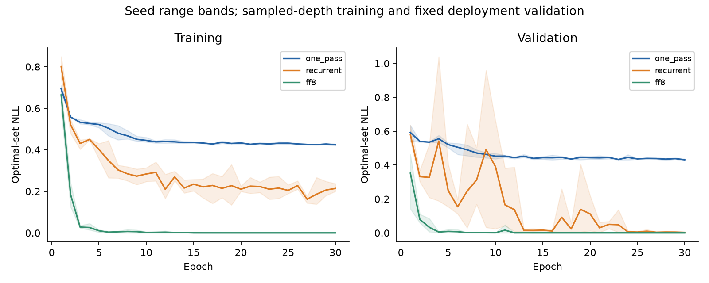

## Fusion, calibration and prospective selection

Base chooses argmax P. Fusion chooses argmax(log P + lambda Q_norm). Q_norm subtracts the candidate mean and divides by max(1, candidate RMS); normalization removes arbitrary offsets and caps score-scale sensitivity without making Q a probability. Temperature is selected separately by validation optimal-set NLL and cannot improve argmax accuracy. Candidate probabilities use raw sigmoid and a validation-only positive-scale/intercept calibration; calibration metrics do not establish ranking or decision gains.

Validation chooses between correctness and ranking and the lambda grid 0/.1/.25/.5/1/2/4; ties prefer lower lambda, then correctness. Primary recurrent depth8 selects correctness/lambda0. Its secondary depth1/2/4 weights are 4/2/.25, fixed on validation. Depth16 reuses depth8 lambda0. The one-hop model selects ranking/.1. Direct and score-only policies, a validation-selected nonzero intervention, shuffled scores and constant scores are retained. [Selection grids](../../experiments/experiment_05d/selection.json).

The [prospective protocol](../../experiments/experiment_05d/protocol.md), [freeze](../../experiments/experiment_05d/frozen_protocol.json) and [opening receipt](../../experiments/experiment_05d/lockbox_opened.json) precede final comparisons. No model, checkpoint, objective, depth or lambda changed after opening. A numerical tie bug made the initial temperature control change a near-tied decision. Three partial trace files were archived, then **all** evaluations rerun after float64 tie comparisons and retaining unscaled base tie resolution for positive temperature. Original frozen source, exact corrected hashes and failure are preserved in the [evaluation amendment](../../experiments/experiment_05d/evaluation_amendment.json). This is an implementation correction, not test-set selection.

## Decision results and correction analysis

Primary: +0.00 pp [+0.00, +0.00], with no actual primary intervention because lambda0. A nonzero weight .1 changes one seed/example decision between equally optimal options, with no correction or degradation. Extra Q compute is not justified at the selected eight-loop operating point.

| ID recurrent depth | Base | Fused | Q correctness only | Q ranking only | Direct classifier | Frozen lambda |
|---|---:|---:|---:|---:|---:|---:|
| 1 | 79.39% | 84.89% | 84.83% | 85.00% | 85.39% | 4 |
| 2 | 89.78% | 90.94% | 91.11% | 91.22% | 90.28% | 2 |
| 4 | 99.17% | 99.17% | 99.17% | 99.17% | 99.17% | 0.25 |
| 8 | 100.00% | 100.00% | 100.00% | 100.00% | 100.00% | 0 |
| 16 | 100.00% | 100.00% | 100.00% | 100.00% | 100.00% | 0 |

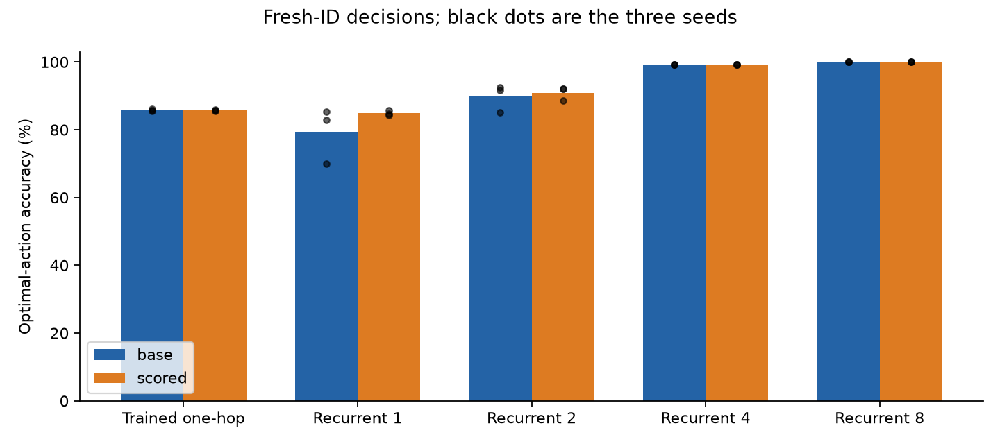

| Depth | Wrong→right | Right→wrong | Both right | Both wrong | Net paired effect, 95% CI |
|---|---:|---:|---:|---:|---|
| 1 | 7.11% | 1.61% | 77.78% | 13.50% | +5.50 pp [+0.28, +13.83] |
| 2 | 2.94% | 1.78% | 88.00% | 7.28% | +1.17 pp [-0.72, +3.83] |
| 4 | 0.00% | 0.00% | 99.17% | 0.83% | +0.00 pp [+0.00, +0.00] |
| 8 | 0.00% | 0.00% | 100.00% | 0.00% | +0.00 pp [+0.00, +0.00] |
| 16 | 0.00% | 0.00% | 100.00% | 0.00% | +0.00 pp [+0.00, +0.00] |

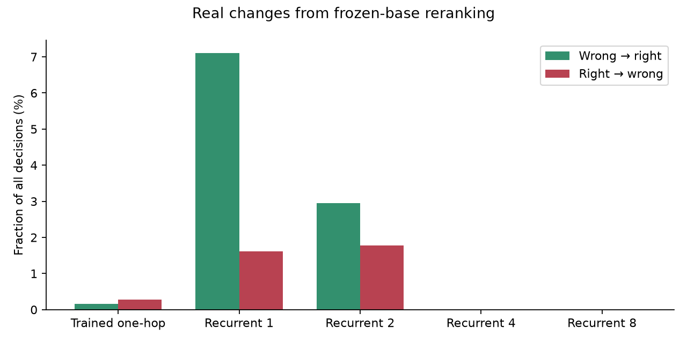

| ID model | Base | Temperature | Constant Q | Shuffled Q | Validated fusion | Forced nonzero |
|---|---:|---:|---:|---:|---:|---:|
| Trained one-hop | 85.83% | 85.83% | 85.83% | 85.50% | 85.72% | 85.72% |
| Rec1 | 79.39% | 79.39% | 79.39% | 60.78% | 84.89% | 81.17% |
| Rec2 | 89.78% | 89.78% | 89.78% | 82.17% | 90.94% | 90.17% |
| Rec8 | 100.00% | 100.00% | 100.00% | 100.00% | 100.00% | 100.00% |

Temperature and constant scores preserve every base choice. Shuffling uses a fixed
independent RNG and the same validated fusion weight; when lambda0 it is necessarily
inert. A nonzero intervention can change semantics without changing correctness
when both options are optimal.

The shallow gain is secondary, varies markedly by seed, and does not beat the matched classifier. Depth2 fusion gives +1.17 pp [-0.72, +3.83] (inconclusive); scored minus direct at depth2 is +0.67 pp [-0.50, +2.00]. One-hop scoring is -0.11 pp [-0.50, +0.33]. Q can alter real outputs and sometimes repair a biased frozen readout; no advantage over ordinary candidate classification is established.

Expected uniform-candidate accuracy is 39.22% on ID, 37.42% on64 nodes and 40.46% on long paths. Tied optimal actions and candidate count change this reference across populations. Always abstaining achieves15% in the quota-based sets and0% on community/long/counterfactual sets; BFS achieves100% in every population.

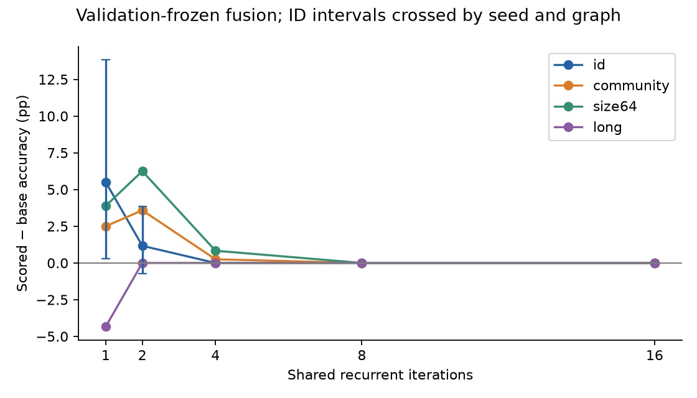

Three-seed/graph crossed bootstrap intervals use 3,000 replicates. Repeated model outputs on one graph do not increase the independent graph count. Counterfactuals cluster both members. Secondary intervals are unadjusted, and three seeds poorly characterize optimization variability. Exact 0/100% sample rates yield degenerate bootstrap intervals; these do not imply certainty on unobserved graphs or equivalence across populations.

## Counterfactual distant-dependency test

Two identical start arms end in interchangeable goal/distractor attachments. Swapping only the distant attachments flips the optimal first candidate while preserving local degrees, flags and candidate ordering. A random remote branch module supplies topology diversity; some graphs have irrelevant isolated nodes. Both pair members are independently solver-verified, with unique opposite optimal actions. There are 60 pairs per goal distance 4/6/10/14. Pair inputs are exactly indistinguishable to the local readout before the prescribed information radius; shallow logits are exactly equal in all recorded locality checks.

| Goal distance | Both correct at 1 | 2 | 4 | 8 | 16 |
|---|---:|---:|---:|---:|---:|
| 4 | 0.00% | 0.00% | 100.00% | 100.00% | 100.00% |
| 6 | 0.00% | 0.00% | 0.00% | 100.00% | 100.00% |
| 10 | 0.00% | 0.00% | 0.00% | 0.00% | 66.67% |
| 14 | 0.00% | 0.00% | 0.00% | 0.00% | 0.00% |

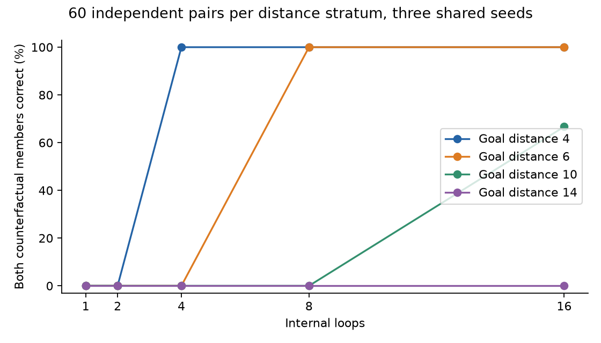

The prespecified distance-six 8−2 comparison is +100.00 pp [+100.00, +100.00], 60 pair clusters. This supports H1: additional local updates can incorporate distant goal information. It does not prove a learned BFS algorithm, H2 candidate-score benefit, or long-horizon planning. Before the signal arrives, the model often wrongly abstains rather than guessing an arm. Even after more loops, longer pairs and unfamiliar graph structures remain difficult. No scorer creates missing information at shallow depths.

## Generalization and feedforward controls

| Split | Graphs | Trained one-hop | One-hop+Q | Rec8 (Q identical) | Rec16 | FF8 width32 | Narrow FF8 |
|---|---:|---:|---:|---:|---:|---:|---:|
| id | 600 | 85.83% | 85.72% | 100.00% | 100.00% | 100.00% | 100.00% |
| community | 400 | 85.33% | 85.42% | 99.75% | 100.00% | 100.00% | 99.25% |
| size16 | 400 | 77.42% | 77.42% | 99.42% | 99.67% | 100.00% | 99.83% |
| size32 | 300 | 69.56% | 69.67% | 92.22% | 95.89% | 96.56% | 97.56% |
| size64 | 240 | 64.72% | 64.86% | 68.19% | 73.47% | 82.36% | 89.44% |
| long | 300 | 0.00% | 0.00% | 0.00% | 28.56% | 26.67% | 40.11% |

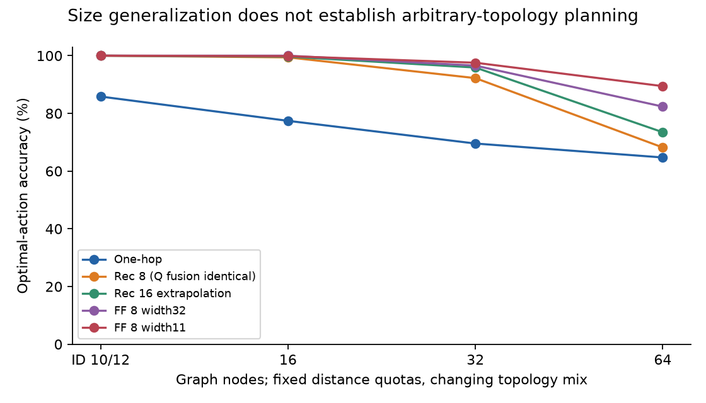

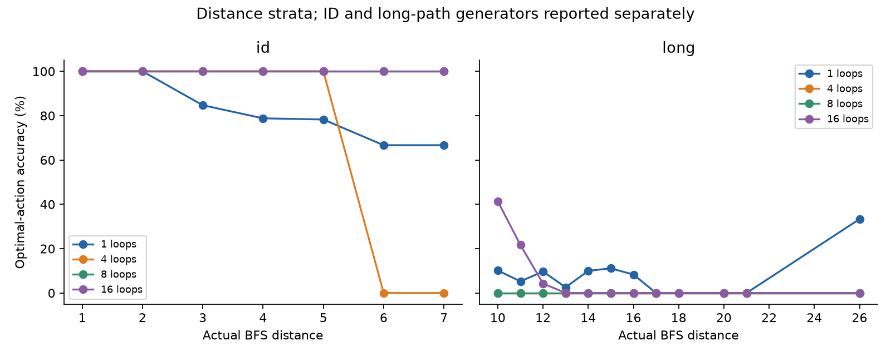

Rec8 minus independently trained one-hop ID is +14.17 pp [+11.61, +17.22]; combined versus one-hop is identical. The scoring/recurrence interaction is +0.11 pp [-0.33, +0.50], inconclusive. Both feedforward controls score 100% on ID. The same-width eight-block model reaches 82.36% on64; the narrower control reaches 89.44%. These final descriptive results do not re-select the deployment model. Extra-base training scores 37.92% on64, illustrating harmful shift sensitivity despite perfect ID validation.

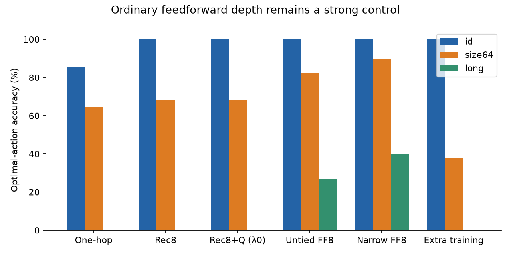

H1 is supported within the paired mechanism test. H2 has a limited secondary shallow-readout result, with no primary gain. H3 and H5 are not established. H4 is partial: permutations and the small community shift work, but scalable long-distance planning and robust scorer benefit do not follow.

## Full graph navigation

At each environmental action, reset hidden state, observe raw adjacency/start/goal, run a fixed internal budget, optionally score the *current* neighbor set, commit one action, then move. No labels/BFS distances or future states enter the policy. Same stable tie keys and deterministic candidate shuffling are used across models. Stop at goal, abstain, repeated node (deterministic cycle), or128 actions. Stopping at a cycle preserves deterministic completion; measured failure time is time to detect it, not wasted timeout iterations. Across-action memory is absent.

Thirty initial graphs per split, three seeds; goal completion below conditions on reachable instances. These are the first30 deterministic examples fixed by the evaluator, not a random episode sample. In quota-based splits they contain10 near/13 medium/4 far/3 unreachable cases, underrepresenting the far/unreachable strata relative to the full population. Completion estimates apply to this small subset. No-route abstention and total task success are separately retained. Successful-path ratios and action traces are public; ratios omit failures and must not be read alone.

| Split | Rec8 reachable completion | Rec16 | FF8 | Narrow FF8 |
|---|---:|---:|---:|---:|
| id | 100.00% | 100.00% | 100.00% | 100.00% |
| community | 100.00% | 100.00% | 100.00% | 97.78% |
| size16 | 100.00% | 100.00% | 100.00% | 100.00% |
| size32 | 100.00% | 100.00% | 100.00% | 100.00% |
| size64 | 66.67% | 70.37% | 85.19% | 91.36% |
| long | 0.00% | 22.22% | 17.78% | 24.44% |

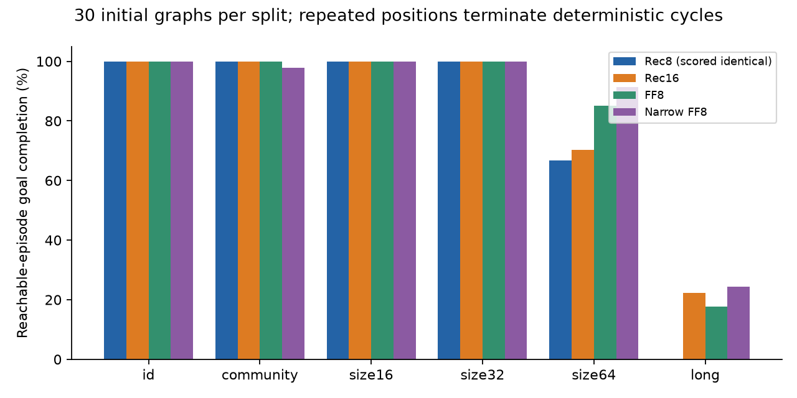

Rec8+Q navigation is identical to Rec8 because lambda0. Long-path recurrence completes no eight-loop episodes and only22.22% at16; first-action accuracy alone is insufficient. The rollout subset is small and not a new model-selection population. Individual environmental actions are not independent statistical trials. [All episode summaries](../../results/experiment_05d/analysis.json).

## Permutations, calibration and representative decisions

All 1,620 relabeling/candidate-order checks preserve the semantic base and scored choice. Maximum observed FP32 logit change is8.59e−6; mathematical equivariance is tested numerically with tolerances, not bitwise node-summation identity. No inference observation mutates during loops. Gradient tests verify finite nonzero recurrent updates and bounded states; weight and optimizer restoration reproduce subsequent updates exactly. [Permutation/locality records](../../results/experiment_05d/invariance_and_locality.json).

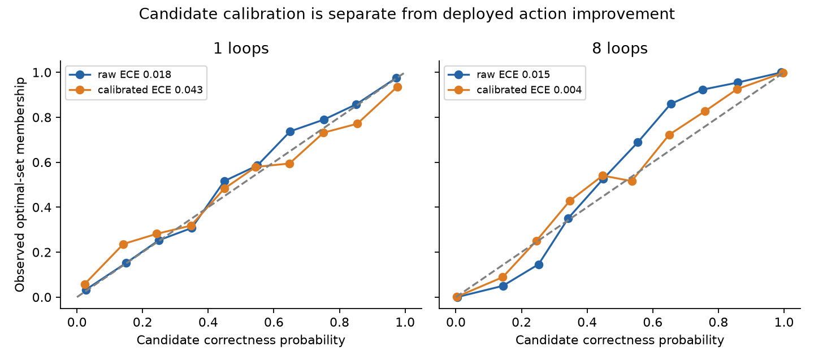

| ID depth | Objective | Base within-graph ranking AUC | Q within-graph ranking AUC | Raw candidate ECE | Validation-calibrated ECE |
|---|---|---:|---:|---:|---:|
| 1 | correctness | 0.826 | 0.866 | 0.018 | 0.043 |
| 1 | ranking | 0.826 | 0.865 | 0.160 | 0.194 |
| 2 | correctness | 0.915 | 0.933 | 0.014 | 0.032 |
| 2 | ranking | 0.915 | 0.932 | 0.134 | 0.111 |
| 8 | correctness | 1.000 | 1.000 | 0.015 | 0.004 |
| 8 | ranking | 1.000 | 1.000 | 0.153 | 0.044 |

Calibration and ranking are reported separately for each objective/depth/split. High candidate AUROC does not demonstrate better deployed decisions; raw sigmoid of ranking/direct scores is not intrinsically a calibrated correctness probability. Validation calibration is shared across depths and can fail under shift.

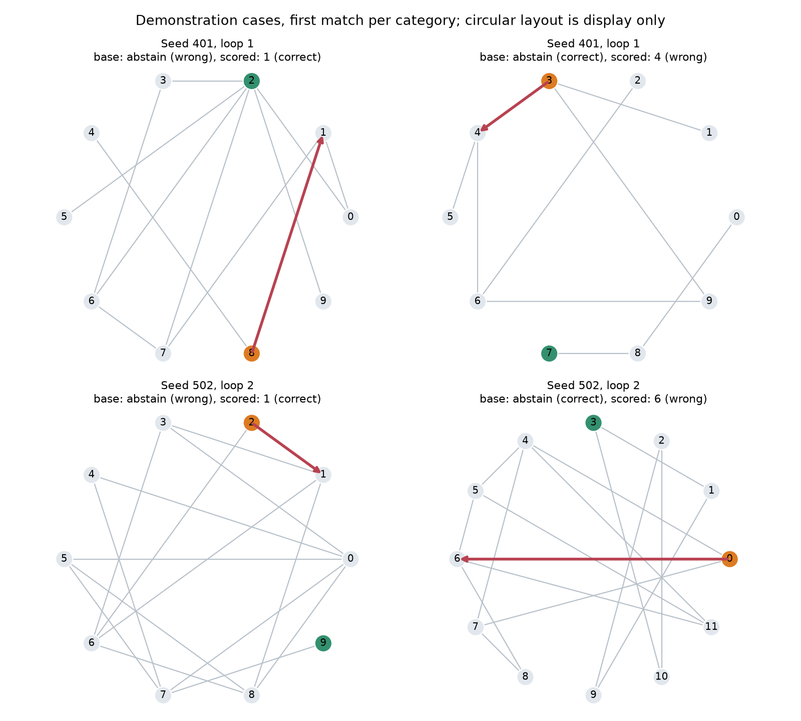

Cases are the first archived correction/degradation in each labeled seed/depth category, not a claim about prevalence. Orange marks start, green goal; blue/red arrows are base/scored choices. The circular drawing is solely visualization, not a model coordinate input. [Exact case IDs](../../results/experiment_05d/representative_examples.json).

## Runtime and memory

MLX0.32.3/Metal, FP32, Python3.12.15, Apple M4 Max/128GiB. No new dependencies, Qwen loading/training, remote workstation access, or interruption of unrelated processes. Budget24GiB; main allocator maximum 0.107GiB. Trainable tiny models are under80,000 parameters. Main training/validation epoch time 84.04s, pilot 83.83s; generation, evaluation, checkpoint I/O, reporting and verification refits are separate. No idle calendar time is counted as training.

Randomized interleaved batch-one medians for the same ten-node timing case: one-hop 0.335ms, recurrent1 0.331ms, recurrent1+Q 0.400ms, recurrent8 0.758ms, recurrent8+Q 0.811ms, untiedFF8 0.820ms. Q adds a paired median 0.054ms at8. A deployment could skip Q when lambda0; the benchmark deliberately measures its execution. Batch8 and32/64-node timings are included in the archive.

Timing includes raw observation preparation, transfer, synchronized model/Q, CPU fusion and action selection; excludes checkpoint loading. Ten warmups/50 paired random-order repetitions, first prespecified seed, normal desktop load. The original 3-warmup/20-repeat serial-order archive had scorer-faster artifacts and remains preserved; interleaved measurements supplement it. No speedup or sharing advantage is inferred from parameter count or noisy timing alone.

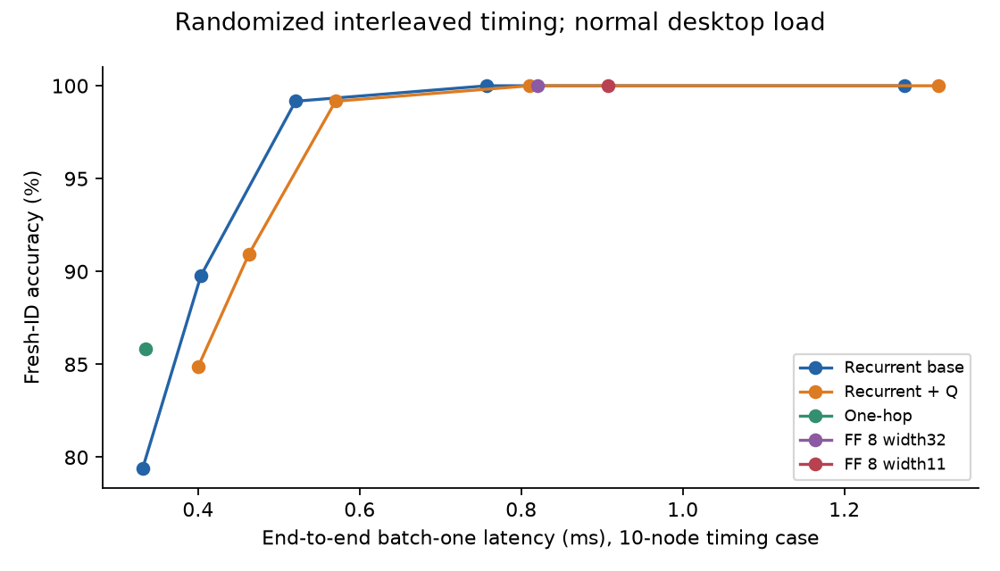

## Negative findings and limitations

1. Primary Q fusion is disabled by validation and supplies no decision gain at8. No architectural complementarity is established.
2. Direct classification matches the useful shallow scorer; a single seed contributes most of the mean shallow repair. That result does not beat the independently trained one-hop model.
3. Distant absent goal signals are confused with no route. On long graphs, extra computation can still fail to deliver reliable optimal actions or completion.
4. Narrow and untied feedforward controls remain strong, including better64-node and long-path performance. Recurrence is not uniquely effective.
5. Perfect small-graph ID accuracy is a ceiling, not general reasoning. Topology rejection changes family prevalence; larger graphs change degree distributions and normalized-degree features. Long and community shifts change generator, not only distance.
6. Three seeds, small episode samples, many unadjusted secondary comparisons, tied optimal sets, diagnostic prevalence and bounded graph families limit statistical/external inference. No general theorem or learned-BFS claim is supported.
7. No dependency task, adaptive controller, learned recurrent scorer, language-model integration or claim of direct Q-weight transfer was attempted. Full independent36-fit replication is not claimed unless separately recorded; a seed-specific verification is provided.

## Reproduction commands and publication status

Run from repository root with existing isolated Apple environment. No model downloads are needed for5.3. Original code/synthetic data use the project MIT license; no third-party model/code is vendored. Checkpoints, optimizer states and feature caches stay ignored under artifacts. Recreate them before live neural evaluation; public scalar audits and reports do not need them.

```sh
LATENT_LOOP_MLX_TESTS=1 PYTHONPATH=src .venv/bin/python -m pytest -q
PYTHONPATH=src artifacts/publication/cpu-env/bin/python -m latent_loop.decision_bridge.public_audit
PYTHONPATH=src artifacts/publication/cpu-env/bin/python -m latent_loop.decision_bridge.reproduce_data
PYTHONPATH=src artifacts/publication/cpu-env/bin/python -m latent_loop.decision_bridge analyze
PYTHONPATH=src artifacts/publication/cpu-env/bin/python -m latent_loop.decision_bridge report
PYTHONPATH=src .venv/bin/python -m latent_loop.decision_bridge example
```

The sealed historical directory refuses new fitting. To reproduce training without deleting receipts or overwriting results:

```sh
# New empty destination; default verifies recurrent seed401 plus its BCE scorer.
PYTHONPATH=src .venv/bin/python -m latent_loop.decision_bridge.retrain --destination artifacts/experiment_05d/new_verification
# Full independent protocol in another fresh workspace (not run automatically).
PYTHONPATH=src .venv/bin/python -m latent_loop.decision_bridge.retrain --all --destination artifacts/experiment_05d/full_reproduction
```

For a fresh study the staged CLI is generate → train → freeze → evaluate → rollout → latency → diagnostics → analyze → report. Individual train fits accept --condition, --seed and --objective; every epoch saves last/best weights and optimizer state with source/data signatures. Fits stop after lockbox opening. Hash checks permit only the documented evaluation correction; model/config/data selection remains immutable.

Public reports/charts and all ten datasets regenerated on CPU; source/outcome checks and actual test counts are in [verification](../../results/experiment_05d/verification.json). Live MLX checks and seed-specific independent retraining are separately recorded. Public release tags and all historical research artifacts remain unchanged. This branch is local, **not published**; review the research caveats before any future publication.

## Rendezvous handoff

The reusable contribution is the candidate-scoring contract, frozen-base supervision and decision-impact evaluation. Graph message passing/adjacency/readouts are task-specific. An LLM would require fresh hidden/candidate features, new labels and newly trained/calibrated scoring weights. [Minimal proposed5.4 design and answers](rendezvous_handoff.md). No5.4 implementation was started.
