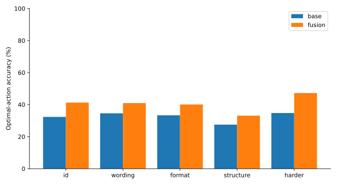
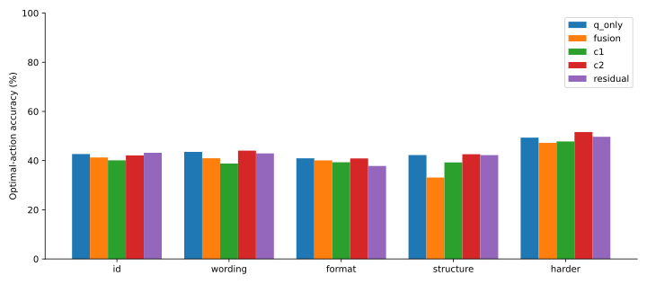
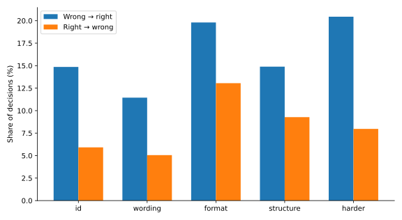
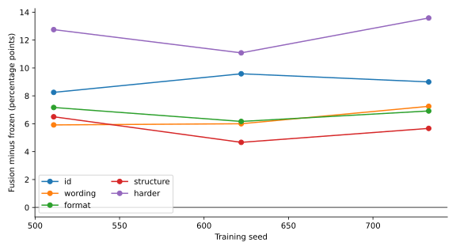
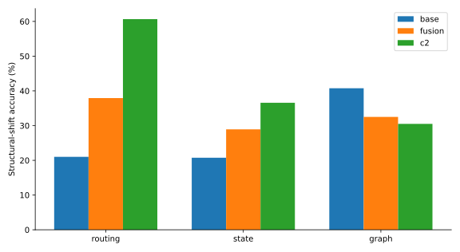
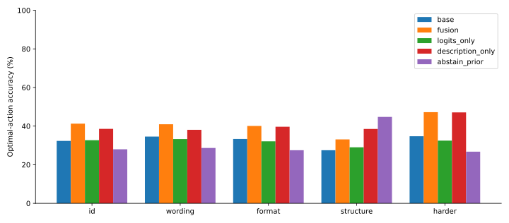
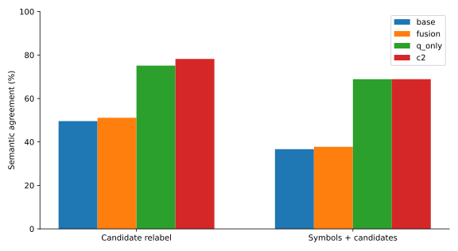
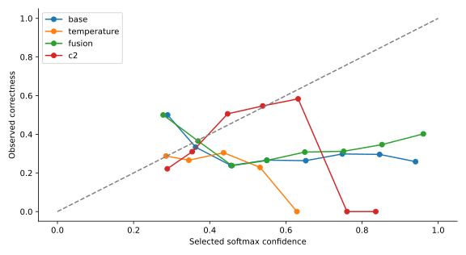
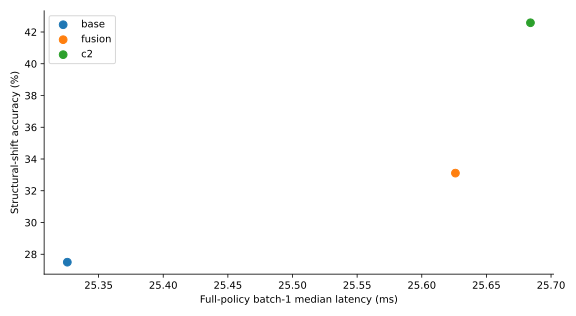
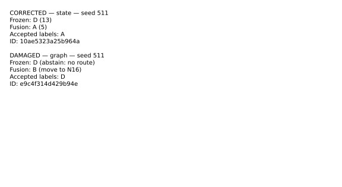

# Experiment 5.4 — The Rendezvous

## Executive summary

**A small candidate head changed frozen Qwen3's constrained choices for the better, but did not justify a distinct scoring architecture.** On the prospectively designated structural-generalization mixture, BaseLM scored **27.50%**, the frozen validation-selected fusion **33.11%**, and the matched logit-aware direct classifier **42.58%**. Fusion minus BaseLM is **+5.61 pp [+2.89, +8.31]**, using paired instance-and-training-seed bootstrap intervals. Fusion minus C2 is **-9.47 pp [-12.25, -6.64]**. All three scoring seeds improve over BaseLM; all three trail C2.

An additional paired option-wording diagnostic collapses Q-only to **26.78%**, and its fusion advantage becomes inconclusive. The score-only policy reaches **42.25%**, statistically inconclusive against C2: −0.33 pp [−2.08, +1.53]. This comparison uses the same architecture and inputs with different supervision, rather than two fundamentally different kinds of network. A simple always-abstain-when-available control scores **44.75%** on this shifted mixture. Absolute competence remains weak. The selected fusion damages directed-graph decisions, has substantial presentation sensitivity, and worsens probability calibration.

**Recommendation: PIVOT.** Supervised constrained-choice heads can be useful, but ordinary candidate classification and exact task solvers deserve priority over additional architectural complexity. This experiment provides no evidence for adding recurrent Qwen layers, learned halting, loop memory, or a special scorer into general autoregressive generation.

## Original research question and historical relationship

The series began by asking whether a small network can inspect transformer representations and predict when more latent computation will help. Historical C predicts selected-answer correctness, V predicts next-loop supervised loss improvement, and D predicts corrections/degradations. Good discrimination did not establish deployed improvements in Experiments 3–4B. Trained Qwen recurrence in Experiment 5 did not establish a reliable depth benefit. Tiny grid/graph networks in 5B–5D transmitted useful information through shared updates, but feedforward controls and long-horizon failures limit the planning interpretation.

Experiment 5D's one-loop graph rescoring gain was dominated by one seed and matched by direct classification; at eight loops validation disabled scoring. Here we directly test **one frozen autoregressive LM forward plus a small candidate head**, without graph-network features, transformer recurrence, adaptive stopping, or visible reasoning tokens. [Series conclusion](../research_conclusion.md) and [5D handoff](../experiment_05d/rendezvous_handoff.md) preserve those distinctions.

## Frozen backbone and candidate tokenization

Qwen/Qwen3-0.6B is pinned to **`c1899de289a04d12100db370d81485cdf75e47ca`**, loaded locally through mlx-lm in FP32. Its inspected architecture has 28 transformer layers, hidden width 1,024, 16 attention heads, 8 KV heads, head dimension 128, and tied input/output embeddings. The model contains **596,049,920 parameters**, all frozen; zero backbone parameters enter an optimizer. The existing chat template uses `enable_thinking=False`, followed by the same assistant prefix **`Answer: (`** for every compared policy.

Letters A/B/C/D are single tokens **32/33/34/35**. Every extracted prompt verifies that appending each letter extends the encoded prefix by exactly that token. Leading-space strings and punctuation are not silently treated as equivalent answer tokens. Each policy makes an actual permitted next-token selection, then maps that token back to its observed semantic candidate. It does not generate a free-text answer or assert that a closing parenthesis or explanation was emitted.

The final prompt position is intercepted before the tied vocabulary projection. Native-versus-intercepted maximum logit error is 2.48e-05; causal-prefix error 0.000154; repeat and right-padding errors are zero. Required local checkpoint/config/tokenizer files are SHA-256 recorded and unchanged after evaluation. The downloaded snapshot omits unused README/LICENSE metadata; the original loader's explicit file allow-list loads all required inference files. Qwen's separate Apache-2.0 attribution is retained; its weights/tokenizer are not distributed.

**Scope:** conditional choice among four allowed labels, unrestricted next-token agreement, and open-ended generation are distinct. The unrestricted greedy token was one of the four allowed labels on all ordinary final examples, so it agreed with constrained argmax here. The unrestricted diagnostic is at the same forced answer prefix, not a free-running assistant turn. It does not turn the experiment into a free-text generation benchmark.

## Dataset construction and split integrity

There are **6,000 training**, **1,200 validation**, and **1,200 examples in each of five ordinary final sets**: fresh ID, new wording, new answer format, unseen structures, and harder tasks. Every ordinary split is one-third each family. Another **480 paired views of 240 ID/structural instances** measure candidate/identifier sensitivity. Main data total **13,200 independent ordinary instances plus 480 dependent views**. Dataset seed is 541731 with independently offset split seeds; manifests record compressed-file hashes and rejection counts.

* **Routing:** three fictional tools with observed supported operations, availability, clearance, cost and an unsafe flag. Choose any permitted tool, or abstain. Training uses conjunctions of capability/availability/clearance/budget; structural and harder sets add a deny-unsafe override. A predicate solver is checked against an independently expressed bit-mask solver.
* **State:** two randomly named integer registers and 1–3 sequential add/subtract/set/swap instructions. Select the final queried value among four distinct observed values. Structural programs introduce copy/multiply; harder programs have 8–12 instructions. A mutable interpreter is checked against functional state transitions.
* **Text graph:** random undirected 9–12-node graphs, three actual start-neighbor candidates and abstain. All equally shortest first actions are valid. The structural family uses directed DAGs with randomized textual node identifiers; harder graphs have 16–20 nodes and BFS route length at least five. Reverse BFS is checked against all-pairs Floyd–Warshall. No graph-model representations are supplied to Qwen.

Canonical hashes reject tool-permuted routing instances, alpha-renamed two-register programs, and equal unrooted graph Weisfeiler–Lehman invariants across all ordinary splits. WL rejection is conservative and not complete isomorphism certification; arithmetic program equivalence is not fully solved. Public task concepts, instructions and generator families are reused across splits by design; only structural holdouts withhold the specified mechanisms. Old LM feature caches and graph checkpoints are not reused. No complete exclusion of every graph topology from every historical generator is claimed.

Randomized semantic-to-letter assignment balances permitted labels approximately: training valid-label prevalence is A 27.73%, B 28.05%, C 28.18%, D 27.17%; these sum above 100% because some tasks have multiple valid answers. There are 595 tied-target training examples and 1,239 abstain training examples. Structural final has 54 tied targets and 440 abstain cases. Structural routing is 60.75% abstain, graph 49.25%; this shift supports strong class-prior controls and limits broad generalization claims. Uniform-random structural accuracy is about 26.23%, not exactly 25%, because ties are accepted.

The initial 180-example development pilot used unordered printed labels and 2–5 state instructions. A conventional-label/shorter-state pilot and an alternative-prefix pilot followed. Aggregate accuracy remained around one-third; the existing prefix was retained after the latter comparison tied. All three measurements are preserved. No test examples were filtered by BaseLM errors or used to redesign the generators. The language shift is modest wording variation, not a different natural language. The harder mixture changes routing constraints as well as state/graph depth, so its aggregate is not a clean causal test of depth alone.

## Head architectures and training objectives

For each candidate, a shared MLP receives three RMS-normalized 1,024-dimensional vectors: final prompt hidden state, mean frozen input embeddings of its observed candidate description, and its frozen label-token embedding. Five scalar features add centered candidate logit/5, conditional probability, clipped log probability/5, conditional entropy/2 and margin/5. No separate encoder or candidate-specific output weights are trained. Mean description embeddings are shallow observed-text features, not solver-derived utilities.

The MLP is **3,077 → 64 → 1**, SiLU, with **197,057 trainable parameters**. Q, C1, C2 and the residual control have the same allocated parameter count. Q and C2 share exactly the same architecture and observable inputs. Their distinction is the supervised objective and deployment rule. Removing logits zeros five inputs (320 first-layer weights become inactive); the logits-only ablation removes prompt and description states; the description-only ablation removes prompt states and all logit features. These have smaller effective capacity despite equal allocated arrays.

| Condition | Objective / deployment |
|---|---|
| Q correctness | Per-candidate binary cross-entropy; all valid candidates positive |
| Q ranking | Positive-versus-negative logistic ranking; ties among valid choices unpenalized |
| C1 | Set-aware direct CE, no original logit/probability inputs |
| C2 | Same-feature set-aware direct CE; strongest matched classifier |
| No-logits Q | BCE with prompt/description/label states only |
| Logits-only Q | BCE with label embeddings and original probability statistics only |
| Description-only Q | BCE with candidate description/label embeddings, no prompt state or logits |
| Residual correction | Set CE on base logits + learned residual; same MLP budget |

All eight conditions use identical training examples and optimizer budgets: 24 epochs, batch 128, AdamW learning rate .001, weight decay .0001, gradient clipping 1, seeds **511/622/733**. The first 600 validation instances choose checkpoints by action accuracy, then set NLL. The second 600 choose the Q objective and fusion lambda. No architecture sweep or backbone training was performed.

There are **24 main fits** and **24 independent verification refits**. Every selected checkpoint is byte-identical across fresh initialization in an isolated directory using the same verified cached frozen features. This verifies auxiliary refitting, not an independent end-to-end re-extraction/retraining of the entire series. Timed main optimizer/validation/checkpoint loops total **15.18 s**; independent refits **54.16 s**. Main frozen-feature extraction took **352.06 s** including startup and cache writes across two invocations. Feature extraction and deployment inference are separate from head fitting.

## Fusion, actual output intervention, and prospective protocol

BaseLM chooses `argmax base_logit`. Q-only chooses `argmax Q`. Fusion chooses `argmax(base_logit + lambda * normalized_Q)`, equivalent to adding Q to conditional log probability. Q is centered per candidate set, then divided by max(RMS, 1). It is a utility/logit, not a calibrated probability after fusion. Validation selects **correctness BCE, lambda=4**, with mean policy-validation accuracy **42.06%**. Lambda zero was included and rejected on validation; no later test changed lambda. The selected weight lies at the predeclared grid boundary; the grid was not extended.

The primary population and test were recorded before final extraction. Source, checkpoint, configuration and dataset-manifest hashes are in `protocol_freeze.json`. Every final extraction and scoring opening is logged; training refuses after the first opening. Source and selected-checkpoint hashes remain unchanged. Two-way bootstrap resamples independent task instances and fitted seeds, 10,000 draws; paired examples are held together. Three seeds cannot precisely characterize the full training distribution. Other tests below are secondary/exploratory and are not used for final selection.

## Base-versus-scored and direct classifier results

Accuracies are percentages, averaged across the same three seeds. BaseLM is identical for every seed.

| Final population | BaseLM | Selected fusion | Q-only | C1 | C2 | Residual |
|---|---:|---:|---:|---:|---:|---:|
| id | 32.33 | 41.28 | 42.67 | 40.11 | 42.11 | 43.17 |
| wording | 34.58 | 40.97 | 43.56 | 38.81 | 44.06 | 42.94 |
| format | 33.33 | 40.08 | 40.94 | 39.33 | 40.89 | 37.81 |
| structure | 27.50 | 33.11 | 42.25 | 39.25 | 42.58 | 42.22 |
| harder | 34.75 | 47.22 | 49.33 | 47.78 | 51.61 | 49.69 |

The primary fusion gain is **+5.61 pp [+2.89, +8.31]**. The direct-classifier strength check is **-9.47 pp [-12.25, -6.64]**. A scoring advantage over ordinary supervised classification was not established. Score-only versus C2 is inconclusive, consistent with their shared architecture.




## Decision correction, damage, and seed variation

| Seed | Structural fusion % | Structural C2 % | Wrong→right | Right→wrong | Fusion minus base pp |
|---|---:|---:|---:|---:|---:|
| 511 | 34.00 | 43.42 | 184 | 106 | +6.50 |
| 622 | 32.17 | 42.50 | 170 | 114 | +4.67 |
| 733 | 33.17 | 41.83 | 182 | 114 | +5.67 |

Across **3×1,200 paired seed-instance decisions**, fusion corrects **536**, damages **334**, and nets **202** additional correct choices. Those are not 3,600 independent test instances. Corrections are 14.89% and damages 9.28% of these decisions. The gain is present in all three seeds, unlike Experiment 5D's one-loop result, but the population is narrow and aggregate gains conceal graph harm.




## Generalization and shortcut controls

| Structural family | BaseLM | Fusion | Q-only | C2 | Abstain prior |
|---|---:|---:|---:|---:|---:|
| routing | 21.00 | 37.92 | 60.42 | 60.67 | 60.75 |
| state | 20.75 | 28.92 | 36.00 | 36.58 | 24.25 |
| graph | 40.75 | 32.50 | 30.33 | 30.50 | 49.25 |

Routing improves +16.92 pp and state +8.17 pp, while directed-graph accuracy **falls 8.25 pp**; its exploratory paired interval is [−12.33, −4.33]. The graph decision information was not recovered reliably. Structural task-prior changes make “larger aggregate accuracy” a poor proxy for stronger reasoning.

| Control | Fresh ID % | Structural % | Harder % |
|---|---:|---:|---:|
| base | 32.33 | 27.50 | 34.75 |
| fusion | 41.28 | 33.11 | 47.22 |
| q_only | 42.67 | 42.25 | 49.33 |
| c1 | 40.11 | 39.25 | 47.78 |
| c2 | 42.11 | 42.58 | 51.61 |
| no_logits | 38.67 | 39.22 | 46.78 |
| logits_only | 32.69 | 29.03 | 32.47 |
| description_only | 38.58 | 38.53 | 47.11 |
| residual | 43.17 | 42.22 | 49.69 |
| abstain_prior | 28.00 | 44.75 | 26.75 |
| label_bias | 32.25 | 27.50 | 34.67 |
| constant | 32.33 | 27.50 | 34.75 |
| random | 29.11 | 25.33 | 30.33 |
| random_shared_head | 33.03 | 26.78 | 36.67 |
| random_q_only | 27.78 | 18.25 | 29.94 |
| shuffled | 30.28 | 26.06 | 32.83 |
| temperature | 32.33 | 27.50 | 34.75 |

The abstain prior always selects abstain when available, otherwise the first semantic numerical candidate; it uses no oracle input and is a descriptive shortcut control. It outperforms all fitted methods on the structural aggregate. Random/shared-random/shuffled scores are negative controls, not fitted policies. A train-label prior is an answer-letter-bias control; constant and temperature controls preserve the base argmax.

Full Q-only beats the label/logits-only head by +13.22 pp [9.50, 16.81] structurally. That does **not isolate useful prompt-hidden information**, because observed candidate descriptions are added too. No-logits Q minus description-only is +0.69 pp [−0.89, 2.47], inconclusive. The frozen prompt representation's incremental contribution is therefore not established by this ablation. Selected fusion even trails description-only by −5.42 pp [−8.58, −2.22]. These are post-freeze exploratory diagnostics, not new selection rules.




## Candidate-order and identifier sensitivity

Pure candidate-feature-row permutation is equivariant: measured maximum Q error is 0. The full system re-encodes the prompt and is **not** semantically invariant. Each view preserves the underlying correct action set; two views share each of 240 parent instances and are not independent samples.

| Paired perturbation | Base semantic agreement % | Fusion % | Q-only % | C2 % |
|---|---:|---:|---:|---:|
| candidate_relabel | 49.58 | 51.11 | 75.14 | 78.19 |
| symbol_and_candidate_relabel | 36.67 | 37.78 | 68.89 | 68.89 |

Relabeling candidates changes roughly half of base and fusion semantic decisions. Symbol-plus-candidate relabeling is worse. Q-only/C2 are more stable but still far from invariant. The candidate-only perturbation preserves descriptions and the body; the combined perturbation also renames tools/registers/nodes. The two effects are not a factorial decomposition. Base selected-label frequencies on structure are A 15.33%, B 28.42%, C 33.25%, D 23.00%, despite approximately balanced valid labels. This is a substantial deployment limitation.



## Exploratory novel candidate descriptions

After the primary comparison was complete, one remaining requested coverage gap was frozen as an additional diagnostic: **600 new independent ID tasks**, each with two paired views. The raw task, semantic options, label mapping and order stay identical; only candidate descriptions change to previously unseen phrases. The additional protocol is explicitly post-primary and exploratory. No head, objective, lambda or original test changed, and no additional model was fitted. Both solvers validate all 1,200 views, and canonical hashes exclude the earlier ordinary instances.

| Policy | Natural descriptions % | Novel descriptions % |
|---|---:|---:|
| BaseLM | 32.33 | 31.00 |
| Fusion | 41.22 | 33.17 |
| Q-only | 42.83 | 26.78 |
| C2 | 42.33 | 24.50 |
| Description-only | 39.89 | 27.06 |

Q-only loses **16.06 pp [11.11, 21.17]**, and C2 loses **17.83 pp [12.00, 23.61]**, when the same options are rephrased. BaseLM loses only 1.33 pp with an interval spanning zero. Novel-wording fusion minus BaseLM is **+2.17 pp [−0.67, 4.61]**, inconclusive. These post-freeze paired diagnostics strongly limit claims of semantic transfer and show that direct classification is also brittle. The system is not ready for deployment. The supplemental protocol, public views, decisions and audit are under `results/experiment_05e/description_shift/`; the paired views are not 1,200 independent instances.

## Confidence, candidate utility, and calibration

On structural data, base selected-confidence AUROC is **0.507**, Q evaluated at the base-selected candidate has correctness AUROC **0.560**, and all-candidate quality AUROC is **0.590**. These are discrimination diagnostics, not proof that Q identifies the right replacement. The actual WR/RW comparisons establish the intervention effect.

Validation chooses base temperature **4.0**. It changes zero selected answers, while structural set NLL improves **2.376 → 1.474** and ECE **0.350 → 0.087**. Fusion improves top-one accuracy but worsens NLL to **2.814** and ECE to **0.422**. C2 NLL is **1.279**, ECE **0.045**. Raw BCE Q candidate sigmoid Brier is **0.189**; fusion softmax confidence is not automatically calibrated by that objective. Improved calibration, changed decisions and better underlying reasoning remain separate findings.

Calibration-bin curves are descriptive; sparsely populated high-confidence bins have unstable observed rates and no confirmatory uncertainty claim.



## End-to-end inference cost and memory

Measurements use this M4 Max, validation prompts 140–200 tokens, six warmups and 36 randomized interleaved repeats per method. They include tokenization and boundary checks, frozen full-prefix forward, four-label tied projection, candidate features where needed, head, semantic selection, host transfer and Metal synchronization. Model loading is excluded; no KV cache or cached hidden states substitute for the full forward. Batch 8 is total batch latency, not per-example latency.

| Policy | Batch 1 median ms | Batch 1 p10–p90 ms | Batch 8 median ms |
|---|---:|---:|---:|
| base | 25.326 | 24.944–30.570 | 142.337 |
| fusion | 25.626 | 25.274–30.883 | 144.029 |
| c2 | 25.684 | 25.149–31.045 | 144.310 |

Fusion adds **0.300 ms** at batch 1, about **1.19%** in this procedure. Head-only median is 0.171 ms and is explicitly a cached diagnostic. Peak measured MLX allocation across feature extraction is **3.817 GiB**; the timing process peaks at **3.528 GiB**. Loading one selected head increases measured active Metal allocation by **803,332 bytes** (~0.766 MiB), separate from backbone residency. The head has 197,057 parameters versus 596,049,920 frozen backbone parameters. Peak observed process RSS is **1.735 GiB** in head fitting; unified-memory accounting is not equivalent to GPU allocation. Allocation remains below 48 GiB.

Live-policy and cached-feature decisions agree on 16 validation prompts; maximum base/fusion logit errors are 3.81e-05/4.42e-05. Timings are small-sample, length-band measurements on one machine and do not establish a workload-general speed or latency guarantee.



## Representative changed decisions and failure analysis

The first corrected and first damaged structural examples for seed 511 are retained in `changed_examples.json`, including complete prompts, accepted sets and all recorded scores. They were chosen by a fixed first-match diagnostic, not as representative prevalence estimates. Population correction/degradation tables above provide that context.



### Corrected example (seed 511)

```text
Solve the following deterministic task.
Integer registers initially: s=2, n=8. Execute every instruction in order:
n := n - 3; s := s * 2; s := s - 3.
What is the final value of n?
Candidates:
(A) 5
(B) 2
(C) 8
(D) 13
Respond with one candidate label only.
```

Base label **D**, fused label **A**; valid labels **A**.

### Damaged example (seed 511)

```text
Solve the following deterministic task.
Graph edges (directed; follow arrows only): N10->N17, N14->N12, N18->N17, N10->N16, N13->N17, N11->N15, N10->N19, N16->N17, N14->N13, N19->N12, N14->N17, N21->N12, N18->N14.
Start=N10; goal=N15. Choose a first move on any shortest route to the goal. Abstain only if no route exists.
Candidates:
(A) move to N17
(B) move to N16
(C) move to N19
(D) abstain: no route
Respond with one candidate label only.
```

Base label **D**, fused label **B**; valid labels **D**.

The most important failures are weak absolute task competence, damage on unseen directed graphs, sensitivity to label/symbol presentation, shortcut priors that outperform the heads, and poorer confidence after fusion. Q-only behaves much like C2. The experiment cannot establish that the frozen LM internally solved the tasks; candidate text priors and original probability patterns explain substantial performance. No scorer can be credited with reasoning merely because supervised labels improve its argmax. This bounded result concerns one small head/feature design, one frozen backbone, three seeds and synthetic task generators; it does not establish that every possible representation or supervised head must fail.

## Hypotheses and bounded conclusion

| Hypothesis | Finding |
|---|---|
| H1: improve frozen LM selected actions | Supported for the prespecified synthetic structural mixture: +5.61 pp [2.89, 8.31], all three seeds positive |
| H2: value beyond original probabilities | Extra candidate features help relative to a logits-only head; useful prompt-hidden information specifically is not established |
| H3: unfamiliar wording/structures/orders | Graph harm, severe semantic sensitivity and collapsed novel-description performance prevent a robust generalization claim |
| H4: beyond matched direct classification | Rejected for selected fusion; score-only versus C2 inconclusive and architecturally equivalent |
| H5: inexpensive computation | Small measured overhead on this frozen constrained-choice workload; not deployment readiness |

**PIVOT:** the practical reusable result is shared candidate supervision, explicit output intervention, and paired correction/damage evaluation. Prefer fair direct classification or deterministic solvers for constrained tasks. Nothing here justifies a dedicated scoring architecture in general autoregressive LMs, nor another recurrent transformer training run. One small future replication could test C2 against candidate-description priors and an exact rule solver on fresh held-out tool-capability compositions with controlled abstain strata. It should test practical task adaptation, not a novel reasoning claim. It is not executed here.

## Reproduction and verification

Use Python 3.12 and the existing pinned Apple dependencies. No upgrade was needed. CPU-only generation, independent solver validation, metric/chart regeneration and tests need no model. Model extraction requires the separately downloaded pinned Qwen revision and MLX/Metal. Weights, raw hidden states and optimizer caches remain ignored; regenerate them in a fresh isolated run directory. The tracked final-opening receipt intentionally prevents reselection in the consumed original run.

```sh
# From the source checkout, inspect/help and regenerate recorded analyses:
python -m latent_loop.rendezvous --help
python experiments/experiment_05e/public_audit.py
python experiments/experiment_05e/verify_and_diagnose.py  # requires MLX + local checkpoints
python -m latent_loop.rendezvous report
python experiments/experiment_05e/write_report.py
LATENT_LOOP_MLX_TESTS=1 RUN_MLX_TESTS=1 python -m pytest -q

# Fresh isolated reproduction: see docs/reproduction_v0.3.0.md for directory setup.
python -m latent_loop.rendezvous generate --config /path/to/source/experiments/experiment_05e/config.json
python -m latent_loop.rendezvous extract --config /path/to/source/experiments/experiment_05e/config.json --splits train validation
python -m latent_loop.rendezvous train --config /path/to/source/experiments/experiment_05e/config.json
python -m latent_loop.rendezvous freeze --config /path/to/source/experiments/experiment_05e/config.json
python -m latent_loop.rendezvous extract --config /path/to/source/experiments/experiment_05e/config.json --splits id wording format structure harder permutations
python -m latent_loop.rendezvous evaluate --config /path/to/source/experiments/experiment_05e/config.json
```

**72 all-enabled tests pass; the CPU-only suite has 46 passes and 17 explicit accelerator skips.** All 13,680 main observations and 1,200 supplementary description views pass both solvers; dataset regeneration is byte-identical; cross-split canonical duplicates are zero. All 24 selected head checkpoints reproduce byte-identically from cached frozen features. Unit/MLX tests, optimizer restore, candidate feature permutation, real-backbone parity/causality, live-versus-cached decisions, parameter counts and checkpoint hashes are recorded. CPU-only runs skip accelerator tests. Full historical retraining and independent re-extraction of the complete feature corpus were not performed. See the [prospective protocol](../../experiments/experiment_05e/PROTOCOL.md), [reproduction guide](../../docs/reproduction_v0.3.0.md), and [publication audit](../../docs/publication_audit_v0.3.0.md).

## Publication status

Local branch **`research/exp05e-rendezvous`**, starting at verified 5D commit `e1b02d3950bcd59b4de875549eb0da21dfc6304c`. Experiments 5C/5D/5E and a consolidated **v0.3.0 draft** remain local pending review. No release tag was created or modified and nothing was pushed. Public v0.1.0 and v0.2.0 remain unchanged. This is the closing experiment of the present run; no next experiment starts automatically.
