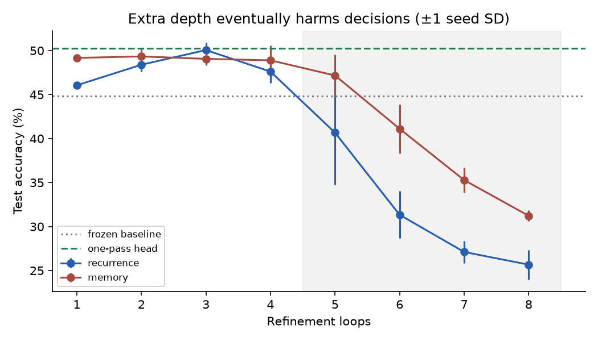
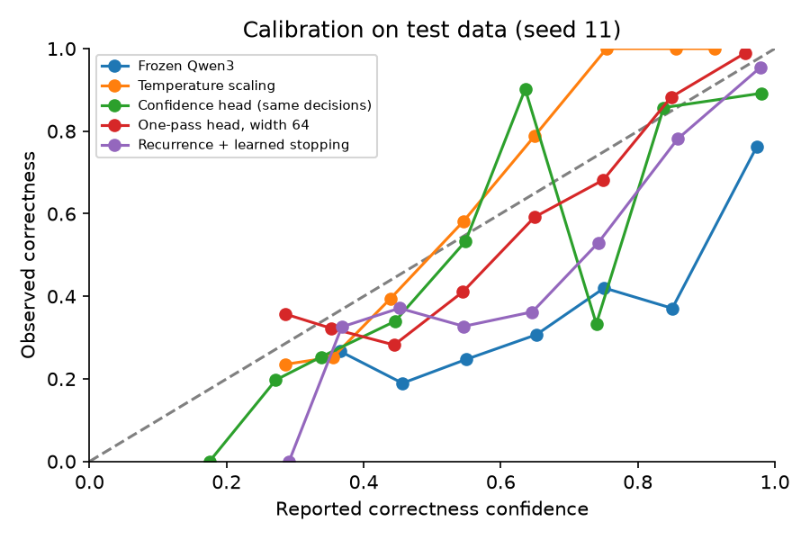
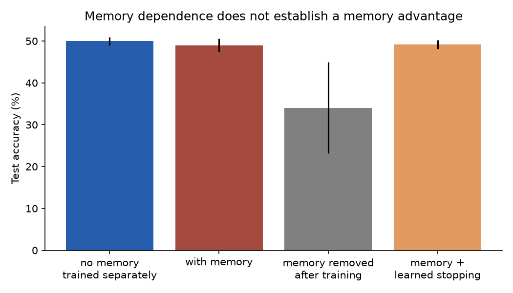
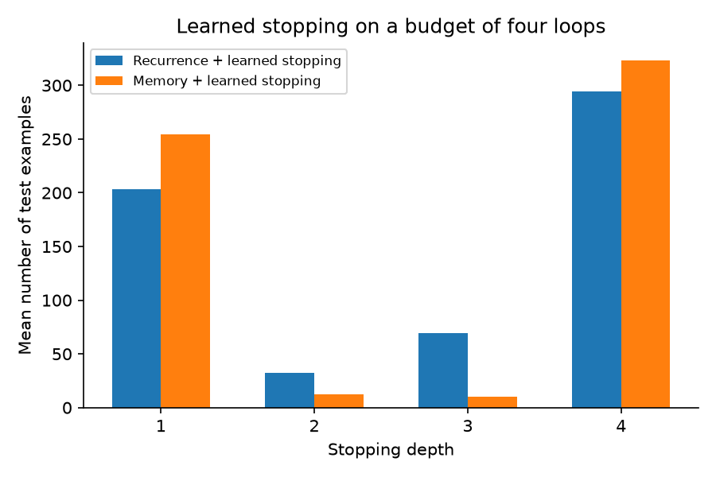
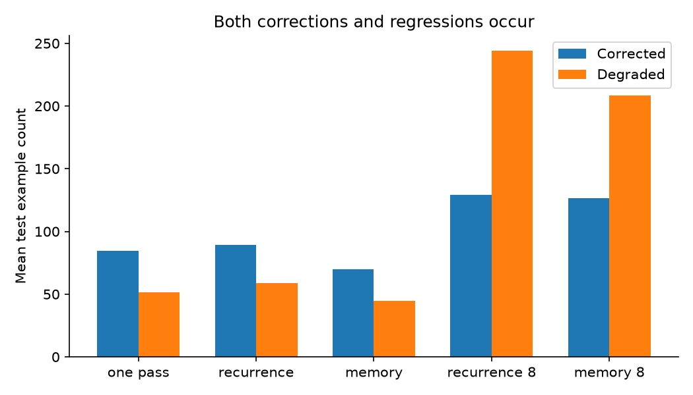
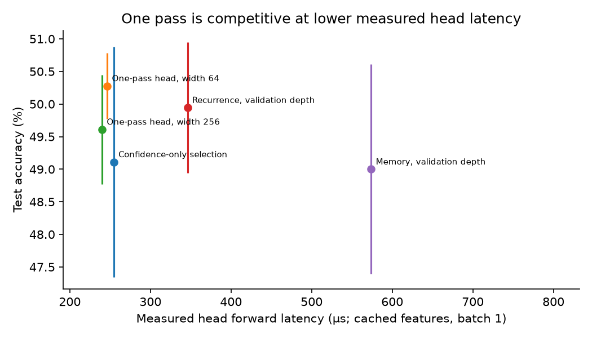

# Confidence-guided latent refinement: research summary

## Executive summary

We tested whether lightweight heads can recover useful decisions from frozen Qwen3-0.6B hidden states, and whether recurrence, memory, or learned continuation provides an advantage over one pass. This is an independent synthetic-task pilot, not an official RecurTrace reproduction.

The best primary test mean was **One-pass head, width 64: 50.28%**, compared with **44.83%** for the frozen conditional baseline. A one-pass width-64 head improved accuracy by 5.44 percentage points; its paired item-bootstrap 95% interval was [2.11, 8.89] points. Recurrence versus that head changed accuracy by -0.33 points, interval [-2.33, 1.67]. This does **not** establish a benefit from recurrence. Memory and learned stopping did not establish an accuracy advantage either.

These intervals describe this pilot. Only 3 training seed(s), multiple comparisons, reused templates, synthetic tasks, and an adjusted prompt format limit confirmatory interpretation. The held-out set is 600 unique examples; shared seed evaluations do not multiply the number of independent test items.

## Hardware and execution

Apple M4 Max, 128 GiB unified memory; MLX Metal; FP32 backbone and heads. Peak recorded MLX allocation: **4.21 GiB** (allocator accounting, not total system memory). Versions: `{"mlx": "0.32.3", "mlx-lm": "0.32.0", "numpy": "2.5.3", "transformers": "5.19.0"}`. Configured memory budget: 48 GiB. Primary extraction took 38.77 seconds. Auxiliary fit times are below; they exclude extraction, oracle trajectory construction, evaluation, and checkpoint/report I/O. Command wall times are in `experiments/last_*.json`.

The original BF16 parity test failed and is retained in `experiments/failure_audit.json`. FP32 interception max absolute logit error was 0.00002480; the repeated-middle-block causal-prefix error was 0.00016785. No unrelated service, checkpoint, or workstation was modified.

## Methodology

Six deterministic tasks cover comparison, arithmetic, register state, pointer chasing, registry-based tool routing, and conjunction-based candidate classification. Counts: 1200 training, 300 validation, 600 test, 300 OOD; approximately equal task counts. Training/test use steps 1–4; OOD uses steps 5–8 for the three sequential tasks, larger numeric range, and separate symbols. Easy comparison, routing, and classification remain one-step tasks in OOD, so the aggregate mixes several shifts. Independent solvers validate labels. Exact instance hashes and a token 13-gram near-duplicate audit found no leaked instances in the primary dataset; templates are shared. Difficulty and per-task results are recorded for every variant.

The pretrained backbone is frozen, unquantized, revision `c1899de289a04d12100db370d81485cdf75e47ca`. We extract the last prompt hidden state and score the verified single-token letters A–D. A fixed assistant prefix `Answer: (` was chosen using 60 training examples after the unprefixed pilot exposed a severe format artifact. No reasoning text is generated. All models see the same prompt and candidates. Primary accuracy and NLL are **conditional on four answer labels**; they are not free-generation accuracy or full language-model perplexity.

The confidence head uses normalized hidden state, candidate label embedding, candidate conditional log probability, original vocabulary log probability, vocabulary entropy, option margin, and option entropy. It learns binary candidate correctness. Calibration is evaluated with unchanged greedy decisions. Confidence-only selection and validation-selected fusion are separate decision experiments; top-2 coverage is recorded, while four-option coverage is 100% by construction.

The refiner learns a closed-gate residual MLP on the final hidden vector, reinjecting the original context. The same weights train at uniformly sampled depths 1–4. Memory reads a bounded three-state history along loop time for this final-position vector, with learned normalized query/key projections and a signed distance bias. This is not per-layer, per-token RecurTrace LMA. A learned continuation head reads current state, current probabilities, and depth; oracle future-loss improvements over a margin of 0.01 supervise it on training trajectories only. At deployment it never receives labels or future states. Validation selects checkpoints, fixed depths, fusion, and stopping thresholds; the stopping budget is four. Eight-loop fixed evaluation tests extrapolation.

All auxiliary fits use AdamW, learning rate 0.001, weight decay 0.01, gradient norm clipping at 1, batch 64, 30 epochs, seeds [11, 22, 33]. Every fit saves last weights, best weights, optimizer state, and epoch metadata. Checkpoints and cached features stay outside git. Confidence correctness BCE, candidate CE, and continuation BCE are distinct objectives, explicitly recorded.

## Results

| Variant | Test accuracy, mean ± SD | OOD accuracy | Test NLL | Correctness ECE | Loops |
|---|---:|---:|---:|---:|---:|
| Frozen Qwen3 | 44.83 ± 0.00% | 45.67% | 1.781 | 0.294 | 0.00 |
| Temperature scaling | 44.83 ± 0.00% | 45.67% | 1.203 | 0.089 | 0.00 |
| Constant correctness prior | 44.83 ± 0.00% | 45.67% | 1.781 | 0.038 | 0.00 |
| Confidence head (same decisions) | 44.83 ± 0.00% | 45.67% | 1.781 | 0.117 | 0.00 |
| Confidence-only selection | 49.11 ± 1.77% | 50.00% | 1.036 | 0.051 | 0.00 |
| Probability + confidence fusion | 46.33 ± 0.33% | 47.11% | 2.184 | 0.342 | 0.00 |
| One-pass head, width 64 | 50.28 ± 0.51% | 51.67% | 1.064 | 0.081 | 1.00 |
| One-pass head, width 256 | 49.61 ± 0.84% | 50.22% | 1.099 | 0.091 | 1.00 |
| Recurrence, validation depth | 49.94 ± 1.00% | 50.78% | 1.108 | 0.078 | 3.33 |
| Memory, validation depth | 49.00 ± 1.61% | 49.11% | 1.099 | 0.090 | 3.33 |
| Recurrence + learned stopping | 50.06 ± 0.98% | 49.56% | 1.129 | 0.123 | 2.76 |
| Memory + learned stopping | 49.17 ± 1.09% | 48.78% | 1.093 | 0.097 | 2.67 |


Mean ± sample SD is across training seeds; test/OOD examples are shared. NLL and multiclass Brier describe the option distribution. Correctness ECE/Brier can instead use an independently calibrated probability, so the unchanged-decision confidence row retains the original option NLL. Temperature scaling improves calibration without changing decisions. Confidence fusion worsens NLL even when its argmax improves slightly; higher certainty is not evidence of better reasoning.

The unrestricted next-token baseline scored 44.17%; its vocabulary argmax was an option letter on 95.83% of test prompts. Full-vocabulary label NLL was 1.895. These are separate format diagnostics, not the primary conditional objective.

| Confidence estimate on original decisions | Correctness Brier | Correctness AUROC | Accuracy at 50% coverage |
|---|---:|---:|---:|
| Frozen Qwen3 | 0.288 | 0.761 | 62.67% |
| Constant correctness prior | 0.249 | 0.500 | 43.00% |
| Temperature scaling | 0.196 | 0.764 | 63.00% |
| margin_calibration | 0.206 | 0.759 | 63.00% |
| entropy_calibration | 0.197 | 0.764 | 63.33% |
| Confidence head (same decisions) | 0.184 | 0.808 | 66.89% |


The learned confidence head ranks correctness better than the original probability on this pilot, but its ECE remains worse than simple temperature/entropy calibration. A constant prior can achieve low ECE while having no ranking ability; ECE alone is insufficient. The held-out prediction-risk metrics support limited usefulness as an uncertainty readout, not a correctness guarantee.

| Task | Frozen model | One-pass head | Recurrence | Memory |
|---|---:|---:|---:|---:|
| arithmetic | 25.00% | 33.33% | 31.67% | 31.33% |
| classification | 81.00% | 85.67% | 83.00% | 82.67% |
| comparison | 44.00% | 45.33% | 49.33% | 49.00% |
| pointer | 23.00% | 28.00% | 29.67% | 26.67% |
| routing | 77.00% | 82.00% | 82.67% | 82.33% |
| state | 19.00% | 27.33% | 23.33% | 22.00% |


Arithmetic, pointer chasing, and state tracking remain difficult and often near chance. Aggregate gains do not establish reliable multi-step reasoning, and OOD aggregates mix easy and harder task families.







Memory removal after training damages a memory-dependent model, but the stronger comparison is separately trained no-memory recurrence. That comparison provides no consistent memory advantage. Learned stopping reduces mean loops, yet does not convincingly beat validation-selected fixed recurrence in accuracy. Oracle stopping is a label-informed diagnostic only; it is excluded from the deployable comparison table. Risk-coverage, Brier, AUROC, state cosine, magnitude changes, and stopping errors are in the public metric files.



## Failure analysis

Eight loops reduce no-memory recurrence to 25.67% and memory recurrence to 31.22% on test data. Extra steps beyond training induce harmful prediction changes and increasing state drift. Learned stopping is a prediction of improvement opportunity, not a guarantee that continuing corrects an answer. The cheap one-pass head is competitive with recurrence and substantially cheaper in added matrix operations.

The unprefixed initial experiment remains in `results/initial/metrics/`: frozen accuracy was 28.83%, dominated by answer-letter bias because the model wanted to start with prose. Its apparent learned gains cannot be interpreted as improved reasoning. The prompt-format audit and all negative controls are retained. Frozen closed-gate recurrence equals the baseline; randomized open-gate updates, memory-disabled inference, fixed depths, confidence stopping, and oracle ceilings are also retained.

Concrete corrected, degraded, and misleading-confidence examples are saved in `results/reports/failure_cases.json`. Such examples illustrate measured transitions; they do not establish a mechanistic account of internal reasoning.



## Compute analysis

| Trained module | Parameters | Total fit seconds across seeds | Best epochs (0-based) |
|---|---:|---:|---|
| confidence | 131,521 | 0.90 | 28, 26, 29 |
| recurrence | 196,674 | 1.56 | 28, 26, 24 |
| memory | 262,212 | 2.97 | 27, 26, 29 |
| feedforward | 196,674 | 1.05 | 26, 29, 29 |
| wide_feedforward | 786,690 | 1.36 | 23, 24, 29 |
| recurrence_continuation | 32,993 | 2.24 | 29, 26, 26 |
| memory_continuation | 32,993 | 2.21 | 29, 28, 18 |


| Variant | Extra matrix FLOPs, estimate | Head latency, mean seed median |
|---|---:|---:|
| Confidence-only selection | 1.05 M | 254.6 µs |
| One-pass head, width 64 | 0.40 M | 246.4 µs |
| One-pass head, width 256 | 1.58 M | 240.0 µs |
| Recurrence, validation depth | 1.34 M | 346.0 µs |
| Memory, validation depth | 2.21 M | 573.9 µs |
| Recurrence + learned stopping | variable; head and stopping overhead | 809.4 µs |
| Memory + learned stopping | variable; head and stopping overhead | 912.2 µs |


Estimated extra matrix FLOPs count multiply-add as two operations. They omit nonlinear functions, normalization, host synchronization, and some attention overhead; they are not profiler measurements. Width 256 is approximately matrix-compute-matched to four width-64 refinement loops but has four times the update parameters. The width-64 one-pass head provides a parameter-matched comparator for no-memory recurrence. These are capacity/control comparisons, not exact end-to-end hardware-budget equivalence. No larger-backbone comparison was run.

Fixed-head timing uses the same batch-one cached validation hidden state, three warmups, synchronized execution, and 20 repetitions. Adaptive timing executes real label-free early stopping over 12 validation examples, also batch one; it includes host decision synchronization. Prompt baseline timing uses those 12 examples separately through the backbone with a full-vocabulary final projection. These head measurements exclude backbone extraction and must not be presented as end-to-end speedups. Baseline prompt median was 21.46 ms.



## Middle-layer experiment

We also repeated original layers 12–14 (zero-based) with shared frozen weights and causal masks. A minimal trained variant adds three input-injection scalars, trained at depth two on 240 training examples for five epochs and selected on 60 validation examples. It has no LMA or learned stopping. This is an architecture-2 feasibility probe, distinct from the post-backbone head experiments.

| Middle-layer variant | Test accuracy | OOD accuracy |
|---|---:|---:|
| middle_plain_d1 | 44.83% | 45.67% |
| middle_plain_d2 | 48.50% | 47.67% |
| middle_injection_d2 | 46.17% | 46.00% |
| middle_plain_d3 | 44.67% | 43.00% |
| middle_injection_d3 | 44.17% | 44.00% |
| middle_plain_d4 | 36.83% | 37.00% |
| middle_injection_d4 | 40.67% | 40.67% |

The middle-layer experiment validates interception and tied recurrence, but three scalars and a tiny training subset cannot reproduce RecurTrace's memory training protocol. Depth-one behavior remains unchanged after injection training. The plain repeated-block results are untrained controls; do not attribute them to learning. Depths beyond two are diagnostic and were not used to select the checkpoint.

## Conclusions and next steps

Small supervised heads recovered some useful decision information from the frozen representation. This supports a limited readout hypothesis, not a demonstration of new latent reasoning. Recurrence, memory, and learned stopping remain unproven advantages over a one-pass head at comparable extra compute. More recurrence is demonstrably unsafe as an accuracy assumption in this pilot.

Next, enlarge the held-out set with fresh generators and compare a one-pass readout against a trained middle-layer module under fixed training and compute budgets. Separate format-following failures from task-solving failures, inspect per-task results, and pre-register the comparison before measuring the new test set. Structured tool routing is a plausible target because it has checkable labels, but this pilot only tests synthetic registry lookup. A larger model could improve the representation or saturate easy tasks; neither outcome is established here. Abandon unconditional extra-loop deployment and confidence-only claims of reasoning improvement.

## Reproduction

On Apple Silicon with the optional dependencies installed:

```sh
python -m latent_loop.cli download --config configs/pilot.yaml
python -m latent_loop.cli run --config configs/pilot.yaml --run-dir artifacts/reproduction
python -m latent_loop.cli middle --config configs/pilot.yaml --run-dir artifacts/reproduction
python -m latent_loop.cli report --config configs/pilot.yaml --run-dir artifacts/reproduction
```

The `run` command includes confidence, reranking, no-memory recurrence, memory, both continuation heads, and the two one-pass controls for all three seeds. It also reproduces the key eight-loop negative result. `evaluate` reloads completed checkpoints and recomputes all diagnostics; no fitting is performed for complete stages. Interruptions stop at checkpoint boundaries, then rerunning resumes. Use a new run directory when changing model, dataset, or prompt. Basic CPU tests and public report regeneration require no model download or accelerator.

For the initial format failure, use `configs/initial.yaml` with a fresh run directory. The historical initial stopping policy's no-eligible-threshold fallback was later corrected to minimize validation NLL; initial measurements are archived rather than silently overwritten. This policy implementation detail means the initial adaptive rows are historical exploratory evidence, not an exact current-code target.

Original results are this repository's recorded synthetic experiments. Prior work appears only in `docs/literature_review.md`; its benchmark results are not included in our plots. See the literature review for [RecurTrace](https://arxiv.org/html/2609.03379v2), Universal Transformers, ACT, PonderNet, Encode-Think-Decode, Think-at-Hard, Semantic Entropy Probes, and process supervision. No novelty claim is made for combining these techniques.
